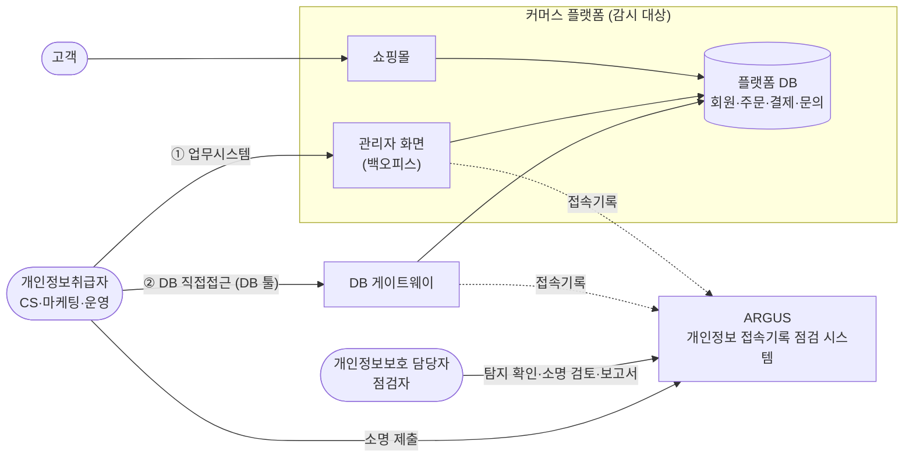
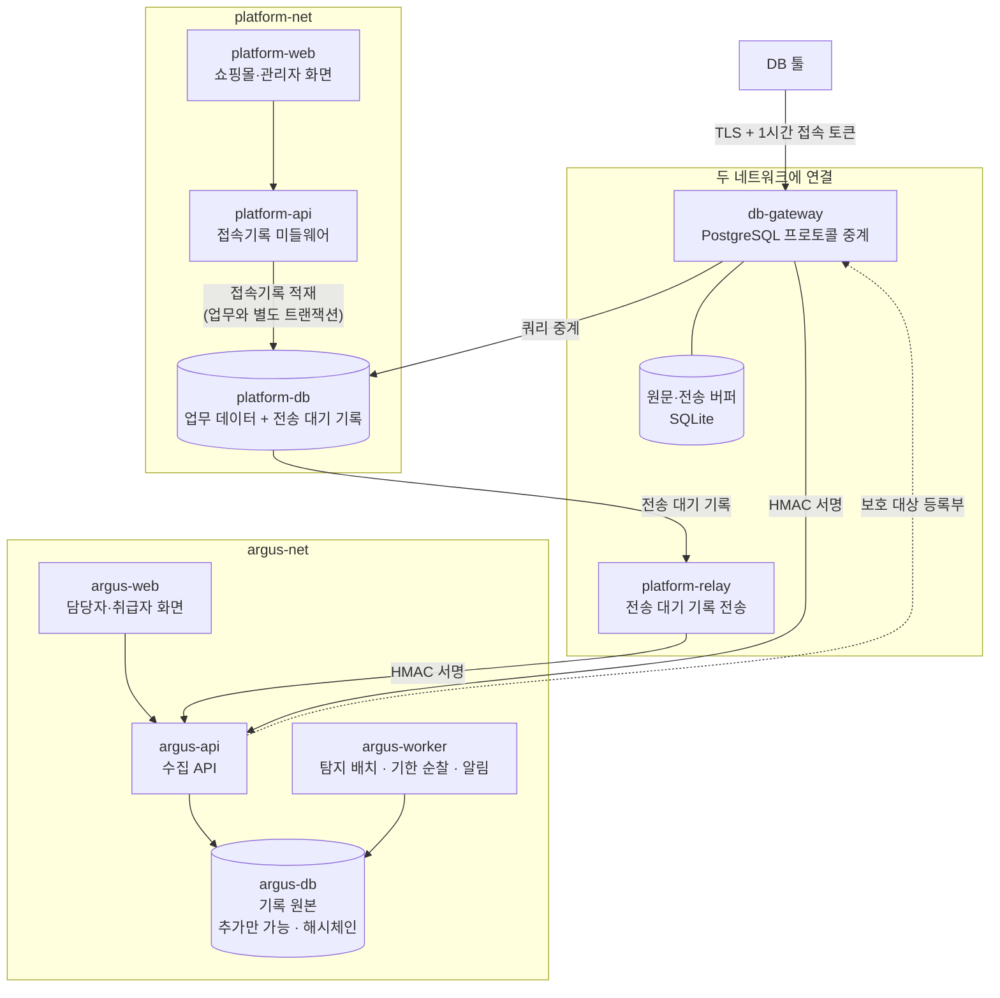
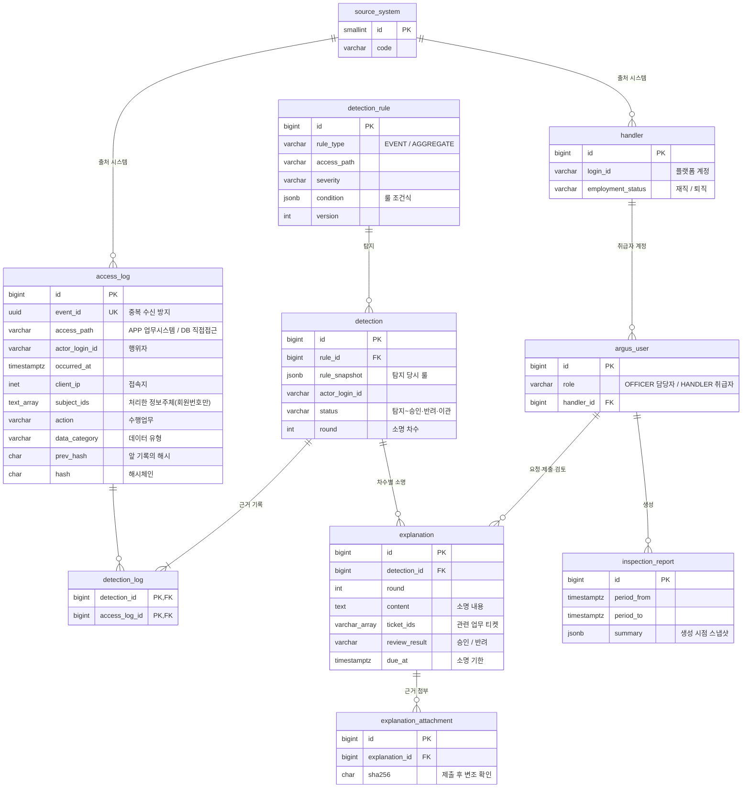
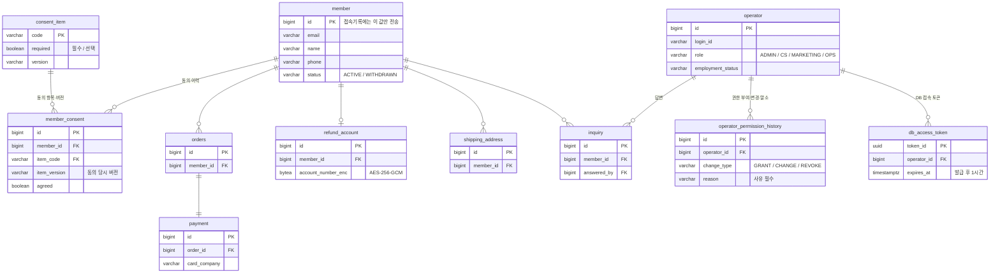

# ARGUS

<p align="center">
  
</p>

<p>
  개인정보처리시스템의 접속기록을 저장하여 이상 행위를 자동으로 탐지하고,<br>
  탐지룰 설정, 이상 행위에 대한 소명 제출, 접속기록 점검 및 보고까지 수행할 수 있는 <b>개인정보 접속기록 점검 시스템</b>
</p>

<p align="center">
  <a href="#구현-화면"><b>▶ 실제 구현 화면</b></a>
</p>

| 항목 | 내용 |
|---|---|
| 기간 | 2026-09-07 ~ 2026-10-11 (v0.1) |
| 인원 | 1명 — 문제 정의, 법령 분석, 설계, 구현 검수, 자체 점검. 코드 구현은 AI 코딩 도구(Claude Code) |
| 근거 법령 | 개인정보 보호법, 개인정보의 안전성 확보조치 기준(2026.7.1 시행 고시)과 안내서(2025.11) |
| 구성 | 커머스 플랫폼(쇼핑몰·관리자 화면, 감시 대상) + DB 게이트웨이 + ARGUS(접속기록 점검 시스템) — 2절 |
| 기술 | Python 3.12 · FastAPI · PostgreSQL 16 · Next.js · Docker Compose · GitHub Actions |
| 검증 | 단위·통합 테스트 1,127개(Argus 589 · 플랫폼 324 · 게이트웨이 214), E2E 26개, PR마다 CI 20개 작업 |

> 시스템 내 회원·직원·접속기록 데이터는 모두 가상으로 생성한 값입니다. 실제 개인정보는 없습니다.


<br>

## 목차

- [1. 프로젝트 배경](#1-프로젝트-배경)
  - [실무에서 마주친 문제](#실무에서-마주친-문제)
  - [어떻게 해결하고자 하는가?](#어떻게-해결하고자-하는가)
  - [왜 자동화했나](#왜-자동화했나)
  - [목표](#목표)
- [2. 시스템 구성](#2-시스템-구성)
  - [전체 구성](#전체-구성)
  - [시스템 아키텍처](#시스템-아키텍처)
  - [데이터 모델](#데이터-모델)
  - [개인정보 보호 원칙](#개인정보-보호-원칙)
  - [설계 문서](#설계-문서)
- [3. 주요 기능](#3-주요-기능)
  - [기능 목록](#기능-목록)
  - [구현 화면](#구현-화면)
- [4. 법적 근거와 구현](#4-법적-근거와-구현)
- [5. 만났던 문제들과 해결 과정](#5-만났던-문제들과-해결-과정)
  - [전송이 실패하면 접속기록이 사라질 수 있다](#전송이-실패하면-접속기록이-사라질-수-있다)
  - [새 기능을 만들 때 접속기록을 빠뜨릴 수 있다](#새-기능을-만들-때-접속기록을-빠뜨릴-수-있다)
  - [접속기록 원본을 고치거나 지울 수 있다](#접속기록-원본을-고치거나-지울-수-있다)
  - [DB 직접접근에서는 누가 누구의 정보를 봤는지 알기 어렵다](#db-직접접근에서는-누가-누구의-정보를-봤는지-알기-어렵다)
  - [ARGUS가 실제로 법 기준을 충족하는가](#argus가-실제로-법-기준을-충족하는가)
- [6. 한계와 향후 계획](#6-한계와-향후-계획)
- [7. 실행](#7-실행)
- [8. 만든 방식](#8-만든-방식)

---

<br>

## 1. 프로젝트 배경

재직 중 개인정보처리시스템의 접속기록을 매월 점검하는 업무를 담당했습니다. 당시 업무를 수행하며 겪었던 불편함과 사각지대를 개선하고자 ARGUS 프로젝트를 시작하게 되었습니다.

### 실무에서 마주친 문제

| 순번 | 내용 |
|---|---|
| 1 | 월 단위로 접속기록 점검 업무를 진행했기 때문에, 개인정보취급자들은 몇 주가 지난 본인의 과거 작업을 파악하고 소명을 작성하는 일에 어려움을 겪었습니다. |
| 2 | 취급자들이 자신의 개인정보 접속기록에 대해 소명을 제출한다고 해도, 이는 개인의 주관과 기억에 의존한 텍스트에 불과했기 때문에 검증이 어려웠습니다. 자칫하면 악의를 품고 소명을 허위로 지어낼 가능성도 존재했습니다. |
| 3 | 점검자는 취급자별 접속기록을 추출하고, 해당 데이터가 접근량 증가·야간 접속 등의 이상행위 기준에 부합하는지 하나하나 대조하여 확인해야 했습니다. 점검자의 실수로 특정 행위를 누락하여 보고할 위험이 있었습니다. |
| 4 | 점검 및 보고의 과정에서 자료 취합 시간이 불필요하게 길었습니다. 점검자는 접속기록을 해당하는 취급자들에게 발송하고, 사유를 전달받아 취합해야 했습니다. 또한 점검 내용을 별도의 결재 문서에 옮겨서 작성해야 하는 불편함이 있었습니다. |
| 5 | 점검자는 점검 과정에서 점검 대상인 개인정보취급자들에게 지속적으로 연락해야 했습니다. 최초 접속기록 전달부터 기한 내에 소명을 제출하지 않은 경우까지 적지 않은 취급자들에게 일일이 연락해야 하는 어려움이 있었습니다. |
| 6 | 업무시스템을 통한 접속기록과 DB 직접접근을 통한 접속기록을 따로 점검하고 보고했습니다. 이에 따라 점검을 수행하는 업무 담당자들이 많은 시간을 쏟아야 했습니다. |

### 어떻게 해결하고자 하는가?

| 순번 | 내용 |
|---|---|
| 1 | 탐지 배치가 일정 시간마다 실행되어 개인정보 처리 행위 직후 해당 기록을 탐지하고, 소명을 자동으로 요청합니다. 취급자는 소명 화면에서 관련 접속기록을 함께 확인할 수 있습니다. |
| 2 | 기존의 텍스트 기반 소명에서 나아가, 개인정보 처리 행위와 관련된 업무 티켓을 연결하거나 근거(결재 문서·요청 메일 등)를 첨부할 수 있습니다. 담당자는 소명 내용을 확인한 뒤 승인·반려·재요청합니다. |
| 3 | 담당자의 수기 점검이 아닌, 룰을 기반으로 한 자동 탐지 방식을 적용합니다. 담당자가 시스템에서 룰을 만들고 수정할 수 있으며, 룰 변경 이력이 남습니다. |
| 4 | 개인정보 처리 행위에 대한 탐지·소명·판단이 한 화면에서 이어지고, 이를 바탕으로 점검 보고서를 자동으로 생성합니다. |
| 5 | 소명 기한이 임박하거나 지나면 취급자와 담당자에게 자동으로 알림을 보냅니다. |
| 6 | 업무시스템과 DB 직접접근 두 경로의 접속기록을 한 곳에 모아 조회·점검합니다. 보고서는 두 경로를 한 문서에 담되 경로별로 나눠 집계하며, 필요하면 한 경로만 따로 생성할 수 있습니다. |

### 왜 자동화했나

「개인정보의 안전성 확보조치 기준」(2026.7.1 시행) §8②는 접속기록을 확인·점검하는 주기·방법·사후조치 절차를 내부 관리계획으로 정해 이행하도록 할 뿐, 점검 방식을 정하지 않습니다. 접속기록을 자동화된 방식으로 분석해 이상 행위를 탐지하고 소명을 요청하는 조치는 공공시스템 운영기관에만 의무입니다(§17). 민간 기업은 수기 점검만으로도 법적 의무를 다할 수 있습니다.

그럼에도 자동화를 적용한 것은, 위의 문제들이 법적 의무를 지키는 것만으로는 해결되지 않았기 때문입니다. 월 단위 수기 점검은 적법하지만 행위와 소명 사이에 몇 주의 시차가 생겨 소명의 정확도가 떨어지고, 점검자가 기준을 하나하나 대조하는 과정에서 누락이 생길 수 있습니다. 자동 탐지는 행위 직후 소명을 받아 취급자의 부담을 줄이고, 같은 기준을 빠짐없이 적용해 점검의 사각지대를 줄입니다. ARGUS의 자동화는 의무 이행 자체보다 점검이 실제로 효과를 내도록 하는 데 목적이 있습니다.

### 목표

ARGUS 프로젝트의 최종 목표는 '접속기록 점검자'와 점검 대상인 '개인정보취급자'가 더욱 정확하고 편리하게 개인정보를 관리하고 점검할 수 있는 환경을 만드는 것이고, 이를 바탕으로 더 견고한 개인정보 접속기록 관리 체계를 갖추는 것입니다.

<br>

## 2. 시스템 구성

### 전체 구성

ARGUS를 시연하기 위해 감시 대상이 되는 커머스 플랫폼을 함께 만들었습니다. 개인정보취급자가 개인정보에 접근하는 경로는 두 가지이며, 두 경로의 접속기록이 모두 ARGUS로 모입니다.



| 구성 | 사용자 | 역할 |
|---|---|---|
| 쇼핑몰 | 고객 | 회원가입·주문·결제·1:1 문의. 감시 대상 개인정보가 여기서 생깁니다(모두 가상 데이터) |
| 관리자 화면(백오피스) | 개인정보취급자 | 회원 조회·다운로드, 주문·문의 처리. 쇼핑몰과 같은 플랫폼의 관리자 화면(`/admin`)이며, 화면 요청마다 서버가 접속기록을 남깁니다(① 업무시스템 경로) |
| DB 게이트웨이 | 개인정보취급자 | DB 툴 접속을 중계하며 공용 DB 계정 뒤의 실제 사용자 기준으로 접속기록을 남깁니다(② DB 직접접근 경로). 관리자 화면에서 발급한 1시간 접속 토큰으로만 접속합니다 |
| ARGUS | 담당자·취급자 | 두 경로의 접속기록을 수집·보관하고, 이상 행위를 탐지해 취급자에게 소명을 요청하며, 점검 보고서를 만듭니다 |

### 시스템 아키텍처

<details>
<summary><b>시스템 아키텍처 이미지 보기</b></summary>



</details>

| 구성요소 | 기술 | 역할 |
|---|---|---|
| platform-web | Next.js 16 · React 19 · TypeScript | 쇼핑몰(`/`)과 관리자 화면(`/admin`) |
| platform-api | Python 3.12 · FastAPI · SQLAlchemy 2.1 · Alembic | 쇼핑몰·관리자 API. 관리자 화면 요청을 미들웨어가 기록합니다. 업무가 실패해도 시도는 실패로 남기고, 기록하지 못하면 응답을 막습니다 |
| platform-relay | Python (platform-api와 같은 이미지) | 전송 대기 기록을 2초마다 Argus로 보냅니다(HMAC 서명, 재시도, 중복 제거) |
| db-gateway | Python asyncio · SQLite | DB 툴과 플랫폼 DB 사이에서 PostgreSQL 프로토콜을 중계합니다. SQL 원문은 게이트웨이 안에만 두고, Argus에는 검색값을 뺀 SQL과 원문의 지문만 보냅니다. 데이터 유형은 Argus의 보호 대상 등록부로 판정하며, 등록부를 받지 못하면 마지막 등록부, 그마저 없으면 기본 분류표를 씁니다 |
| argus-api | Python 3.12 · FastAPI · SQLAlchemy 2.1 · Alembic | 수집 API(서명 검증), 담당자·취급자 화면 API |
| argus-worker | Python (argus-api와 같은 이미지) | 5분 주기 탐지 배치, 소명 기한 순찰, 화면 알림·웹 푸시 |
| argus-web | Next.js 16 · React 19 · TypeScript | 담당자(탐지 목록·소명 검토·룰 설정·보고서)·취급자(소명 관리·접속기록) 화면 |
| platform-db · argus-db | PostgreSQL 16 | 두 DB는 서로 다른 네트워크에 둡니다. platform-relay와 db-gateway만 두 네트워크에 함께 연결됩니다 |

- 보안: HMAC-SHA256 요청 서명, TLS(게이트웨이), AES-256-GCM(환불 계좌), 웹 푸시 암호화(RFC 8291·8292)
- 인프라·CI: Docker Compose. GitHub Actions에서 PR마다 ruff·pytest·eslint·tsc·E2E·gitleaks·trivy·Docker 빌드

### 데이터 모델

Argus의 핵심 테이블입니다. 이력 테이블(룰 변경·상태 변경·계정 변경)과 알림·설정 테이블은 생략했습니다.

| 테이블 | 설명 |
|---|---|
| access_log | 두 경로의 접속기록 원본. 추가만 가능하고 해시체인으로 위·변조를 확인합니다. 정보주체는 회원번호로만 남깁니다 |
| handler | 플랫폼에서 받은 개인정보취급자 명부(재직·퇴직) |
| argus_user | ARGUS 로그인 계정. 담당자(OFFICER)와 취급자(HANDLER) |
| detection_rule | 탐지 룰. 조건식·심각도·적용 경로 |
| detection | 탐지건. 탐지 당시 룰의 스냅샷과 처리 상태 |
| detection_log | 탐지건과 근거가 된 접속기록의 연결 |
| explanation | 소명. 차수별 내용·관련 업무 티켓·검토 결과·기한 |
| explanation_attachment | 소명 근거 첨부 파일(SHA-256으로 변조 확인) |
| inspection_report | 점검 보고서. 생성 시점의 스냅샷 |

<details>
<summary><b>ARGUS DB ERD 보기</b></summary>



</details>

<details>
<summary><b>플랫폼 DB(감시 대상) ERD 보기</b></summary>



이 밖에 상품, 전송 대기 기록(outbox), 탈퇴 회원 파기·분리보관 테이블이 있습니다.

</details>

### 개인정보 보호 원칙

ARGUS의 접속기록에는 처리한 정보주체가 들어가므로, ARGUS 자신도 개인정보처리시스템입니다. 그래서 감시 시스템이 또 하나의 개인정보 저장소가 되지 않게 했습니다.

- 플랫폼은 회원 내부 번호만 보내고, 검색 조건은 값 없이 키 이름만, SQL 원문은 게이트웨이에만 둡니다. 화면과 보고서의 정보주체는 기본 마스킹(`member_10***`)입니다.
- 감시 대상 쇼핑몰도 최소 수집으로 만들었습니다. 생년월일·성별은 받지 않고, 카드번호는 결제창 안에서만 입력되어 쇼핑몰 서버에 오지 않으며, 환불계좌는 암호화해 저장합니다. 탈퇴하면 즉시 파기하고 법정 보존분만 분리 보관합니다.

### 설계 문서

| 문서 | 내용 |
|---|---|
| [요구사항](docs/requirements.md) | 기능·비기능 요구, 범위 |
| [정책](docs/policy.md) | 탐지 룰, 소명·상태 전이, 권한, 마스킹, 보관·파기 |
| [액터별 흐름](docs/actor-flows.md) | 담당자·취급자·관리자·고객의 화면 흐름 |
| [아키텍처](docs/architecture.md) | 수집 구조, 보안 설계, 한계와 다음 버전 |
| [API 명세](docs/api-spec.md) | 시스템 간 API와 화면 API |
| [DB 스키마](docs/db-schema.md) | 전체 테이블, 룰 조건식, 탐지 배치 |

<br>

## 3. 주요 기능

### 기능 목록

ARGUS의 주요 기능 목록입니다. 실제 시연 화면은 아래 [구현 화면](#구현-화면)에서 확인 가능합니다.

| 기능 | 내용 |
|---|---|
| 접속기록 관리 | 개인정보에 접근하는 모든 경로(3 Tier-업무시스템 경유/2 Tier-DB 직접접근)에 대해 사용자의 접속 및 개인정보 처리 행위를 기록한다. 구체적으로 계정·일시·접속지·처리한 정보주체·수행업무를 저장한다. |
| 접속기록·탐지건 검색 | 계정·기간·수행업무·접속지 등을 기준으로 접속기록을 검색한다. 또한 룰·취급자·심각도·접속경로를 기준으로 탐지건을 검색한다. |
| 자동 탐지 | 기본 13개의 룰(야간·주말 접근, 대량 조회·다운로드, 전월 대비 조회량 급증, 특정 회원 반복 처리 등)을 기반으로 탐지 배치가 동작한다. 5분 간격으로 새로운 접속기록과 룰을 대조하여 이상 행위를 탐지한다. 탐지건은 업무시스템과 DB 직접접근 경로별로 구분하여 생성한다. |
| 탐지룰 관리 | 담당자가 룰 빌더에서 탐지조건(수행업무·데이터 유형·시간대·건수 등)과 심각도, 적용경로 등을 설정해 룰을 생성하고 수정한다. 룰은 활성화·비활성화 할 수 있으며, 설정값 변경 시 버전과 변경 이력이 남는다. |
| 소명 요청·제출 | 이상 행위가 탐지되면 취급자에게 소명을 자동으로 요청한다. 취급자는 본인의 접속기록을 확인하여 소명 내용을 작성하고, 관련 업무 티켓을 추가하거나 근거가 되는 파일(결재문서, 이메일 등)을 첨부하여 제출한다. |
| 소명 검토 | 담당자는 점검 대상이 제출한 소명을 확인하고 승인·반려·재요청하거나 정보보안팀으로 이관한다. 재요청한 소명은 새로운 차수로 쌓여 이전 소명이 남는다. 점검 담당자 본인이 개인정보 처리 행위자인 건은 스스로 처리할 수 없다. |
| 알림 발송 | 이상행위 탐지 시 점검 담당자와 행위자 모두에게 알림을 발송한다. 심각도에 따라 알림 표시를 다르게 한다. 심각도 '상'인 탐지건의 경우 ARGUS에 접속하지 않아도 확인 가능하도록 웹 푸시 알림을 발송한다. 심각도 '중'인 탐지건의 경우 ARGUS 내 버튼을 통해 알림 목록을 확인할 수 있다. 소명 제출 기한이 임박하거나 초과한 경우에도 취급자와 담당자에게 알림을 발송한다. |
| 점검 보고서 관리 | 점검하고자 하는 기간과 접근 경로를 선택하여 보고서를 자동 생성한다. 탐지건별 소명 요지와 검토 의견, 처리자, 기한 초과·이관 건수 등의 내용이 포함되며 브라우저에서 PDF로 저장 가능하다. 또한 과거 생성한 보고서를 조회할 수 있다. |
| 접속기록 무결성 제공 | 해시체인 기술을 이용하여 접속기록 원본에 대한 위 ·변조를 방지한다. 보고서 생성 시 접속기록 전체를 재점검하고 직전 보고서의 기준점과 대조한다. |


### 구현 화면
*내용을 클릭하면 실제 구현 화면을 확인하실 수 있습니다.

<details open>
<summary><b>대량 다운로드 행위 탐지(취급자) → 알림(점검자) → 탐지 상세(점검자)</b></summary>
<br>
<p align="center">

<br>
<sub>회원 정보 다운로드 행위가 탐지되어 점검 담당자에게 웹 푸시 알림 발송</sub>
<br>
<sub>점검자는 해당 알림을 클릭하여 탐지건 상세 정보를 확인함</sub>
</p>
</details>

<details>
<summary><b>소명 작성 및 제출 → 담당자 승인</b></summary>
<br>
<p align="center">

<br>
<sub>소명 요청을 받은 개인정보취급자는 사유를 작성하고 관련 업무 티켓을 추가하여 소명을 제출함</sub>
<br>
<sub>점검 담당자가 제출한 소명 내용 확인 후 승인 처리</sub>
</p>
</details>

<details>
<summary><b>점검 보고서 관리</b></summary>
<br>
<p align="center">

<br>
<sub>기간과 접근 경로를 설정하여 새로운 점검 보고서 생성</sub>
<br>
<sub>보고서엔 접속기록 무결성 점검 결과, 탐지건별 소명 요지 등의 내용 포함</sub>
</p>
</details>

<details>
<summary><b>탐지 룰 생성</b></summary>
<br>
<p align="center">

<sub>점검 담당자가 룰 설정 메뉴에서 탐지조건, 심각도, 접근 경로 등을 설정해 새로운 탐지 룰을 생성함</sub>
</p>
</details>

<details>
<summary><b>DB 직접접근</b></summary>
<br>
<p align="center">

<sub>플랫폼 백오피스에서 DB 직접 접근을 위한 토큰을 발급받은 후 DB에 접속하여 쿼리 실행을 통해 회원정보를 조회함. 이 처리 내역이 ARGUS 접속기록에 남으며, SQL의 파라미터 값은 <code>$1</code>로 바뀌어 저장되고 정보주체는 쿼리 실행 결과에서 읽은 회원번호로 기록됨</sub>
</p>
</details>

<br>

## 4. 법적 근거와 구현

| 근거 | 요구 | 구현 | 확인 |
|---|---|---|---|
| 고시 §2 3호 | 접속기록 항목: 계정, 일시, 접속지, 처리한 정보주체, 수행업무 | 업무시스템·DB 직접접근 모두 다섯 항목 기록. DB 직접접근은 결과에서 회원번호를 읽는다 | [test_agent.py](apps/platform-api/tests/test_agent.py), [test_db_gateway.py](e2e/test_db_gateway.py) |
| 고시 §8① | 1년 이상 보관, 5만 명 이상·고유식별·민감정보 처리 등은 2년 | 기록 원본은 삭제할 수 없게 막는다. 등록부에 고유식별·민감정보가 있으면 2년 보관 대상으로 판정 | [test_append_only.py](apps/argus-api/tests/test_append_only.py), [test_protection.py](apps/argus-api/tests/test_protection.py) |
| 고시 §8② | 접속기록·다운로드 점검의 주기·방법·사후조치를 내부 관리계획으로 정하고 이행 | 5분 주기 자동 탐지, 다운로드 룰, 소명·판정, 점검 보고서 | [test_scenario.py](e2e/test_scenario.py), [test_report.py](e2e/test_report.py) |
| 고시 §8③ | 위·변조·도난·분실 방지 | 추가만 가능한 기록 원본(UPDATE·DELETE·TRUNCATE 거부), 해시체인, 보고서에 기준점 저장 후 다음 보고서에서 대조, 기록하지 못하면 응답 차단 | [test_reports_api.py](apps/argus-api/tests/test_reports_api.py), [test_self_access_log.py](apps/argus-api/tests/test_self_access_log.py) |
| 고시 §5③ | 권한 부여·변경·말소 내역 3년 보관 | 플랫폼·Argus 계정 이력(추가만 가능, 사유 필수) | [test_accounts.py](apps/platform-api/tests/test_accounts.py), [test_users_api.py](apps/argus-api/tests/test_users_api.py) |
| 고시 §5①, §6① | 업무에 필요한 최소 권한, 비정상 접근 탐지 | 역할별 접근 범위(거부도 기록), 접속지 기반 룰 | [test_roles.py](apps/platform-api/tests/test_roles.py), [test_ip_subject_rules.py](apps/argus-api/tests/test_ip_subject_rules.py) |
| 안내서 FAQ 147 | 로그인·로그아웃·로그인 실패 기록 | 세 가지 모두 기록(존재하지 않는 아이디의 실패는 6절) | [test_v01_reinforcement.py](e2e/test_v01_reinforcement.py) |
| 안내서 94쪽 | 점검의 객관성 | 담당자 본인이 행위자인 탐지건은 처리할 수 없다 | [test_self_review.py](apps/argus-api/tests/test_self_review.py) |
| 고시 §17 (참고) | 공공시스템: 자동 분석·탐지, 사유 소명, 기능 추가 시 기록 누락 방지 | 자동 탐지·소명. 기록 표시가 없는 관리자 화면이 있으면 서버가 기동하지 않는다 | [test_agent.py](apps/platform-api/tests/test_agent.py) |

<br>

## 5. 만났던 문제들과 해결 과정

프로젝트를 진행하며 만났던 주요 문제와 이를 해결한 과정을 정리했습니다. 해결한 뒤에도 남은 과제는 [6. 한계와 향후 계획](#6-한계와-향후-계획)에 따로 모았습니다.

| 문제 | 핵심 해결 |
|---|---|
| [전송이 실패하면 접속기록이 사라질 수 있다](#전송이-실패하면-접속기록이-사라질-수-있다) | 업무와 별도 트랜잭션으로 대기열에 먼저 저장하고 상한 없이 재시도. 저장하지 못하면 응답을 막는다 |
| [새 기능을 만들 때 접속기록을 빠뜨릴 수 있다](#새-기능을-만들-때-접속기록을-빠뜨릴-수-있다) | 기록 표시가 없는 관리자 API가 있으면 서버가 기동하지 않는다. DB 직접접근은 보호 대상 등록부로 판정 |
| [접속기록 원본을 고치거나 지울 수 있다](#접속기록-원본을-고치거나-지울-수-있다) | 두 DB 분리, 추가만 가능한 기록 원본, 해시체인, 보고서 기준점 대조 |
| [DB 직접접근에서는 누가 누구의 정보를 봤는지 알기 어렵다](#db-직접접근에서는-누가-누구의-정보를-봤는지-알기-어렵다) | 게이트웨이와 개인 토큰으로 실사용자 확인, 조회 결과의 열 정보로 회원번호만 기록 |
| [ARGUS가 실제로 법 기준을 충족하는가](#argus가-실제로-법-기준을-충족하는가) | 점검표 작성 → 실측 → 판정 → 보완 → 재측정. 미충족 5건을 0건으로 |

### 전송이 실패하면 접속기록이 사라질 수 있다

**문제 상황**

업무시스템은 개인정보 처리 행위가 일어날 때마다 접속기록을 ARGUS 수집 API로 보냅니다. 이때 ARGUS가 멈춰 있거나, 네트워크가 끊기거나, 업무 처리 자체가 실패하면 그 행위의 접속기록이 빠질 수 있습니다. 기록이 빠진 행위는 점검할 방법이 없습니다.

**해결 과정**

- 접속기록을 바로 보내지 않고, 업무와 **별도 트랜잭션**으로 업무시스템 안의 대기열(outbox)에 먼저 저장합니다. 업무가 실패해도 그 시도는 "실패"로 기록됩니다.
- 대기열에 저장하지 못하면 응답을 내보내지 않습니다. CSV 같은 개인정보가 기록 없이 나가는 경로를 없애기 위해서입니다.
- 전송은 별도 프로세스가 2초마다 맡고, 실패하면 간격을 늘려 가며 상한 없이 재시도합니다. 형식이 잘못된 기록 외에는 스스로 버리지 않습니다.
- 같은 기록이 두 번 전송돼도 고유 번호(event_id)로 한 번만 저장합니다.
- DB 직접접근은 게이트웨이가 자체 버퍼를 두고 같은 방식으로 전송합니다.

### 새 기능을 만들 때 접속기록을 빠뜨릴 수 있다

**문제 상황**

접속기록은 개발자가 기능마다 기록 코드를 넣어야 남습니다. 새 메뉴를 만들면서 이를 빠뜨리면 그 기능은 점검의 사각지대가 됩니다. 안내서도 대표적인 누락 사례로 신규 메뉴 미연계, 대량 조회 시 정보주체 공란, 첫 화면 자동 조회 미기록을 듭니다(128~129쪽, 공공시스템 해설).

**해결 과정**

- 관리자 API마다 "어떤 개인정보를 어떻게 처리하는지" 기록 표시를 붙이게 했습니다. 표시가 없는 API가 하나라도 있으면 **서버가 기동하지 않습니다.** 기록에서 빼려면 코드에 사유를 적어야 합니다. ARGUS 자신의 API도 같은 장치를 씁니다.
- 목록 조회와 CSV 다운로드는 내보낸 회원번호와 건수를 기록하고, 검색 조건은 값 없이 키 이름만 남깁니다. 첫 화면에서 자동으로 불러오는 조회도 기록합니다.
- DB 직접접근은 게이트웨이가 DB 구조 목록을 ARGUS에 보내고, ARGUS의 **보호 대상 등록부**와 대조해 개인정보 테이블인지 판정합니다. 등록부를 받지 못하면 마지막으로 받은 등록부나 기본 표를 써서 판정이 비지 않게 했습니다.

### 접속기록 원본을 고치거나 지울 수 있다

**문제 상황**

접속기록은 점검의 근거입니다. 감시받는 쪽이나 관리자가 기록을 고치거나 지울 수 있다면, 기록이 남아 있어도 믿을 수 없습니다(고시 §8③).

**해결 과정**

- 플랫폼과 ARGUS의 DB를 완전히 분리했습니다. 감시받는 쪽은 ARGUS DB에 접근할 수 없습니다.
- 기록 원본은 **추가만 가능**합니다. UPDATE·DELETE·TRUNCATE를 DB 트리거로 거부하고(테이블 소유자 포함), 앱 계정의 DB 권한도 제한했습니다.
- 모든 기록을 **해시체인**으로 이어, 중간의 한 건이라도 바뀌면 검증에서 드러나게 했습니다.
- 점검 보고서를 만들 때 마지막 기록의 해시를 기준점으로 저장하고, 다음 보고서에서 그 기록이 그대로 남아 있는지 대조합니다.

### DB 직접접근에서는 누가 누구의 정보를 봤는지 알기 어렵다

**문제 상황**

DBA·개발자가 DB 툴로 직접 조회하면 업무시스템처럼 기록 코드를 넣을 곳이 없습니다.

- **누가**: 처음 검토한 DB 감사 로그(pgaudit) 수집은 공용 DB 계정 뒤의 실제 사용자를 알 수 없었습니다.
- **누구의 정보를**: SQL을 해석해 정보주체를 뽑으려 하면 조인·별칭·함수·매개변수 때문에 정확하지 않습니다. SQL을 그 시점의 DB에서 다시 실행해 재현하는 방법도 검토했지만, 접속기록 보관 기간만큼 백업을 두어야 해서 탈퇴 즉시 파기 정책과 정면으로 충돌했습니다.

**해결 과정**

- 상용 DB 접근제어 솔루션처럼 DB 툴과 DB 사이에 **게이트웨이**를 두었습니다. 취급자는 플랫폼에서 발급한 1시간짜리 개인 토큰으로만 접속하고, DB 툴은 게이트웨이로만 연결됩니다.
- 정보주체는 SQL을 해석하지 않고 찾습니다. PostgreSQL이 조회 결과와 함께 보내는 열 정보(테이블 OID·열 번호)로 회원 식별 열을 찾아, **그 열의 값만** 회원번호로 기록합니다. 이름·이메일 같은 다른 값은 남기지 않습니다.
- SQL 원문은 게이트웨이 저장소에만 두고, ARGUS에는 값을 `$1`로 바꾼 SQL과 원문 참조·지문만 보냅니다.

### ARGUS가 실제로 법 기준을 충족하는가

**문제 상황**

ARGUS는 실무 경험과 고시·안내서에 대한 해석을 바탕으로 만들었습니다. 해석이 틀렸거나 빠진 요구가 있을 수 있고, 만든 사람이 자기 결과물을 점검하면 맹점이 생깁니다.

**해결 과정**

- 기능 개발을 멈춘 뒤 고시 §8·§5와 안내서를 기준으로 근거 조항과 확인 방법을 적은 점검표를 먼저 만들고, 실제 동작을 측정해 판정했습니다.
- 판정 중 안내서 128~130쪽이 공공시스템(§17) 해설임을 확인해, 그 항목들은 의무가 아니라 "공공 기준 참고"로 다시 분류했습니다.
- 미충족 항목을 보완한 뒤, 조치를 반영한 빈 환경에서 실제 화면과 수집 API로 다시 재현해 측정했습니다.

| 영역 | 첫 판정 | 조치 후 재측정 | 조치 |
|---|---|---|---|
| ARGUS가 고객사의 준수를 돕는가 (20개) | 충족 7 · 부분 8 · 미충족 5 | 충족 14 · 부분 6 · 미충족 0 | 로그아웃 기록, 접속지·특정 회원 반복 처리 룰, 담당자 본인 건 처리 차단, 보고서 소명 내용, 권한 이력, 알림, 검색 조건, 기록 원본 삭제 차단과 보고서 기준점 |
| ARGUS 자체의 준수 (9개) | 충족 5 · 부분 2 · 미충족 1 · 다음 버전 1 | 충족 6 · 부분 2 · 다음 버전 1 | 계정 변경 사유와 이력 |
| 감시 대상 쇼핑몰 (8개) | 충족 3 · 부분 2 · 미충족 2 · 위험 수용 1 | 충족 5 · 부분 2 · 위험 수용 1 | 처리방침·이용약관 정식 문안, 동의 항목 문안 보완 |

재측정에서 기록 원본 전체(1,171건)에 이메일·전화번호 형태의 값이 0건이었고, 해시체인 검증도 정상이었습니다. 부분 충족으로 남긴 것과 이유는 [6. 한계와 향후 계획](#6-한계와-향후-계획)에 적었습니다.

<br>

## 6. 한계와 향후 계획

| 한계 | 계획 |
|---|---|
| 업무시스템 기록의 임시 버퍼가 플랫폼 DB 안에 있고, DB 게이트웨이의 공용 계정이 DB 소유자 권한이라 전송 전 기록을 지울 수 있는 위치다 | 버퍼를 플랫폼 DB 밖으로 옮기고 공용 계정 권한을 분리 |
| 기록 원본의 삭제 차단 트리거는 DB 소유자·슈퍼유저가 끌 수 있다. 보고서 기준점을 출력해 결재 문서에 붙이는 운영을 전제로 한다 | 외부 기준점 보관(WORM 저장소 등) |
| 보관 기간이 지난 접속기록을 지우는 파기 배치가 없다(지금은 무기한 보관) | 파기 전용 경로와 함께 구현 |
| DB 직접접근에서 결과에 회원 식별 열이 없는 쿼리는 정보주체를 특정하지 못한다. 원문 SQL(검색 조건문)로 갈음하지만, 안내서(93쪽)가 함께 요구하는 시점 백업 등 추적 조치가 없어 부분 충족 | 시점 복구(PITR)와 재현 절차 |
| 보호 대상 등록부의 관리 화면(미분류 컬럼 표시 포함)과 Argus 계정 관리 화면을 아직 공개하지 않았다. 판정은 테이블 단위이고, 업무시스템 기록의 데이터 유형은 코드의 기록 표시로 따로 관리된다 | 관리 화면 공개, 컬럼 단위 판정, 자동 식별, 화면 기록도 등록부를 따르게 |
| 존재하지 않는 아이디의 로그인 실패는 기록하지 않는다(행위자를 특정할 수 없음) | 접속지 기준 집계로 대응 검토 |
| 공휴일 달력이 없어 업무시간 외 판정은 야간·주말만 | 공휴일 반영 |
| DB 접속 토큰은 접속할 때만 재직·잠금을 확인한다. 이미 열린 연결은 말소 뒤에도 만료(최대 1시간)까지 유지되고, 역할이 바뀌어도 발급된 토큰은 쓸 수 있다 | 말소·역할 변경 시 토큰 폐기와 연결 종료 |
| 법 기준 충족 여부는 스스로 점검한 결과로, 제3자 검증을 거치지 않았다 | 보안성 검토와 ISMS-P 기준 점검 |

<br>

## 7. 실행

```bash
git clone https://github.com/Salgoo26/argus.git && cd argus
bash scripts/init-env.sh          # .env 생성(무작위 비밀값)
docker compose up -d --build      # 플랫폼 http://localhost:3000 · Argus http://localhost:3001
bash scripts/e2e.sh               # 전체 시나리오 자동 검증
```

계정 준비, 시연 순서, DB 툴 접속 방법은 [실행 안내](docs/run.md)에 있습니다.

<br>

## 8. 만든 방식

문제 정의 → 요구사항·정책 → 아키텍처·API·DB 설계 → 구현 → 자체 점검 → 조치 순서로 진행했고, 단계마다 설계 문서에 결정과 기각한 대안을 남겼습니다. 코드 구현은 AI 코딩 도구(Claude Code)로 했습니다. 문제 정의, 법령 해석, 설계 결정, 구현 결과 검수와 점검 판정은 직접 했습니다. 모든 변경은 PR과 CI(테스트·린트·E2E·보안 검사)를 거쳐 반영했습니다.
