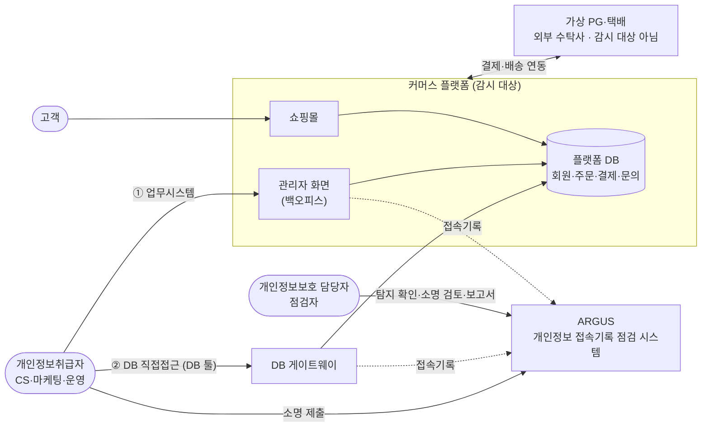
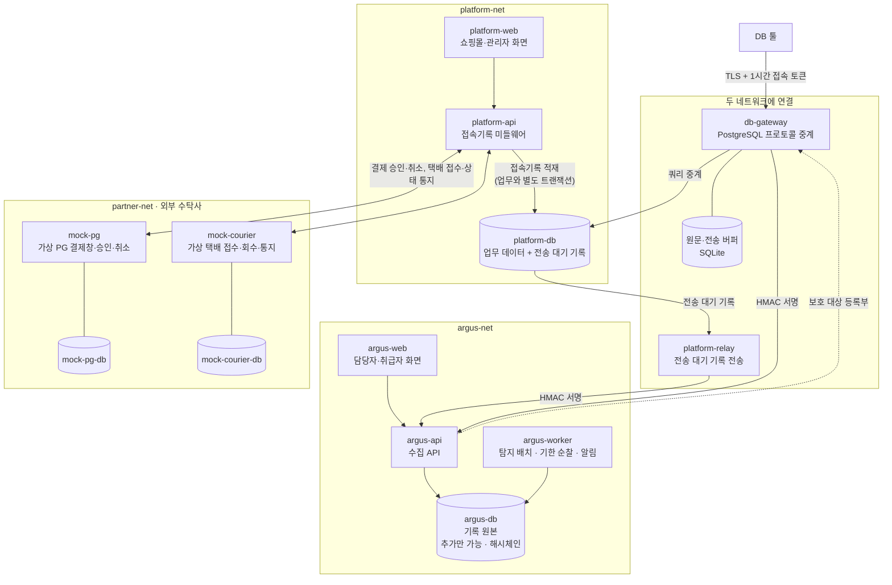
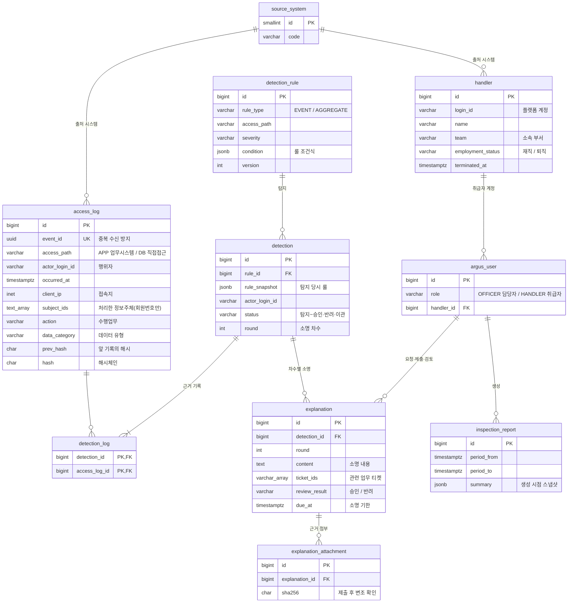
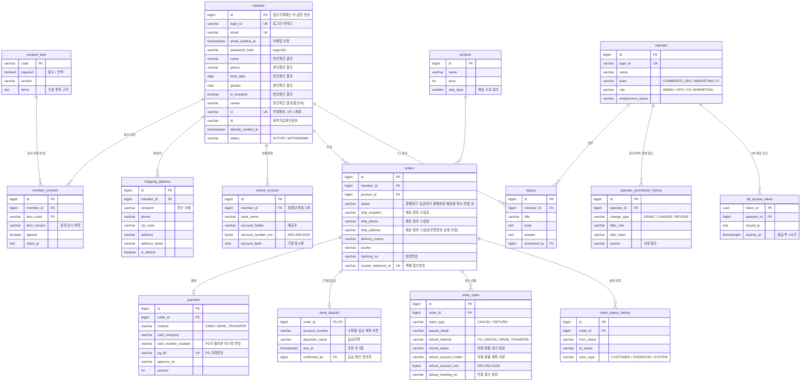
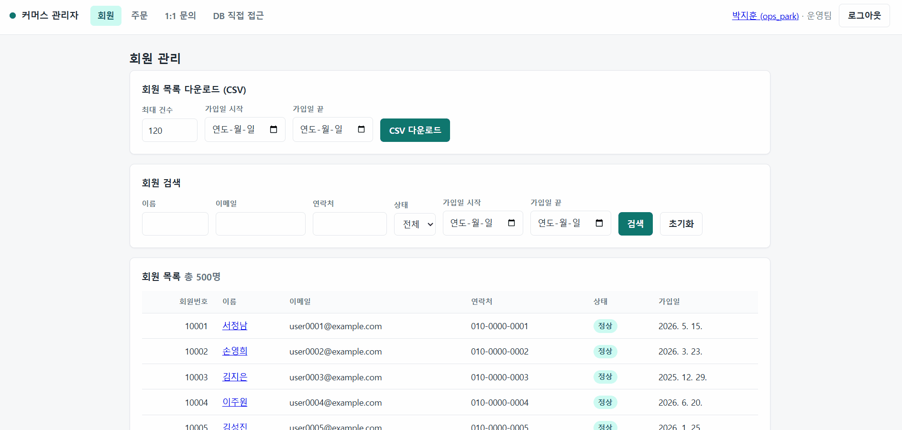
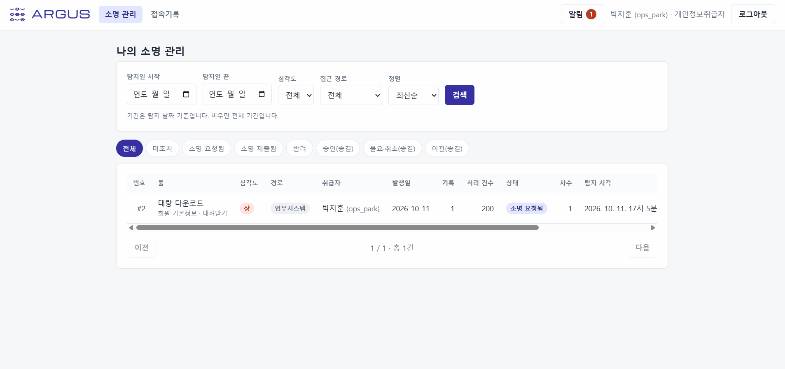
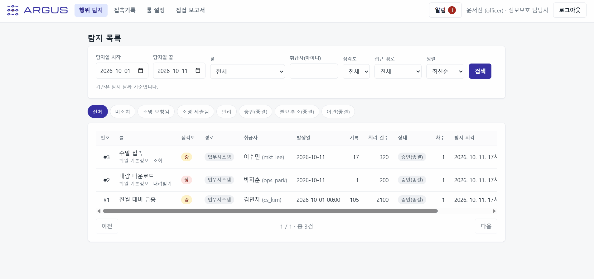
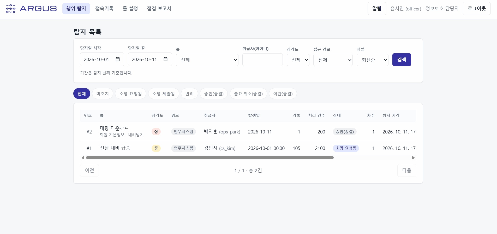
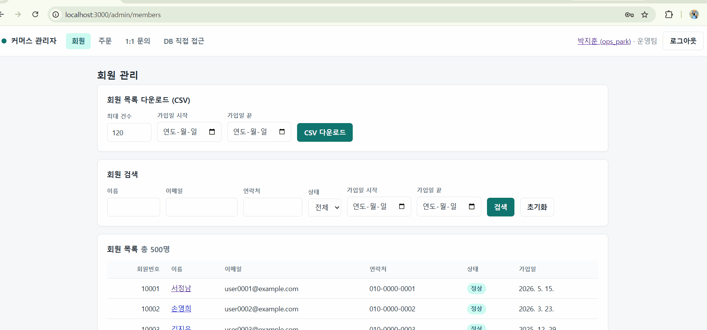

# ARGUS

<p align="center">
  
</p>

<p>
  개인정보처리시스템에 접속하는 개인정보취급자 등의 접속기록을 수집·보관하고,<br>
  이상행위 모니터링 및 탐지, 이상행위에 대한 소명 제출, 접속기록 점검 및 보고 기능을 제공하는 <b>개인정보 접속기록 점검 시스템</b>
</p>
<br>

[▶ 실제 구현 화면](#구현-화면)<br>
[▶ 개인정보 영향평가(PIA) 진행 현황](docs/pia/README.md)
<br>
## 요약

| 항목 | 내용 |
|---|---|
| 기간 | 2026-09-07 ~ 2026-10-11 (v0.1)<br>2026-10-12 ~ 2026-10-22 (커머스 기능 확장) |
| 인원 | 1인 프로젝트로, 프로젝트 기획-설계-구현-검수 등의 과정에서 Claude·Claude Code 활용 |
| 근거 법령 | 개인정보 보호법, 「개인정보의 안전성 확보조치 기준」(고시) 및 해설 안내서 |
| 구성 | 커머스 플랫폼(쇼핑몰·관리자 화면, 감시 대상) + DB 게이트웨이 + ARGUS(접속기록 점검 시스템) — 2절 |
| 기술 | Python 3.12 · FastAPI · PostgreSQL 16 · Next.js · Docker Compose · GitHub Actions |
| 진행 방식 | 문제 정의 → 요구사항·정책 → 아키텍처·API·DB 설계 → 구현 → 자체 점검 → 보완 조치<br>결정과 기각한 대안은 설계 문서에 남기고, 모든 변경은 PR과 CI를 거쳐 반영 |
| 점검 활동 | 플랫폼 대상 [개인정보 영향평가(PIA)](docs/pia/README.md) 수행 (2026-10-19 ~) |

> 시스템 내 회원·직원·접속기록 데이터는 모두 가상으로 생성한 값입니다. 실제 개인정보는 없습니다.

<br>

## 목차

- [1. 프로젝트 배경](#1-프로젝트-배경)
  - [실무에서 마주친 문제](#실무에서-마주친-문제)
  - [해결 방향](#해결-방향)
  - [목표](#목표)
- [2. 시스템 구성](#2-시스템-구성)
  - [전체 구성](#전체-구성)
  - [시스템 아키텍처](#시스템-아키텍처)
  - [데이터 모델](#데이터-모델)
- [3. 주요 기능](#3-주요-기능)
  - [기능 목록](#기능-목록)
  - [구현 화면](#구현-화면)
- [4. 법적 요구사항과 구현](#4-법적-요구사항과-구현)
- [5. 주요 문제와 해결 과정](#5-주요-문제와-해결-과정)
  - [문제 1. API 전송 실패 시 접속기록 유실](#문제-1-api-전송-실패-시-접속기록-유실)
  - [문제 2. 새로운 기능 개발 시 접속기록 누락](#문제-2-새로운-기능-개발-시-접속기록-누락)
  - [문제 3. 접속기록 원본 위·변조 가능성](#문제-3-접속기록-원본-위변조-가능성)
  - [문제 4. DB 직접접근 시 정보주체 식별정보 기록의 어려움](#문제-4-db-직접접근-시-정보주체-식별정보-기록의-어려움)
  - [문제 5. 구현이 법적 기준을 충족하는가?](#문제-5-구현이-법적-기준을-충족하는가)
- [6. 한계와 향후 계획](#6-한계와-향후-계획)
- [7. 실행 가이드](#7-실행-가이드)
- [8. 프로젝트 산출물](#8-프로젝트-산출물)

---

<br>

## 1. 프로젝트 배경

재직 중 개인정보처리시스템의 접속기록을 매월 점검하는 업무를 담당했습니다. 당시 업무를 수행하며 겪었던 불편함과 사각지대를 개선하고자 ARGUS 프로젝트를 시작하게 되었습니다.

### 실무에서 마주친 문제

| 순번 | 내용 |
|---|---|
| 1 | 월 단위로 접속기록 점검 업무를 진행했기 때문에, 개인정보취급자들은 몇 주가 지난 본인의 과거 작업을 파악하고 소명을 작성하는 일에 어려움을 겪었습니다. |
| 2 | 취급자들이 자신의 개인정보 접속기록에 대해 소명을 제출한다고 해도, 이는 개인의 주관과 기억에 의존한 텍스트에 불과했기 때문에 검증이 어려웠습니다. 사후에 사유를 지어내더라도 이를 확인할 방법이 없었습니다. |
| 3 | 점검자는 취급자별 접속기록을 추출하고, 해당 데이터가 접근량 증가·야간 접속 등의 이상행위 기준에 부합하는지 하나하나 대조하여 확인해야 했습니다. 점검자의 실수로 특정 행위를 누락하여 보고할 위험이 있었습니다. |
| 4 | 점검 및 보고의 과정에서 자료 취합 시간이 불필요하게 길었습니다. 점검자는 접속기록을 취급자들에게 발송하고, 사유를 전달받아 취합해야 했습니다. 또한 점검 내용을 별도의 결재 문서에 옮겨서 작성해야 하는 불편함이 있었습니다. |
| 5 | 점검자는 점검 과정에서 점검 대상인 개인정보취급자들에게 지속적으로 연락해야 했습니다. 최초 접속기록 전달부터 기한 내에 소명을 제출하지 않은 경우까지 적지 않은 취급자들에게 일일이 연락해야 하는 어려움이 있었습니다. |
| 6 | 업무시스템을 통한 접속기록과 DB 직접접근을 통한 접속기록을 따로 점검하고 보고했습니다. 이에 따라 점검 담당자들이 많은 시간을 쏟아야 했습니다. |

### 해결 방향

| 순번 | 내용 |
|---|---|
| 1 | 탐지 배치가 일정 시간마다 실행되어 개인정보 처리 행위 직후 해당 기록을 탐지하고, 소명을 자동으로 요청합니다. 취급자는 소명 화면에서 관련 접속기록을 함께 확인할 수 있습니다. |
| 2 | 기존의 텍스트 기반 소명에서 나아가, 개인정보 처리 행위와 관련된 업무 티켓을 연결하거나 근거(결재 문서·요청 메일 등)를 첨부할 수 있습니다. 담당자는 소명 내용을 확인한 뒤 승인·반려·재요청합니다. |
| 3 | 담당자의 수기 점검이 아닌, 룰을 기반으로 한 자동 탐지 방식을 적용합니다. 담당자가 시스템에서 룰을 만들고 수정할 수 있으며, 룰 변경 이력이 남습니다. |
| 4 | 개인정보 처리 행위에 대한 탐지·소명·판단이 한 화면에서 이어지고, 이를 바탕으로 점검 보고서를 자동으로 생성합니다. |
| 5 | 소명 기한이 임박하거나 지나면 취급자와 담당자에게 자동으로 알림을 보냅니다. |
| 6 | 업무시스템과 DB 직접접근 두 경로의 접속기록을 한 곳에 모아 조회·점검합니다. 보고서는 두 경로를 한 문서에 담되 경로별로 나눠 집계하며, 필요하면 한 경로만 따로 생성할 수 있습니다. |

<br>

### 목표

ARGUS 프로젝트의 목표는 접속기록 점검자와 점검 대상인 개인정보취급자가 더 정확하고 편리하게 접속기록을 점검할 수 있는 환경을 만들고, 이를 바탕으로 견고한 개인정보 접속기록 관리 체계를 갖추는 것입니다.

「개인정보의 안전성 확보조치 기준」 제8조제2항은 접속기록 점검의 주기·방법·사후조치 절차를 내부 관리계획으로 정해 이행하도록 할 뿐, 점검 방식을 따로 정하지 않습니다. 접속기록을 자동화된 방식으로 분석해 이상행위를 탐지하고 소명을 받는 것은 같은 고시 제17조에 따라 공공시스템에만 의무입니다. 그럼에도 자동화를 택한 것은 법적 의무를 지키는 것만으로는 해결되지 않는 문제가 있기 때문입니다. 월 단위 수기 점검도 적법하지만, 행위와 소명 사이에 몇 주의 간격이 생겨 소명의 정확도가 떨어지고, 점검자가 기준을 하나하나 대조하는 과정에서 누락이 생길 수 있습니다. 자동화하면 이상행위 직후에 소명을 받을 수 있고, 모든 기록에 같은 기준을 빠짐없이 적용할 수 있습니다. ARGUS의 자동화는 의무 이행 자체보다 점검이 실제로 효과를 내도록 하는 데 목적이 있습니다.

<br>

## 2. 시스템 구성

### 전체 구성

ARGUS를 시연하기 위해 감시 대상이 되는 커머스 플랫폼을 함께 만들었습니다. 개인정보취급자가 개인정보에 접근하는 경로는 업무시스템을 거치는 3티어 접근과 DB에 직접 접속하는 2티어 접근 두 가지이며, 두 경로의 접속기록이 모두 ARGUS로 모입니다.



| 구성 | 사용자 | 역할 |
|---|---|---|
| 쇼핑몰 | 고객 | 회원가입(휴대폰 본인확인)·주문·결제(카드·무통장입금)·배송 조회·취소·청약철회·1:1 문의. 감시 대상 개인정보가 여기서 생깁니다(모두 가상 데이터) |
| 관리자 화면(백오피스) | 개인정보취급자 | 회원 조회·다운로드, 주문·배송·반품·환불·문의 처리. 쇼핑몰과 같은 플랫폼의 관리자 화면(`/admin`)이며, 화면 요청마다 서버가 접속기록을 남깁니다(① 업무시스템 경로) |
| DB 게이트웨이 | 개인정보취급자 | DB 툴 접속을 중계하며 공용 DB 계정 뒤의 실제 사용자 기준으로 접속기록을 남깁니다(② DB 직접접근 경로). 관리자 화면에서 발급한 1시간 접속 토큰으로만 접속합니다 |
| ARGUS | 담당자·취급자 | 두 경로의 접속기록을 수집·보관하고, 이상행위를 탐지해 취급자에게 소명을 요청하며, 점검 보고서를 만듭니다 |
| 가상 PG·택배 | — | 쇼핑몰이 결제·배송을 맡기는 외부 수탁사를 흉내 낸 별도 서비스(각자 DB)입니다. 쇼핑몰 서버와 API로만 연결되고, ARGUS의 감시 대상이 아닙니다 |

### 시스템 아키텍처

<details>
<summary><b>시스템 아키텍처 이미지 보기</b></summary>



</details>

| 구성요소 | 기술 | 역할 |
|---|---|---|
| platform-web | Next.js 16 · React 19 · TypeScript | 쇼핑몰(`/`)과 관리자 화면(`/admin`) |
| platform-api | Python 3.12 · FastAPI · SQLAlchemy 2.1 · Alembic | 쇼핑몰·관리자 API. 관리자 화면 요청을 미들웨어가 기록합니다. 업무가 실패해도 시도는 실패로 남기고, 기록하지 못하면 응답을 막습니다 |
| platform-relay | Python (platform-api와 같은 이미지) | 전송 대기 기록을 2초마다 ARGUS로 보냅니다(HMAC 서명, 재시도) |
| db-gateway | Python asyncio · SQLite | DB 툴과 플랫폼 DB 사이에서 PostgreSQL 프로토콜을 중계합니다. SQL 원문은 게이트웨이 안에만 두고, ARGUS에는 검색값을 뺀 SQL과 원문의 지문만 보냅니다. 데이터 유형은 ARGUS의 보호 대상 등록부(어떤 테이블·컬럼이 어떤 개인정보인지 정리한 목록)로 판정하며, 등록부를 받지 못하면 마지막 등록부, 그마저 없으면 기본 분류표를 씁니다 |
| argus-api | Python 3.12 · FastAPI · SQLAlchemy 2.1 · Alembic | 수집 API(서명 검증), 담당자·취급자 화면 API |
| argus-worker | Python (argus-api와 같은 이미지) | 5분 주기 탐지 배치, 소명 기한 순찰, 화면 알림·웹 푸시 |
| argus-web | Next.js 16 · React 19 · TypeScript | 담당자(행위 탐지·접속기록·룰 설정·점검 보고서)·취급자(소명 관리·접속기록) 화면 |
| mock-pg · mock-courier | Python 3.12 · FastAPI | 가상 PG(작은 창 결제창, 승인·취소 API)와 가상 택배(접수·반품 회수 API, 설정한 시간마다 상태를 넘기고 쇼핑몰에 서명 통지). 각자 DB를 두며 platform-api와만 연결됩니다 |
| platform-db · argus-db | PostgreSQL 16 | 두 DB는 서로 다른 네트워크에 둡니다. platform-relay와 db-gateway만 두 네트워크에 함께 연결됩니다 |

- 보안: HMAC-SHA256 요청 서명(플랫폼과 ARGUS만 공유하는 비밀키로 서명해, 서명이 맞지 않는 접속기록은 받지 않음), TLS(게이트웨이), AES-256-GCM(환불계좌), 웹 푸시 암호화(RFC 8291·8292)
- 인프라·CI: Docker Compose. GitHub Actions에서 PR마다 ruff·pytest·eslint·tsc·E2E·gitleaks·trivy·Docker 빌드

### 데이터 모델

ARGUS의 핵심 테이블입니다. 이력 테이블(룰 변경·상태 변경·계정 변경)과 알림·설정 테이블은 생략했습니다.

| 테이블 | 설명 |
|---|---|
| access_log | 두 경로의 접속기록 원본. 추가만 가능하고 해시체인으로 위·변조를 확인합니다. 정보주체는 회원번호로만 남깁니다 |
| handler | 플랫폼에서 받은 개인정보취급자 명부(재직·퇴직) |
| argus_user | ARGUS 로그인 계정. 담당자(OFFICER)와 취급자(HANDLER) |
| detection_rule | 탐지 룰. 조건식·심각도·적용 경로 |
| detection | 탐지건. 탐지 당시 룰의 스냅샷과 처리 상태 |
| detection_log | 탐지건과 근거가 된 접속기록의 연결 |
| explanation | 소명. 차수별 내용·관련 업무 티켓·검토 결과·기한 |
| explanation_attachment | 소명 근거 첨부 파일(SHA-256으로 변조 확인) |
| inspection_report | 점검 보고서. 생성 시점의 스냅샷 |

<details>
<summary><b>ARGUS DB ERD 보기</b></summary>



</details>

<details>
<summary><b>플랫폼 DB(감시 대상) ERD 보기</b></summary>



개인정보가 담긴 컬럼과 주요 키 위주로 표시했습니다(전체 DDL은 [DB 스키마](docs/db-schema.md) 4절). 이 밖에 전송 대기 기록(outbox), 탈퇴 회원 분리보관(`retained_member_record`)·파기 이력 테이블이 있습니다.

</details>

<br>

## 3. 주요 기능

### 기능 목록

ARGUS의 주요 기능 목록입니다. 실제 시연 화면은 아래 [구현 화면](#구현-화면)에서 확인 가능합니다.

| 기능 | 내용 |
|---|---|
| 접속기록 관리 | 개인정보에 접근하는 두 가지 경로(3티어: 업무시스템 경유 / 2티어: DB 직접접근)에서 개인정보취급자의 접속과 개인정보 처리 행위를 기록합니다. 계정·일시·접속지·처리한 정보주체·수행업무를 저장합니다. |
| 접속기록·탐지건 검색 | 계정·기간·수행업무·접속지 등을 기준으로 접속기록을 검색하고, 룰·취급자·심각도·접근 경로를 기준으로 탐지건을 검색합니다. |
| 자동 탐지 | 기본 13개의 룰(야간·주말 접근, 대량 조회·다운로드, 전월 대비 조회량 급증, 특정 회원 반복 처리 등)을 기반으로 탐지 배치가 동작합니다. 5분 간격으로 새로운 접속기록을 룰과 대조하여 이상행위를 탐지하며, 탐지건은 업무시스템과 DB 직접접근 경로별로 구분하여 생성합니다. |
| 탐지 룰 관리 | 담당자가 룰 빌더에서 탐지 조건(수행업무·데이터 유형·시간대·건수 등)과 심각도, 적용경로 등을 설정해 룰을 생성하고 수정합니다. 룰은 활성화·비활성화할 수 있으며, 설정값을 변경하면 버전과 변경 이력이 남습니다. |
| 소명 요청·제출 | 이상행위가 탐지되면 취급자에게 소명을 자동으로 요청합니다. 취급자는 본인의 접속기록을 확인하여 소명 내용을 작성하고, 관련 업무 티켓을 추가하거나 근거 파일(결재 문서, 이메일 등)을 첨부하여 제출합니다. |
| 소명 검토 | 담당자는 취급자가 제출한 소명을 확인하고 승인·반려·재요청하거나 정보보안팀으로 이관합니다. 재요청한 소명은 새로운 차수로 쌓여 이전 소명이 남습니다. 점검 담당자 본인이 개인정보 처리 행위자인 건은 스스로 처리할 수 없습니다. |
| 알림 발송 | 이상행위가 탐지되면 행위자(취급자)에게 소명 요청 알림을, 점검 담당자에게 탐지 알림을 보냅니다. 심각도 '상'은 ARGUS 화면을 열어 두지 않아도 알 수 있도록 웹 푸시를 함께 보내고, 담당자는 심각도 '중'·'하' 탐지건을 알림 없이 탐지 목록에서 확인합니다(알림 과다 방지). 소명 기한이 24시간 이내로 다가오거나 지나면 취급자와 담당자 모두에게 알립니다. |
| 점검 보고서 관리 | 점검하고자 하는 기간과 접근 경로를 선택하여 보고서를 자동 생성합니다. 탐지건별 소명 요지와 검토 의견, 처리자, 기한 초과·이관 건수 등이 포함되며 브라우저에서 PDF로 저장할 수 있습니다. 과거에 생성한 보고서도 조회할 수 있습니다. |
| 접속기록 무결성 보장 | 접속기록 원본은 수정·삭제할 수 없도록 막고, 해시체인으로 접속기록의 위·변조 여부를 검증합니다. 보고서를 생성할 때 접속기록 전체를 재점검하고 직전 보고서의 기준점과 대조합니다. |


### 구현 화면
*내용을 클릭하면 실제 구현 화면을 확인하실 수 있습니다.

<details open>
<summary><b>취급자 대량 다운로드 → 담당자 알림 → 탐지 상세 확인</b></summary>
<br>
<p align="center">

<br>
<sub>회원 정보 다운로드 행위가 탐지되어 점검 담당자에게 웹 푸시 알림 발송</sub>
<br>
<sub>점검자는 해당 알림을 클릭하여 탐지건 상세 정보를 확인함</sub>
</p>
</details>

<details>
<summary><b>소명 작성 및 제출 → 담당자 승인</b></summary>
<br>
<p align="center">

<br>
<sub>소명 요청을 받은 개인정보취급자는 사유를 작성하고 관련 업무 티켓을 추가하여 소명을 제출함</sub>
<br>
<sub>점검 담당자는 제출된 소명 내용 확인 후 승인 처리</sub>
</p>
</details>

<details>
<summary><b>점검 보고서 관리</b></summary>
<br>
<p align="center">

<br>
<sub>기간과 접근 경로를 설정하여 새로운 점검 보고서 생성</sub>
<br>
<sub>보고서에는 접속기록 무결성 점검 결과, 탐지건별 소명 요지 등의 내용 포함</sub>
</p>
</details>

<details>
<summary><b>탐지 룰 생성</b></summary>
<br>
<p align="center">

<sub>점검 담당자가 룰 설정 메뉴에서 탐지 조건, 심각도, 접근 경로 등을 설정해 새로운 탐지 룰을 생성함</sub>
</p>
</details>

<details>
<summary><b>DB 직접접근</b></summary>
<br>
<p align="center">

<sub>플랫폼 백오피스에서 DB 직접접근을 위한 토큰을 발급받은 후 DB에 접속하여 쿼리 실행을 통해 회원 정보를 조회함.<br>처리 내역이 ARGUS 접속기록에 남으며, SQL의 파라미터 값은 <code>$1</code>로 바뀌어 저장되고 정보주체는 쿼리 실행 결과에서 읽은 회원번호로 기록됨</sub>
</p>
</details>

<br>

## 4. 법적 요구사항과 구현

「개인정보의 안전성 확보조치 기준」(이하 고시) 및 안내서의 항목과 ARGUS의 세부 구현 내용이 어떻게 이어지는지 정리했습니다.

| 근거 | 요구 | 구현 | 확인 |
|---|---|---|---|
| 고시 제2조제3호 | 접속기록 항목: 계정, 일시, 접속지, 처리한 정보주체, 수행업무 | 업무시스템·DB 직접접근 모두 다섯 항목 기록. DB 직접접근은 결과에서 회원번호를 가져온다. | [test_agent.py](apps/platform-api/tests/test_agent.py), [test_db_gateway.py](e2e/test_db_gateway.py) |
| 고시 제8조제1항 | 1년 이상 보관, 5만 명 이상·고유식별·민감정보 처리 등은 2년 | 기록 원본은 삭제할 수 없게 막는다. 등록부에 고유식별·민감정보가 있으면 2년 보관 대상으로 판정 | [test_append_only.py](apps/argus-api/tests/test_append_only.py), [test_protection.py](apps/argus-api/tests/test_protection.py) |
| 고시 제8조제2항 | 접속기록·다운로드 점검의 주기·방법·사후조치를 내부 관리계획으로 정하고 이행 | 5분 주기 자동 탐지, 소명·승인/반려, 점검 보고서 | [test_scenario.py](e2e/test_scenario.py), [test_report.py](e2e/test_report.py) |
| 고시 제8조제3항 | 위·변조·도난·분실 방지 | 기록 원본 변경 불가(UPDATE·DELETE·TRUNCATE 거부), 해시체인, 보고서에 기준점 저장 후 다음 보고서에서 대조 | [test_hashchain.py](apps/argus-api/tests/test_hashchain.py), [test_reports_api.py](apps/argus-api/tests/test_reports_api.py) |
| 고시 제5조제3항 | 권한 부여·변경·말소 내역 3년 보관 | 플랫폼·ARGUS 계정 생성 및 권한 변경 이력 보관 | [test_accounts.py](apps/platform-api/tests/test_accounts.py), [test_users_api.py](apps/argus-api/tests/test_users_api.py) |
| 고시 제5조제1항, 제6조제1항 | 업무에 필요한 최소 권한, 비정상 접근 탐지 | 역할별 접근 범위 설정 기능, 접속지 기반 룰 | [test_roles.py](apps/platform-api/tests/test_roles.py), [test_ip_subject_rules.py](apps/argus-api/tests/test_ip_subject_rules.py) |
| 안내서 FAQ 147 | 로그인·로그아웃·로그인 실패 기록 보관 | 인증 관련 세 가지 내용 모두 기록 | [test_v01_reinforcement.py](e2e/test_v01_reinforcement.py) |
| 안내서 94쪽 | 점검의 객관성 | 담당자 본인이 행위자인 탐지건은 처리(승인/반려 등) 불가 | [test_self_review.py](apps/argus-api/tests/test_self_review.py) |
| 고시 제17조 | 공공시스템: 자동 분석·탐지, 사유 소명 | 룰 기반 자동 탐지 및 소명 요청 | [test_detection_batch.py](apps/argus-api/tests/test_detection_batch.py), [test_scenario.py](e2e/test_scenario.py) |

<br>

## 5. 주요 문제와 해결 과정

프로젝트를 진행하며 맞닥뜨린 주요 문제와 이를 해결한 과정을 정리했습니다. 해결한 뒤에도 남은 과제는 [6. 한계와 향후 계획](#6-한계와-향후-계획)에 따로 정리했습니다.

| 순번 | 문제 | 해결 방법 |
|---|---|---|
| 1 | [API 전송 실패 시 접속기록 유실](#문제-1-api-전송-실패-시-접속기록-유실) | 업무와 별도 트랜잭션으로 대기열에 먼저 저장하고 상한 없이 재시도 |
| 2 | [새로운 기능 개발 시 접속기록 누락](#문제-2-새로운-기능-개발-시-접속기록-누락) | 기록 표시가 없는 관리자 API가 있으면 서버가 기동하지 않음 |
| 3 | [접속기록 원본 위·변조 가능성](#문제-3-접속기록-원본-위변조-가능성) | 두 DB 분리, 추가만 가능한 기록 원본, 해시체인, 보고서 기준점 대조 |
| 4 | [DB 직접접근 시 정보주체 식별정보 기록의 어려움](#문제-4-db-직접접근-시-정보주체-식별정보-기록의-어려움) | 게이트웨이와 개인 토큰으로 실사용자 확인, 조회 결과의 컬럼 정보로 회원번호만 기록 |
| 5 | [구현이 법적 기준을 충족하는가?](#문제-5-구현이-법적-기준을-충족하는가) | 점검표 작성 → 실측 → 판정 → 보완 → 재측정 |

<br>

### 문제 1. API 전송 실패 시 접속기록 유실

> [!WARNING]
> **문제 상황**
>
> 업무시스템이 개인정보 처리 행위가 일어날 때마다 접속기록을 ARGUS 수집 API로 보낼 경우, ARGUS가 멈춰 있거나 혹은 네트워크가 끊기거나, 업무 처리 자체가 실패하면 그 행위의 접속기록이 누락될 수 있습니다. 기록되지 않은 행위는 점검할 방법이 없어 문제가 되는 상황이었습니다.

> [!TIP]
> **해결 과정**
>
> - 접속기록을 바로 보내지 않고, 업무와 **별도 트랜잭션**으로 업무시스템 안의 대기열(outbox)에 먼저 저장합니다. 업무와 기록을 한 트랜잭션으로 묶으면 업무가 실패해 롤백될 때 기록도 함께 사라지기 때문입니다. 업무가 실패해도 그 시도는 "실패"로 기록됩니다.
> - 대기열에 저장하지 못하면 응답 자체를 내보내지 않습니다. 개인정보가 기록 없이 나가는 경우를 차단하기 위해서 입니다.
> - 별도의 프로세스가 2초마다 ARGUS로의 접속기록 전송을 담당하고, 실패하면 간격을 늘려 가며 상한 없이 재시도합니다.
> - 같은 기록이 두 번 전송돼도 고유 번호(event_id)로 한 번만 저장합니다.
> - DB 직접접근은 게이트웨이가 자체 버퍼를 두고 같은 방식으로 전송합니다.

<br>

### 문제 2. 새로운 기능 개발 시 접속기록 누락

> [!WARNING]
> **문제 상황**
>
> 접속기록은 해당하는 기능마다 로그 연계가 되어 있어야 저장됩니다. 이를 고려할 때, 신규 메뉴를 개발하는 과정에서 로그 연계 부분을 누락하면 해당 기능은 점검의 사각지대가 된다는 문제점이 있었습니다. 개발자가 신규 기능을 개발할 때마다 점검한다고 해도 한계가 있습니다.

> [!TIP]
> **해결 과정**
>
> - 관리자 API마다 "어떤 개인정보를 어떻게 처리하는지" 기록 표시를 붙이게 했습니다.
> - 표시가 없는 API가 하나라도 있으면 **서버 자체가 기동하지 않습니다.** 만약 로그 연계에서 제외하려면 코드에 사유를 적어야 합니다.

<br>

### 문제 3. 접속기록 원본 위·변조 가능성

> [!WARNING]
> **문제 상황**
>
> 접속기록은 점검의 절대적 근거입니다. 그런데 감시 대상이나 관리자가 접속기록을 고치거나 지울 수 있다면, 기록이 남아 있어도 믿을 수 없는 상황이 발생합니다.

> [!TIP]
> **해결 과정**
>
> - 플랫폼과 ARGUS의 DB를 완전히 분리했습니다. 감시받는 취급자들은 ARGUS DB에 접근할 수 없습니다.
> - 기록 원본은 **추가만 가능**합니다. UPDATE·DELETE·TRUNCATE를 DB 트리거로 거부하고(테이블 소유자 포함), 앱 계정의 DB 권한도 제한했습니다.
> - 모든 기록을 **해시체인**으로 이어, 중간에 있는 한 건이라도 바뀔 경우 확인이 가능합니다. 각 기록이 바로 앞 기록의 해시값을 포함하므로, 한 건이 바뀌면 그 뒤의 해시가 모두 어긋납니다.
> - 점검 보고서를 만들 때 마지막 기록의 해시를 기준점으로 저장하고, 다음 보고서에서 그 기록이 그대로 남아 있는지 대조합니다. 해시체인은 맨 끝의 기록들을 통째로 지우면 남은 체인이 정상으로 보이는 한계가 있어, 이를 보완하기 위한 장치입니다.

<br>

### 문제 4. DB 직접접근 시 정보주체 식별정보 기록의 어려움

> [!WARNING]
> **문제 상황**
>
> DBA·개발자가 DB에 직접접근하여 개인정보를 조회하면 업무시스템과 다르게 정보주체에 대한 식별정보를 로깅하기 어렵다는 문제점이 있습니다.
>
> - **누가**: 최초 검토한 DB 감사 로그(pgaudit) 수집 방식으로는 공용 DB 계정 뒤의 실제 사용자를 알 수 없었습니다. 여러 사람이 하나의 DB 계정을 함께 쓰면 DB 로그에는 그 계정 이름만 남기 때문입니다.
> - **누구의 정보를**: SQL을 해석해 정보주체를 추출하려 하면 조인·별칭·함수·매개변수 때문에 정확한 정보를 뽑는 것이 어려웠습니다. SQL 원본을 저장 후 그 시점의 DB에서 다시 실행해 재현하는 방법도 검토했지만, 백업의 시점과 주기도 모호할 뿐더러 접속기록 보관 기간만큼 많은 양의 DB 백업 데이터를 관리해야 하여 현실적인 부담이 있었습니다.

> [!TIP]
> **해결 과정**
>
> - 상용 DB 접근제어 솔루션처럼 DB 툴과 DB 사이에 **게이트웨이**를 두었습니다. 취급자는 플랫폼 관리자 화면에서 발급한 개인 토큰(1시간 유효)으로만 접속 가능하고, DB 툴은 게이트웨이로만 연결됩니다.
> - 정보주체는 SQL을 파싱하지 않고 찾습니다. PostgreSQL이 조회 결과와 함께 보내는 열 정보(테이블 OID·열 번호: 각 결과 열이 어느 테이블의 몇 번째 컬럼에서 왔는지 알려주는 값)로 회원 식별 컬럼을 찾아, **해당 컬럼의 값만** 회원번호로 기록합니다. 이름·이메일 등의 다른 개인정보는 저장하지 않습니다.
> - SQL 원문은 게이트웨이 저장소에만 두고, ARGUS에는 파라미터 값을 `$1`로 바꾼 SQL(예: `WHERE phone = '010-…'` → `WHERE phone = $1`)과 원문 참조·지문(원문의 해시값)만 전송합니다. 접속기록 자체에 검색한 개인정보가 쌓이지 않도록 하기 위해서입니다.

<br>

### 문제 5. 구현이 법적 기준을 충족하는가?

> [!WARNING]
> **문제 상황**
>
> ARGUS는 저의 실무 경험과 고시·안내서에 대한 해석을 바탕으로 만들었습니다. 하지만 제 해석이 틀렸거나 누락된 요구사항이 있을 수 있고, 만든 사람이 스스로 판단하면 놓치는 부분이 생길 수 있었습니다.


> [!TIP]
> **해결 과정**
>
> - 기능 개발 후 고시와 안내서를 기준으로 근거 조항 및 확인 방법을 적은 점검표를 작성하고, 실제 동작을 측정해 판단했습니다.
> - 미충족 항목을 보완한 뒤, 실제 화면과 수집 API로 다시 재현해 측정했습니다.

| 영역 | 첫 판정 | 조치 후 재측정 | 조치 |
|---|---|---|---|
| ARGUS가 고객사의 준수를 돕는가 (20개) | 충족 7 · 부분 8 · 미충족 5 | 충족 14 · 부분 6 · 미충족 0 | 로그아웃 기록, 접속지·특정 회원 반복 처리 룰, 담당자 본인 건 처리 차단, 보고서 소명 내용, 권한 이력, 알림, 검색 조건, 기록 원본 삭제 차단과 보고서 기준점 |
| ARGUS 자체의 준수 (9개) | 충족 5 · 부분 2 · 미충족 1 · 다음 버전 1 | 충족 6 · 부분 2 · 다음 버전 1 | 계정 변경 사유와 이력 |
| 감시 대상 쇼핑몰 (8개) | 충족 3 · 부분 2 · 미충족 2 · 위험 수용 1 | 충족 5 · 부분 2 · 위험 수용 1 | 처리방침·이용약관 정식 문안, 동의 항목 문안 보완 |

<br>

## 6. 한계와 향후 계획

| 한계 | 계획 |
|---|---|
| 업무시스템 접속기록의 전송 대기 버퍼(outbox)가 플랫폼 DB 안에 있고, DB 게이트웨이의 공용 계정은 DB 소유자 권한이다. 따라서 게이트웨이로 접속한 사용자가 ARGUS로 전송되기 전의 기록을 지울 수 있다 | 버퍼를 플랫폼 DB 밖으로 옮기고 공용 계정 권한을 분리 |
| 기록 원본의 삭제 차단 트리거는 DB 소유자·슈퍼유저가 끌 수 있다. | 외부 기준점 보관(WORM 저장소: 한 번 쓰면 수정·삭제할 수 없는 저장소 등) |
| 보관 기간이 지난 접속기록을 지우는 파기 배치가 없다(지금은 무기한 보관) | 파기 전용 경로와 함께 구현 |
| DB 직접접근에서 결과에 회원 식별 컬럼이 없는 쿼리는 정보주체를 특정하지 못한다. 원문 SQL(검색 조건문)로 갈음하지만, 안내서(93쪽)가 함께 요구하는 시점 백업 등 추적 조치가 없다. | 시점 복구(PITR)와 재현 절차 |
| 존재하지 않는 아이디의 로그인 실패는 기록하지 않는다(행위자를 특정할 수 없음) | 접속지 기준 집계로 대응 검토 |
| DB 접속 토큰은 접속할 때만 재직·잠금을 확인한다. 이미 열린 연결은 말소 뒤에도 만료(최대 1시간)까지 유지되고, 역할이 바뀌어도 발급된 토큰은 쓸 수 있다 | 말소·역할 변경 시 토큰 폐기와 연결 종료 |
| 플랫폼 및 ARGUS에 대한 보안성 검토가 이루어지지 않았고, 개인정보 영향평가는 진행 중이다. | 웹 취약점 점검 등의 보안성 검토, [개인정보 영향평가(PIA)](docs/pia/README.md), ISMS-P 기준 점검 |

<br>

## 7. 실행 가이드

```bash
git clone https://github.com/Salgoo26/argus.git && cd argus
bash scripts/init-env.sh          # .env 생성(무작위 비밀값). 이미 있으면 --add-missing으로 새 항목만 채움
docker compose up -d --build      # 플랫폼 http://localhost:3000 · ARGUS http://localhost:3001
bash scripts/e2e.sh               # 전체 시나리오 자동 검증
```

### 로그인 계정

비밀번호는 레포에 두지 않습니다. 플랫폼 관리자 계정은 `init-env.sh`가 `.env`에 무작위로 만든 값을 쓰고, ARGUS 계정은 처음 한 번 직접 설정합니다.

| 화면 | 아이디 | 비밀번호 |
|---|---|---|
| 플랫폼 관리자<br>`localhost:3000/admin` | `ops_park`(운영) · `cs_kim`(CS) · `mkt_lee`(마케팅) · `admin_han`(관리자) 등 | `.env`의 `PLATFORM_SEED_OPERATOR_PASSWORD` 값 (모든 시드 관리자 공통) |
| ARGUS 담당자<br>`localhost:3001` | `officer` | 아래 `create-officer` 실행 시 입력 |
| ARGUS 취급자<br>`localhost:3001` | 플랫폼 관리자 아이디 (예: `ops_park`) | 아래 `set-password` 실행 시 입력 |
| 쇼핑몰 고객<br>`localhost:3000` | 회원가입으로 생성 | 가입 시 입력 (시드 회원 500명은 로그인 불가) |

```bash
grep '^PLATFORM_SEED_OPERATOR_PASSWORD=' .env                                       # 플랫폼 관리자 비밀번호 확인
winpty docker compose exec argus-api python -m app.scripts.users create-officer officer --reason "최초 담당자"   # ARGUS 담당자
winpty docker compose exec argus-api python -m app.scripts.users set-password ops_park                         # ARGUS 취급자
```

ARGUS 비밀번호는 명령 실행 후 입력창에 입력합니다(12자 이상). `winpty`는 Windows Git Bash에서 입력창을 띄우기 위한 것으로, macOS·Linux에서는 빼고 실행합니다.

시연 순서와 DB 툴 접속 방법은 [실행 안내](docs/run.md)에 있습니다.

<br>

## 8. 프로젝트 산출물

| 구분 | 산출물 | 내용 |
|---|---|---|
| 기획 | [요구사항 정의서](docs/requirements.md) | 감시 대상 플랫폼과 ARGUS의 기능·비기능 요구, 범위, 근거 법령 |
| 기획 | [정책 정의서](docs/policy.md) | 탐지 룰, 소명·상태 전이, 알림, 권한, 마스킹, 보관·파기 |
| 기획 | [액터별 흐름](docs/actor-flows.md) | 정보보호 담당자·개인정보취급자·플랫폼 관리자·고객의 화면 흐름 |
| 설계 | [아키텍처 설계서](docs/architecture.md) | 시스템 구성, 접속기록 수집 구조(업무시스템·DB 직접접근), 보안 설계, 한계 |
| 설계 | [API 명세서](docs/api-spec.md) | 시스템 간 API(수집·동기화·게이트웨이)와 화면 API |
| 설계 | [DB 스키마](docs/db-schema.md) | 두 DB의 테이블, 룰 조건식, 탐지 배치 흐름 |
| 개인정보 문서 | [개인정보 처리방침](apps/platform-web/app/%28shop%29/privacy/page.tsx) | 감시 대상 쇼핑몰의 처리방침(v3) |
| 점검 | [자체 점검 결과](docs/inspection.md) | 고시·안내서 기준 37개 항목의 첫 판정, 보완 내용, 재측정 결과 |
| 점검 | [개인정보 영향평가 진행 현황](docs/pia/README.md) | 플랫폼 대상 개인정보 영향평가(PIA) 수행 (2026-10-19 ~) |
