# 상세 개선방안

> 안내서 개선계획 수립(5.2, 71쪽) 상세 개선방안 작성 양식. 개선계획표의 과제마다 대상·방식·기준을 구체적으로 적고, 필요한 과제에는 개선 후 모습을 그림으로, 근거가 되는 공공 안내서 내용을 함께 제시합니다

## 1. 개인정보 수집 동의 절차 개선

| 개선과제명 | 1. 개인정보 수집 동의 절차 개선 |
|---|---|
| 순번 | 1 |
| 관련 평가항목 | 3.1.1, 3.1.8 |
| 법적 요건 | 필수 사항 |
| 과제 상세 내용 | ○ 회원가입 개인정보 처리 근거 정리(3.1.1) - 연계정보(CI): 중복 가입 확인에 필요한 정보로, 동의 없이 처리(계약 체결·이행)하고 회원 탈퇴 시 파기 - 생년월일: 만 14세 이상 확인에만 쓰고 바로 파기 - 계약 이행에 필요한 개인정보는 필수 동의를 없애고, 회원가입 화면의 "개인정보 수집·이용 안내"로 목적·항목·보유 기간을 알림(본인확인 정보 포함) ○ 마케팅 동의의 중요한 내용 표시(3.1.8) - 마케팅 목적(이벤트·혜택 안내)과 보유 기간을 글씨 크기·굵기·밑줄로 다른 내용과 구분해 표시 - 회원가입 화면과 마이페이지 선택 동의 화면에 함께 적용  [그림] 개선 후 회원가입 동의 화면 예시 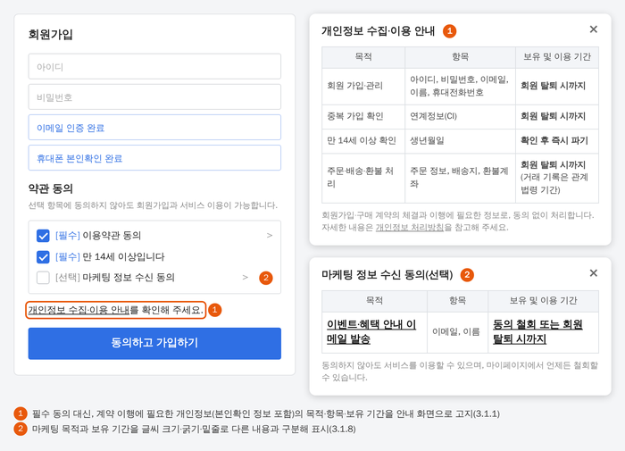  [참고] 「개인정보 처리 통합 안내서」(2025.7) 128쪽: 중요한 내용 표시 방법(고시 제4조 개정) 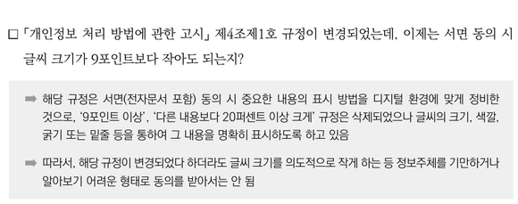 |
| 담당부서(수행 주체) | IT팀 |
| 수행 시기 | 2027.03(단기) |
| 관련 법령 및 문서 | - 「개인정보 보호법」 제15조(개인정보의 수집·이용), 제22조(동의를 받는 방법) - 「개인정보 보호법 시행령」 제17조(동의를 받는 방법) - 「개인정보 처리 방법에 관한 고시」 제4조(서면 동의 시 중요한 내용의 표시 방법) |

## 2. 개인정보 보유·파기 체계 마련

| 개선과제명 | 2. 개인정보 보유·파기 체계 마련 |
|---|---|
| 순번 | 2 |
| 관련 평가항목 | 3.1.2, 3.5.1, 3.2.1 |
| 법적 요건 | 필수 사항 |
| 과제 상세 내용 | ○ 목적 없는 본인확인 결과 정리(3.1.2) - DI·성별·내외국인·통신사는 저장하지 않도록 바꾸고, 이미 저장된 값은 일괄 삭제 - 생년월일은 만 14세 이상 확인에만 쓰고 저장하지 않음 ○ 보유기간 다시 정하기(3.2.1) - 거래·분쟁 기록: 회원 탈퇴 시점이 아닌 거래 시점부터 계약·결제 기록 5년, 분쟁 처리 기록 3년 - 환불 계좌 사본: 대금결제 기록으로 보고 환불 완료 시점부터 5년 - 퇴직자 계정 정보: 권한 이력 보관 기간과 같게 퇴직 후 3년 ○ 자동 파기 배치 구현(3.5.1) - 보존 기간이 끝난 분리보관 기록·접속기록·권한 이력·환불 계좌 사본·퇴직자 계정 정보를 매일 삭제 - 배치는 시스템 부하와 이용자 영향이 적은 새벽 시간대(예: 03시)에 실행 - 파기 일시·대상·건수를 파기 관리대장에 남기고, 개인정보 보호책임자가 월 1회 확인  [참고] 「개인정보 처리 통합 안내서」(2025.7) 112쪽: 목적 달성 시 5일 이내 파기, 전자상거래법에 따른 거래 기록은 5년 보존 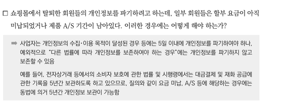 |
| 담당부서(수행 주체) | IT팀 |
| 수행 시기 | 2027.03(단기) |
| 관련 법령 및 문서 | - 「개인정보 보호법」 제3조(개인정보 보호 원칙), 제16조(개인정보의 수집 제한), 제21조(개인정보의 파기) - 「전자상거래 등에서의 소비자보호에 관한 법률 시행령」 제6조(사업자가 보존하는 거래기록의 대상 등) - 「표준 개인정보 보호지침」 제10조(개인정보의 파기방법 및 절차) |

## 3. 웹 침입 탐지·차단과 취약점 관리

| 개선과제명 | 3. 웹 침입 탐지·차단과 취약점 관리 |
|---|---|
| 순번 | 3 |
| 관련 평가항목 | 4.2.1, 4.2.6 |
| 법적 요건 | 필수 사항 |
| 과제 상세 내용 | ○ 웹 침입 탐지·차단(4.2.1) - 쇼핑몰 앞단에 웹 방화벽을 도입해 SQL 인젝션·XSS 등 알려진 웹 공격을 탐지·차단(오픈소스 웹 방화벽 또는 클라우드 웹 방화벽 서비스 중 선택) - 2주간 탐지만 하며 오탐을 조정한 뒤 차단으로 전환 - 로그인 요청은 IP별 시도 횟수를 제한해 크리덴셜 스터핑 차단 - 탐지·차단 기록은 IT팀이 주 1회 점검하고, 유출 시도가 보이면 해당 IP 차단 등 조치 ○ 웹 취약점 정기 진단(4.2.6) - 연 1회 이상, 그리고 주요 기능을 배포하기 전에 쇼핑몰·백오피스 진단 - 진단 기준은 「주요정보통신기반시설 기술적 취약점 분석·평가 방법 상세가이드」의 웹 점검 항목(28개) - 발견된 취약점은 위험도별 조치 기한을 정해 조치하고, 재진단으로 이행 확인  [참고] OWASP CRS 프로젝트(coreruleset.org): 웹 방화벽에 적용하는 공개 공격 탐지 규칙 세트 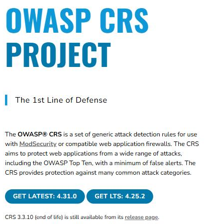  [참고] 「주요정보통신기반시설 기술적 취약점 분석·평가 방법 상세가이드」 643쪽: Web 취약점 분석·평가 항목 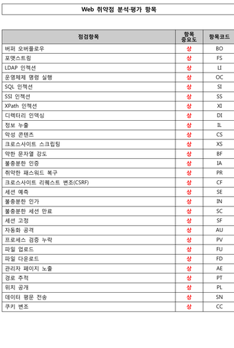 |
| 담당부서(수행 주체) | IT팀 |
| 수행 시기 | 2027.03(단기) |
| 관련 법령 및 문서 | - 「개인정보 보호법」 제29조(안전조치의무) - 「개인정보의 안전성 확보조치 기준」 제4조(내부 관리계획의 수립·시행 및 점검), 제6조(접근통제) |

## 4. 서버 보안 업데이트와 악성프로그램 방지

| 개선과제명 | 4. 서버 보안 업데이트와 악성프로그램 방지 |
|---|---|
| 순번 | 4 |
| 관련 평가항목 | 4.5.2, 4.5.1 |
| 법적 요건 | 필수 사항 |
| 과제 상세 내용 | ○ 운영체제 보안 업데이트(4.5.2) - 운영체제 제작사의 보안 공지를 매주 확인 - 공지가 나오면 테스트 서버에서 서비스 동작을 확인(영향도 분석)한 뒤 지체 없이 운영 서버에 적용 - 적용 일시·대상·결과를 기록 ○ 서버 악성프로그램 방지(4.5.1) - 모든 서버에 리눅스용 백신(예: ClamAV)을 설치하고 매일 1회 전체 검사 - 엔진·패턴은 자동 업데이트하고, 발견된 악성프로그램은 격리·삭제 후 IT팀에 알림  [참고] ClamAV 홈페이지(clamav.net): 리눅스 서버에 설치할 수 있는 오픈소스 백신 엔진 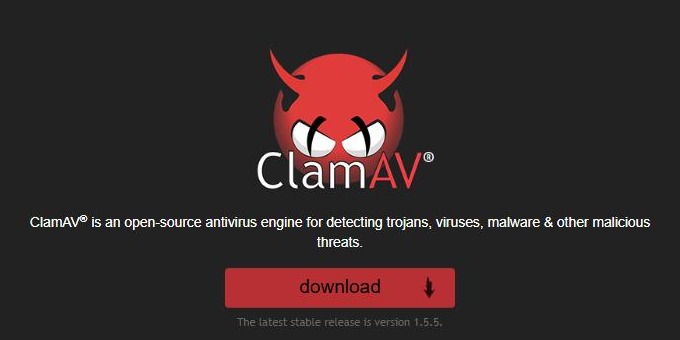 |
| 담당부서(수행 주체) | IT팀 |
| 수행 시기 | 2027.03(단기) |
| 관련 법령 및 문서 | - 「개인정보 보호법」 제29조(안전조치의무) - 「개인정보의 안전성 확보조치 기준」 제9조(악성프로그램 등 방지) |

## 5. 개인정보 처리방침 보완

| 개선과제명 | 5. 개인정보 처리방침 보완 |
|---|---|
| 순번 | 5 |
| 관련 평가항목 | 3.4.1, 3.1.9, 2.3.2, 2.3.1 |
| 법적 요건 | 필수 사항 |
| 과제 상세 내용 | ○ 위탁 현황 공개(3.4.1) - 택배사(배송·반품 회수)와 휴대폰 본인확인 기관(본인확인)을 수탁자·위탁 업무와 함께 추가 ○ 처리 근거별 구분 공개(3.1.9) - "동의 없이 처리하는 개인정보"(회원·주문·배송지·환불계좌·문의 등)와 "동의를 받아 처리하는 개인정보"(마케팅)로 나눠 기재 - 빠져 있던 송장번호·회수 송장번호 추가 ○ 빠진 내용 보완(2.3.2) - 아이디·본인확인 결과·결제·송장 정보와 마케팅 문자 발송 목적 추가 - 고충 처리 부서를 실제 운영 부서인 커머스운영팀으로 정정 ○ 이전 버전 공개(2.3.1) - 처리방침 상단에 시행일 선택 목록을 두고 버전별 전문을 열람할 수 있게 함  [그림] 버전별 전문 열람 예시 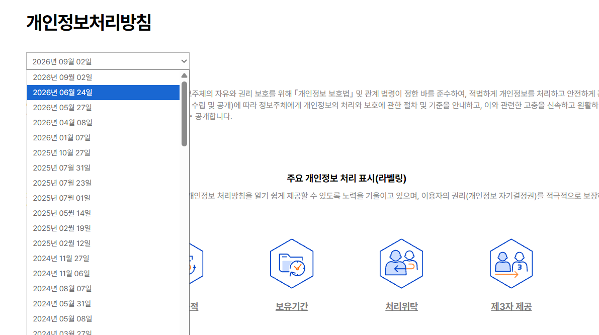  [참고] 「개인정보 처리방침 작성지침」(2026) 26쪽: 동의를 받지 않고 처리하는 개인정보 항목 작성 예시 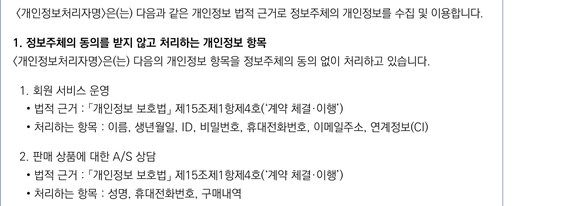 |
| 담당부서(수행 주체) | IT팀 |
| 수행 시기 | 2027.03(단기) |
| 관련 법령 및 문서 | - 「개인정보 보호법」 제22조(동의를 받는 방법), 제26조(업무위탁에 따른 개인정보의 처리 제한), 제30조(개인정보 처리방침의 수립 및 공개) - 「개인정보 보호법 시행령」 제28조(개인정보의 처리 업무 위탁 시 조치), 제31조(개인정보 처리방침의 내용 및 공개방법 등) - 「표준 개인정보 보호지침」 제21조(개인정보 처리방침의 변경) |

## 6. 마케팅 개인정보 이용 시 보호조치 강화

| 개선과제명 | 6. 마케팅 개인정보 이용 시 보호조치 강화 |
|---|---|
| 순번 | 6 |
| 관련 평가항목 | 3.3.3, 3.3.4 |
| 법적 요건 | 필수 사항 |
| 과제 상세 내용 | ○ 발송 대상과 수신 동의 개선(3.3.3, IT팀) - 백오피스 마케팅 다운로드는 내려받는 시점에 수신 동의 상태인 회원만 추출(철회·탈퇴 회원 제외) - 수신 동의를 이메일·문자 매체별로 받고, 동의 항목에 휴대전화번호 추가 - 회원·주문정보를 마케팅 분석에 쓰려면 별도 선택 동의를 받고, 동의한 회원 정보만 이용 ○ 분석 항목 기준 마련(3.3.4, 마케팅팀) - 분석 목적별로 쓸 항목을 정한 기준표 작성(예: 구매 실적 분석은 회원번호·구매 금액·상품 분류) - 이름·연락처·주소는 분석용 추출에서 제외  [그림] 개선 후 마케팅 발송 대상 조회 화면 예시 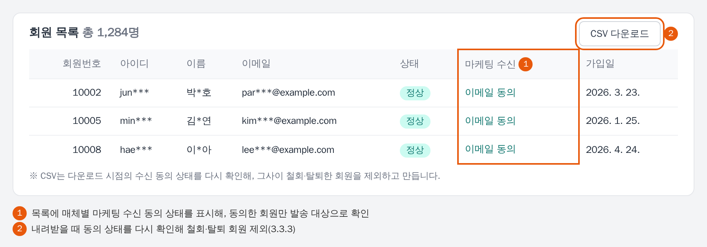  [참고] 「불법스팸 방지를 위한 정보통신망법 안내서」(7차 개정) 13쪽: 전송매체별 명시적 수신동의 예시 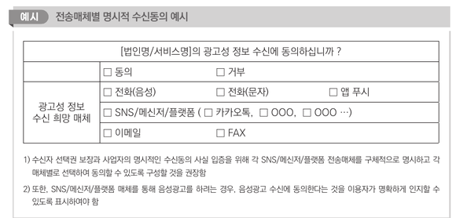 |
| 담당부서(수행 주체) | IT팀, 마케팅팀 |
| 수행 시기 | 2027.03(단기) |
| 관련 법령 및 문서 | - 「개인정보 보호법」 제3조(개인정보 보호 원칙), 제18조(개인정보의 목적 외 이용·제공 제한) - 「정보통신망 이용촉진 및 정보보호 등에 관한 법률」 제50조(영리목적의 광고성 정보 전송 제한) |

## 7. 내부 관리계획 수립·시행

| 개선과제명 | 7. 내부 관리계획 수립·시행 |
|---|---|
| 순번 | 7 |
| 관련 평가항목 | 1.2.1, 4.4.2 |
| 법적 요건 | 필수 사항 |
| 과제 상세 내용 | ○ 내부 관리계획 수립·시행(1.2.1) - 안전성 확보조치 기준 제4조제1항의 항목(보호 조직, 책임자 지정, 역할·책임, 교육, 접근 권한·접근통제, 암호화, 접속기록, 악성프로그램 방지, 취약점 점검, 물리적·출력 안전조치 등)을 모두 포함 - 대표자 승인을 거쳐 전 직원에게 공지하고, 연 1회 이상 이행 여부를 점검해 개정 ○ 접속기록 점검 기준 명시(4.4.2) - 주기: 탐지는 5분마다 자동, 담당자 검토는 매일, 종합 점검은 월 1회 - 방법: 접속기록 점검 시스템의 탐지 결과(대량 다운로드, 업무 시간 외 접속 등) 검토 - 담당: 개인정보를 처리하는 부서가 아닌 정보보호 담당자 - 사후조치: 소명 요청 → 소명 검토 → 부적정하면 경위 확인·권한 회수·보고  [참고] 「개인정보의 안전성 확보조치 기준 안내서」(2025.11) 37~38쪽: 개인정보 내부 관리계획 목차 예시 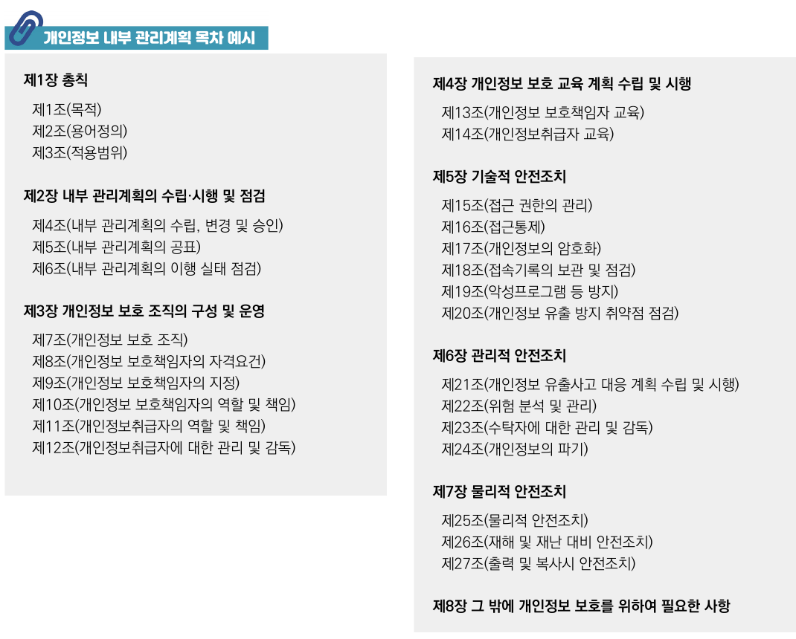  [참고] 「개인정보의 안전성 확보조치 기준 안내서」(2025.11) 94쪽: 접속기록 점검 주기·방법·사후조치 예시 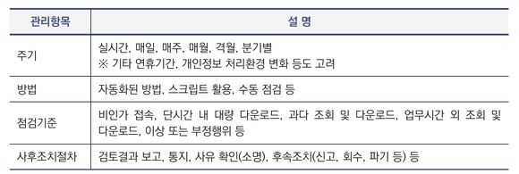 |
| 담당부서(수행 주체) | IT팀 |
| 수행 시기 | 2027.03(단기) |
| 관련 법령 및 문서 | - 「개인정보 보호법」 제29조(안전조치의무) - 「개인정보의 안전성 확보조치 기준」 제4조(내부 관리계획의 수립·시행 및 점검), 제8조(접속기록의 보관 및 점검) |

## 8. 정보주체 권리 보장 절차 마련

| 개선과제명 | 8. 정보주체 권리 보장 절차 마련 |
|---|---|
| 순번 | 8 |
| 관련 평가항목 | 1.4.1, 1.4.2 |
| 법적 요건 | 필수 사항 |
| 과제 상세 내용 | ○ 권리 요구 처리절차(1.4.1) - 마이페이지에서 처리할 수 없는 요구는 고충 처리 부서가 접수하고 본인 여부 확인 - 열람·정정·삭제·처리정지 요구는 접수 후 10일 이내 처리하고 결과 통지 - 접수일·요구 유형·처리 결과·통지일을 관리대장에 기록 - 법령상 보존 의무가 있는 거래 기록의 삭제 요구 등 거절 사유를 미리 정해 둠 ○ 이의제기 절차(1.4.2) - 거절·제한 통지에 사유와 이의제기 방법(접수처·기한)을 함께 안내 - 이의제기는 정보보호 담당자가 재검토해 결과를 통지하고, 이 절차를 처리방침에도 공개  [참고] 공공기관 개인정보 처리방침의 정보주체 권리 행사 절차 예시 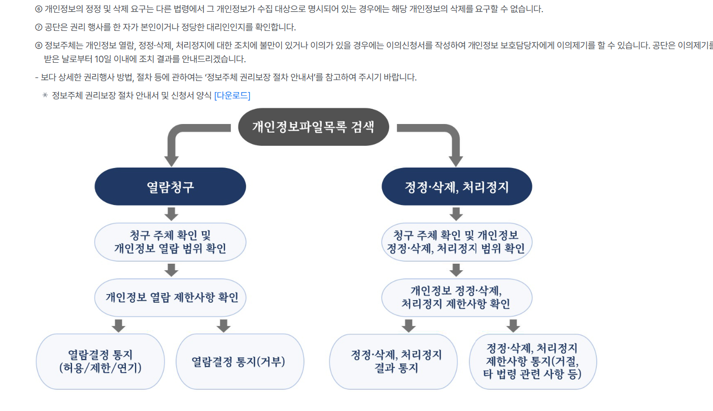 |
| 담당부서(수행 주체) | 커머스운영팀 |
| 수행 시기 | 2027.03(단기) |
| 관련 법령 및 문서 | - 「개인정보 보호법」 제35조(개인정보의 열람), 제36조(개인정보의 정정·삭제), 제37조(개인정보의 처리정지 등), 제38조(권리행사의 방법 및 절차) - 「개인정보 보호법 시행령」 제41조(개인정보의 열람절차 등), 제42조(개인정보 열람의 제한·연기 및 거절), 제43조(개인정보의 정정·삭제 등), 제44조(개인정보의 처리정지 등) |

## 9. 접근권한 관리 절차 마련

| 개선과제명 | 9. 접근권한 관리 절차 마련 |
|---|---|
| 순번 | 9 |
| 관련 평가항목 | 4.1.9, 4.1.10 |
| 법적 요건 | 필수 사항 |
| 과제 상세 내용 | ○ 인사 변동 시 권한 변경·말소(4.1.9) - 전보·퇴직이 정해지면 부서장이 바로 IT팀에 알리고, IT팀은 당일 권한을 변경·말소 - IT팀은 월 1회 관리자 계정 목록과 재직·소속 현황을 대조해 누락 확인 ○ 권한 요청·승인(4.1.10) - 권한 신청(대상·역할·사유) → 신청자 부서장 승인 → IT팀 부여 순서로 처리 - 신청자·승인자·발급자·사유·일시를 기존 권한 이력에 함께 기록하고 3년 이상 보관  [그림] 권한 변경·말소 및 요청·승인 절차 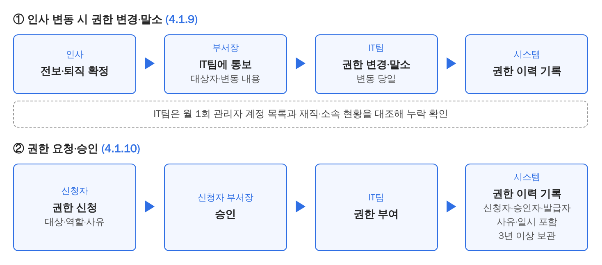 |
| 담당부서(수행 주체) | IT팀 |
| 수행 시기 | 2027.03(단기) |
| 관련 법령 및 문서 | - 「개인정보 보호법」 제29조(안전조치의무) - 「개인정보의 안전성 확보조치 기준」 제5조(접근 권한의 관리) |

## 10. 업무별 접근 권한 분리

| 개선과제명 | 10. 업무별 접근 권한 분리 |
|---|---|
| 순번 | 10 |
| 관련 평가항목 | 4.1.11, 3.5.2 |
| 법적 요건 | 필수 사항 |
| 과제 상세 내용 | ○ 화면·DB 직접접근 권한 조정(4.1.11) - 마케팅팀 계정의 회원 상세에서 환불계좌 항목을 숨김 - DB 직접접근은 IT팀 계정만 접속 토큰을 발급받을 수 있도록 제한 ○ 업무별 DB 계정 분리(4.1.11, 3.5.2) - 하나로 쓰던 DB 계정을 용도별로 나누고, 계정마다 필요한 테이블 권한만 부여 - 별도 보존 테이블은 전용 계정으로만 조회하고, 다른 계정의 조회 권한은 회수  [그림] 업무별 DB 계정 구성(안) 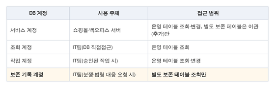 |
| 담당부서(수행 주체) | IT팀 |
| 수행 시기 | 2027.06(중기) |
| 관련 법령 및 문서 | - 「개인정보 보호법」 제21조(개인정보의 파기), 제29조(안전조치의무) - 「개인정보의 안전성 확보조치 기준」 제5조(접근 권한의 관리) |

## 11. 개인정보취급자 인증 강화

| 개선과제명 | 11. 개인정보취급자 인증 강화 |
|---|---|
| 순번 | 11 |
| 관련 평가항목 | 4.1.3, 4.1.5, 4.2.2 |
| 법적 요건 | 필수 사항 |
| 과제 상세 내용 | ○ DB 직접접근(4.1.3) - 접속 토큰을 발급할 때 OTP(시간 기반 일회용 비밀번호)로 한 번 더 확인 ○ 대량 처리 취급자(4.1.5) - 회원 다운로드 권한이 있는 계정은 백오피스 로그인 때 OTP 추가 확인 ○ 외부 접속(4.2.2) - 외부에서는 VPN을 거쳐서만 접속하게 하고, VPN 로그인에도 OTP 적용 - OTP는 IT팀 확인 후 등록하고, 기기를 잃어버리면 즉시 해제  [참고] 「개인정보의 안전성 확보조치 기준 안내서」(2025.11) 68쪽: 안전한 인증수단의 예시 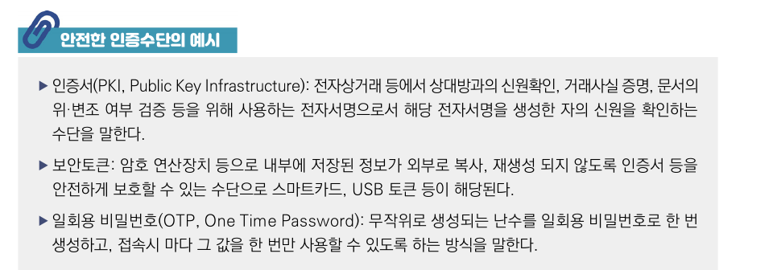 |
| 담당부서(수행 주체) | IT팀 |
| 수행 시기 | 2027.06(중기) |
| 관련 법령 및 문서 | - 「개인정보 보호법」 제29조(안전조치의무) - 「개인정보의 안전성 확보조치 기준」 제5조(접근 권한의 관리), 제6조(접근통제) |

## 12. 화면·출력 개인정보 최소화와 노출 방지

| 개선과제명 | 12. 화면·출력 개인정보 최소화와 노출 방지 |
|---|---|
| 순번 | 12 |
| 관련 평가항목 | 4.8.4, 4.8.2 |
| 법적 요건 | 필수·권고 |
| 과제 상세 내용 | ○ 출력 항목 최소화(4.8.4) - 부서·용도별 출력 항목을 정함(예: 배송 처리는 받는 사람·연락처·주소, 마케팅 발송은 이름·수신 동의한 연락처) - 회원 CSV도 용도를 고르면 그 용도에 필요한 항목만 출력 ○ 화면 표시 제한과 노출 방지(4.8.2) - 회원 목록·상세, 주문 상세에 마스킹 적용: 이름 가운데 글자(홍*동), 휴대전화 가운데 4자리(010-****-5678), 상세주소 - 전체 보기가 필요하면 버튼으로 해제하고 접속기록에 남김 - 개인정보 화면은 브라우저 캐시에 저장하지 않게 하고(Cache-Control: no-store), 우클릭·복사 제한 |
| 담당부서(수행 주체) | IT팀 |
| 수행 시기 | 2027.06(중기) |
| 관련 법령 및 문서 | - 「개인정보 보호법」 제29조(안전조치의무) - 「개인정보의 안전성 확보조치 기준」 제12조(출력·복사시 안전조치) |

## 13. 개인정보 파일·전송 구간 암호화

| 개선과제명 | 13. 개인정보 파일·전송 구간 암호화 |
|---|---|
| 순번 | 13 |
| 관련 평가항목 | 4.3.2, 4.3.5 |
| 법적 요건 | 필수 사항 |
| 과제 상세 내용 | ○ 내려받는 파일 암호화(4.3.2) - 회원 CSV·분석용 추출 파일은 비밀번호를 건 압축 파일(AES-256)로 내려받게 변경 - 파일 비밀번호는 다운로드할 때 취급자가 직접 정하고(영문·숫자·특수문자 8자리 이상), 시스템에 저장하지 않음 ○ 연계 구간 암호화(4.3.5) - PG사·택배사와 주고받는 구간은 HTTPS(TLS 1.2 이상)만 허용하고 상대 서버 인증서를 검증 - 암호화되지 않은 요청(HTTP)은 거부  [참고] 「개인정보의 안전성 확보조치 기준 안내서」(2025.11) 83쪽: 사용을 권장하는 안전한 암호 알고리즘 예시 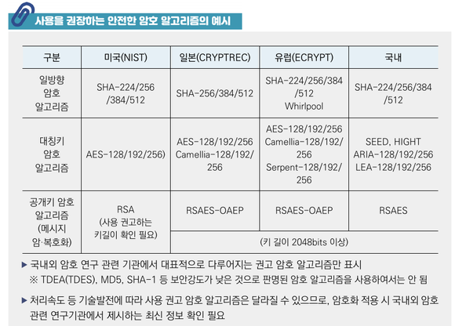 |
| 담당부서(수행 주체) | IT팀 |
| 수행 시기 | 2027.06(중기) |
| 관련 법령 및 문서 | - 「개인정보 보호법」 제29조(안전조치의무) - 「개인정보의 안전성 확보조치 기준」 제7조(개인정보의 암호화) |

## 14. 접속기록 보관 강화

| 개선과제명 | 14. 접속기록 보관 강화 |
|---|---|
| 순번 | 14 |
| 관련 평가항목 | 4.4.5 |
| 법적 요건 | 필수 사항 |
| 과제 상세 내용 | ○ 보관 기간 지정 - 정보주체가 5만 명 이상이므로 접속기록 보관 기간을 2년으로 정하고, 지난 기록은 과제 2의 파기 배치로 파기 ○ 백업 분리 보관 - 매일 암호화한 백업을 운영 서버가 아닌 별도 저장소(백업 서버 또는 외부 저장소)에 보관 - 해시체인의 마지막 해시 값을 백업과 따로 기록해, 복구할 때 위·변조 여부 확인 - 분기 1회 백업 복구 시험  [참고] 「개인정보의 안전성 확보조치 기준 안내서」(2025.11) 95쪽: 접속기록의 안전한 보관 방법 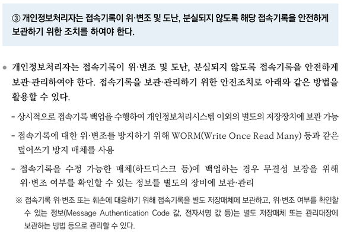 |
| 담당부서(수행 주체) | IT팀 |
| 수행 시기 | 2027.06(중기) |
| 관련 법령 및 문서 | - 「개인정보 보호법」 제29조(안전조치의무) - 「개인정보의 안전성 확보조치 기준」 제8조(접속기록의 보관 및 점검) |

## 15. 관리자 접속 통제 강화

| 개선과제명 | 15. 관리자 접속 통제 강화 |
|---|---|
| 순번 | 15 |
| 관련 평가항목 | 4.4.1, 4.1.8 |
| 법적 요건 | 필수·권고 |
| 과제 상세 내용 | ○ 서버를 거친 DB 접속 통제(4.4.1) - 서버 직접 접속(SSH)은 접근통제 서버를 거쳐서만 허용하고 접속 세션을 기록 - 서버에서 DB로 들어오는 관리자 접속을 막아, 모든 관리자 DB 접속이 접속기록이 남는 경로를 거치게 함 ○ 계정 접속 제한(4.1.8) - 90일 이상 접속하지 않은 계정은 잠금 - 업무 시간(08~20시) 외 접속은 사전 승인한 경우에만 허용 - 한 계정의 동시 접속은 1개로 제한하고, 관리자가 로그인하면 본인에게 알림  [그림] 개선 후 관리자 접속 경로 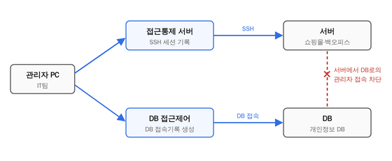 |
| 담당부서(수행 주체) | IT팀 |
| 수행 시기 | 2027.12(장기) |
| 관련 법령 및 문서 | - 「개인정보 보호법」 제29조(안전조치의무) - 「개인정보의 안전성 확보조치 기준」 제2조(정의), 제8조(접속기록의 보관 및 점검) |
