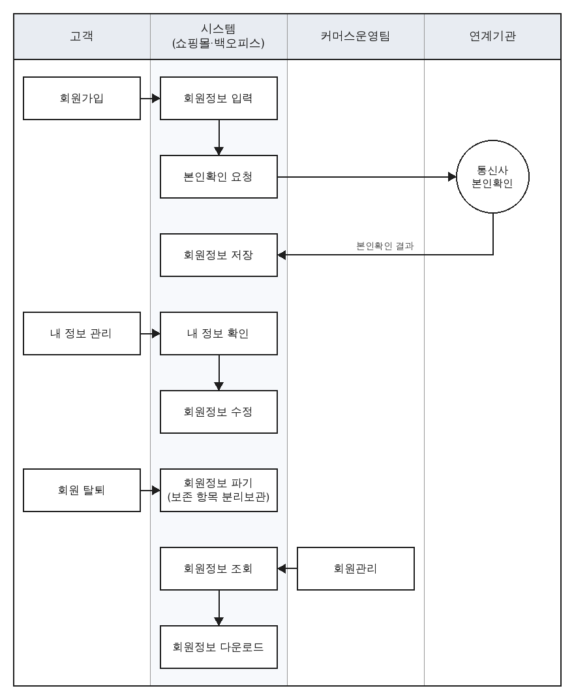
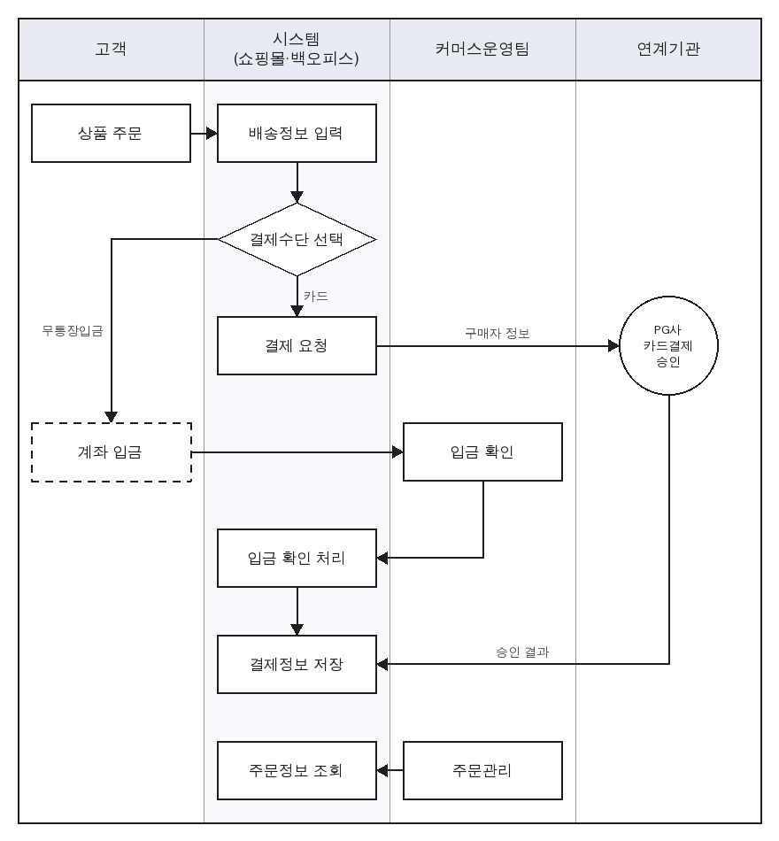
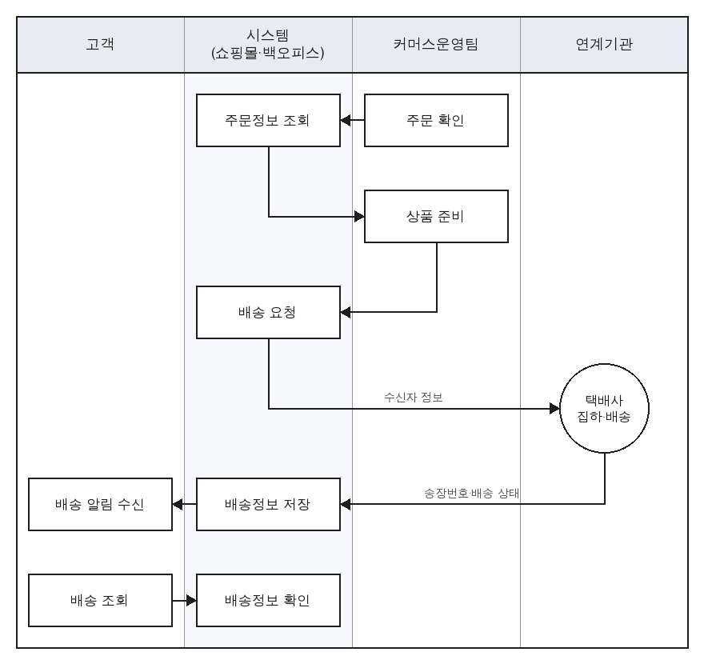
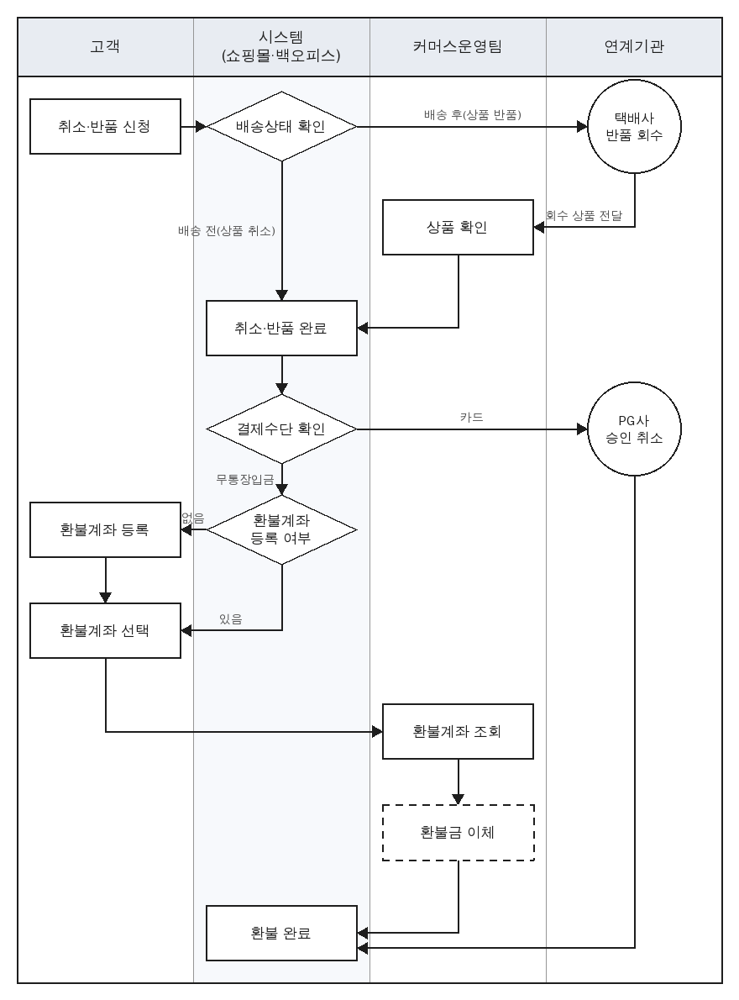
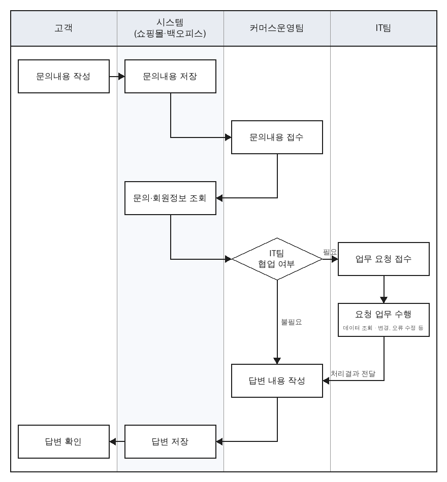
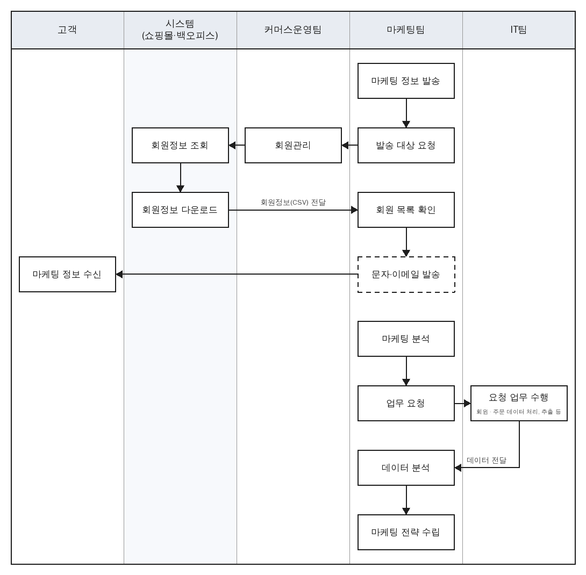
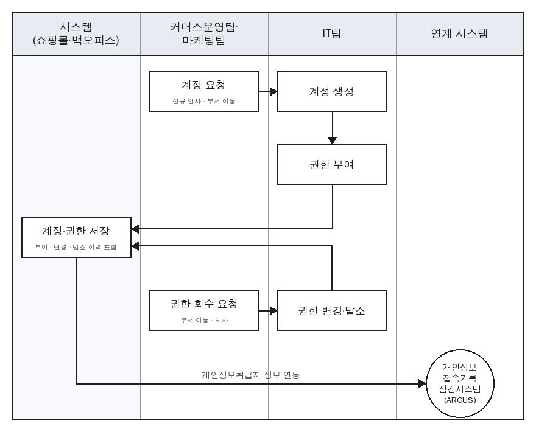
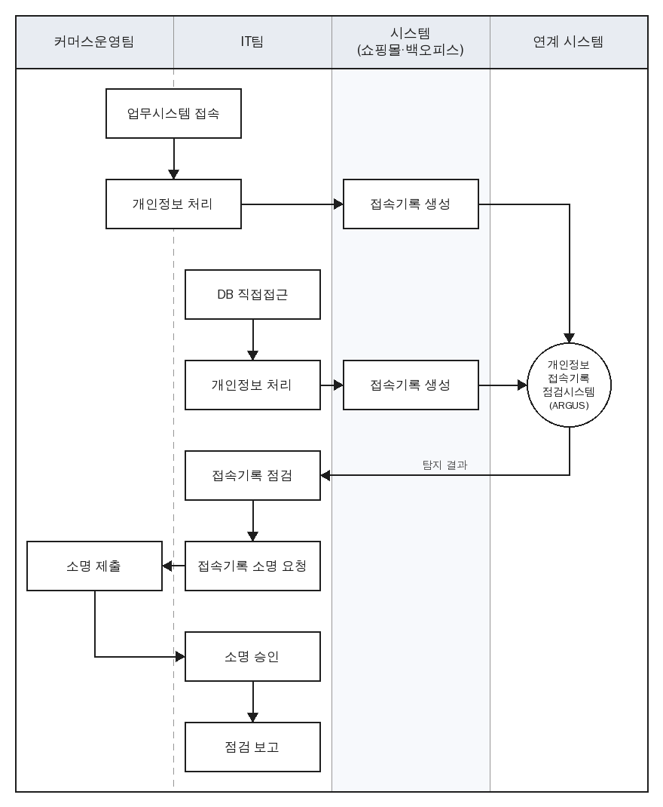

# 개인정보 처리업무 흐름도

> 안내서 3.2 개인정보 처리 업무흐름도 작성(40쪽). 개인정보 처리 업무표의 업무마다 한 장씩, 업무를 수행하는 부서와 연계기관을 함께 표시한다
> 레인은 고객, 시스템(쇼핑몰·백오피스), 부서, 연계기관 중 그 업무에 나오는 것만 둔다. 원은 연계기관, 점선 상자는 시스템 밖 처리, 마름모는 조건 분기
> 연계기관(본인확인 서비스·PG·택배사)과 ARGUS는 흐름에 표시만 하고 내부 처리는 평가하지 않는다. DB 직접접근은 IT팀이 DB 게이트웨이를 거쳐 업무 전반에 쓰며, 업무별 흐름도에는 그리지 않고 8. 접속기록 관리에 경로를 표시한다

## 1. 회원관리

고객 정보 입력·관리·탈퇴 요청은 고객이, 저장·수정·파기는 시스템이 한다. 본인확인 서비스(통신사)는 연계기관이다.

## 2. 주문·결제

카드번호는 PG 결제창에만 입력하고 시스템은 승인 결과(마스킹 카드번호 등)만 받는다. 무통장입금은 고객이 입금자명을 입력하고 안내받은 계좌로 입금하면, 커머스운영팀이 입금자명·금액을 확인해 시스템에서 입금 확인 처리한다.

## 3. 배송

결제가 완료된 주문은 커머스운영팀이 확인해 상품을 준비한 뒤 배송을 요청하고, 시스템이 택배사에 수신자 정보를 보낸다. 택배사는 수탁자(연계기관)로 수신자 성명·연락처·주소·배송 메모를 받아 집하·배송한다. 송장번호와 배송 상태는 택배사 통지로 시스템에 저장되고, 시스템이 고객에게 배송 알림을 보낸다.

## 4. 취소·반품·환불

배송 전(결제완료·상품준비중, 택배 접수 뒤면 집하 전까지)에는 고객이 바로 취소한다. 배송완료 후 7일 안에는 반품(청약철회)을 신청하면 시스템이 택배사에 회수를 요청하고, 회수 상품이 전달되면 커머스운영팀이 상품을 확인한 뒤 반품 완료가 된다. 배송중에는 취소·반품을 신청할 수 없다. 카드 결제는 PG사 승인 취소로 환불이 끝난다. 무통장입금은 고객이 고른 환불계좌(없으면 마이페이지에서 등록)로 커머스운영팀이 시스템 밖에서 이체한 뒤 환불 완료한다.

## 5. 고객 상담

고객이 남긴 문의를 커머스운영팀이 접수해 문의내용과 회원정보를 조회한 뒤 답변한다. 데이터 조회·변경이나 오류 수정처럼 IT팀과 협업이 필요하면 IT팀에 업무를 요청하고, IT팀이 처리한 결과를 받아 답변한다. IT팀의 DB 직접접근은 접속기록으로 남고, ARGUS에서 접근 사유를 소명할 때 해당 1:1 문의를 근거로 첨부한다.

## 6. 마케팅

발송 기능은 시스템에 없어 마케팅팀이 커머스운영팀에 발송 대상을 요청해 회원정보(CSV)를 받고, 문자·이메일로 개별 발송한다. 회원 CSV에는 수신 동의 여부 열이 없다. 마케팅 분석에 필요한 회원·주문정보는 마케팅팀이 IT팀에 요청해 받는다.

## 7. 계정·권한 관리

신규 입사·부서 이동 때 소속 부서가 IT팀에 계정을 요청하면, IT팀이 백오피스 계정·권한 화면에서 계정을 만들고 권한(역할)을 부여한다. 부서 이동·퇴사 때는 권한을 변경하거나 말소한다. 부여·변경·말소는 사유와 함께 권한 이력으로 남고, 개인정보취급자 정보(아이디·이름·소속·재직상태·퇴직시각)는 ARGUS로 연동된다. 계정은 사번을 아이디로 쓰고, 취급자는 첫 로그인 때 임시 비밀번호를 바꾼다.

## 8. 접속기록 관리

커머스운영팀과 IT팀은 업무시스템(쇼핑몰·백오피스)에 접속해 개인정보를 처리하고, IT팀은 DB 게이트웨이를 거쳐 DB에 직접 접근하기도 한다. 업무시스템 처리 기록은 시스템이, DB 직접접근 기록은 DB 게이트웨이가 만들어 ARGUS로 보낸다. IT팀이 ARGUS에서 접속기록을 점검하고, 비정상 행위로 탐지된 건은 해당 취급자에게 소명을 요청한다. 취급자가 ARGUS에서 소명을 제출하면 IT팀이 검토해 승인하거나, 부족하면 반려해 다시 소명을 요청한다. 승인된 건까지 모아 점검 결과를 보고한다. ARGUS는 연계 시스템으로 내부 처리는 평가하지 않는다.
