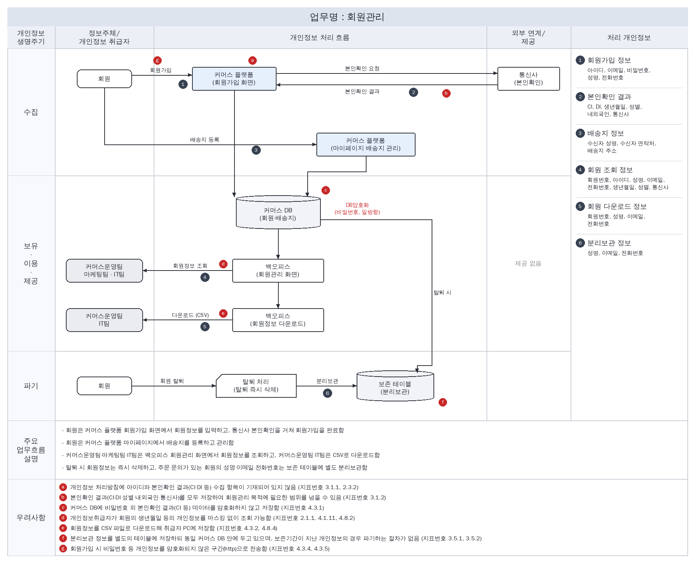

# 개인정보 흐름도

> 안내서 3.4 개인정보 흐름도 작성(49~54쪽). 개인정보 흐름표를 바탕으로 업무별 개인정보 흐름도를 그리고, 이어서 시스템 전체의 총괄 개인정보 흐름도를 그립니다
> 범례: 흰색 도형은 정보주체, 회색 도형은 개인정보취급자, 하늘색 상자는 외부 인터넷에서 접속하는 시스템, 원통은 DB. 실선은 온라인, 점선은 오프라인, 붉은 굵은 선은 암호화 구간. 검은 원 번호는 오른쪽 처리 개인정보, 붉은 원 기호는 우려사항 발생 위치입니다
> 접속 구간은 현재 운영 환경(http) 기준입니다. 우려사항은 흐름분석 단계에서 본 예상 문제점이며, 침해요인 분석에서 관련 지표로 점검해 확정합니다

## 업무별 개인정보 흐름도

### 1. 회원관리

