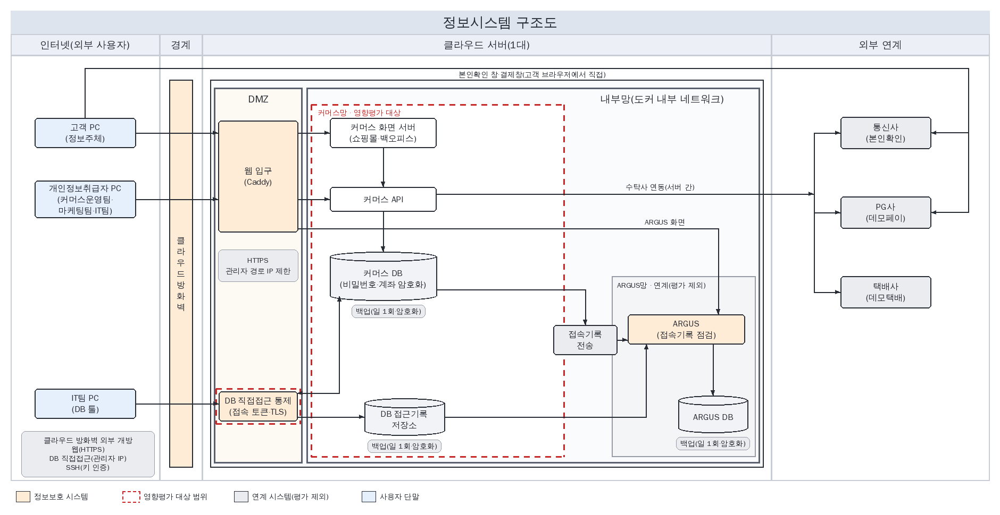

# 정보시스템 구조도 및 정보보호 시스템 목록

> 안내서 정보시스템 구조도 및 정보보호 시스템 목록 작성(3.5, 55~56쪽)
> 실제 배포는 진행되지 않았으며 설계안을 기준으로 작성했습니다.

## 정보시스템 구조도

## 정보보호 시스템 목록

원본: [xlsx](정보보호_시스템_목록.xlsx)

| 유형 | 적용 솔루션명 | 목적 및 용도 | 적용 대상 | 본 사업 범위 여부 |
|---|---|---|---|---|
| 방화벽 | 클라우드 방화벽 | 외부 접근 통제(웹, DB 직접접근, 서버 관리 접속만 개방) DB 직접접근은 관리자 허용 IP만 허용 | 클라우드 서버 전체 | 신규 |
| 웹 접근통제 | Caddy | 웹 구간 암호화(HTTPS) 관리자 경로 허용 IP 제한 | 쇼핑몰·백오피스, ARGUS | 신규 |
| DB 접근제어 | DB 직접접근 통제(자체 개발) | DB 직접접근 시 개인별 접속 토큰 인증·암호화 접속 DB 직접접근 접속기록 생성 | 커머스 DB | 신규 |
| 접속기록 관리 | ARGUS(자체 개발) | 개인정보 접속기록 보관·위변조 방지 이상행위 탐지 및 소명 관리 | 백오피스, 커머스 DB | 신규 |
| DB 암호화 | 응용프로그램 암호화(API 방식) 비밀번호: argon2id 환불계좌: AES-256-GCM | 비밀번호 일방향 암호화 환불계좌 양방향 암호화 | 커머스 DB(회원정보, 환불계좌) | 신규 |
