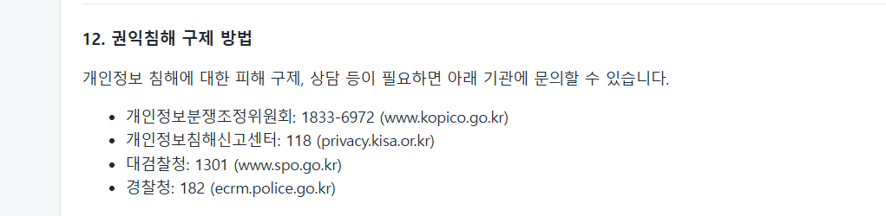

# 현황파악 — 1.3 개인정보 침해대응

> 안내서 현황파악(4.2, 61~64쪽)의 평가항목별 결과 양식으로 작성했습니다. 평가자료(처리방침·설계 문서)와 흐름분석 산출물, 시스템 담당자 인터뷰·실사로 판정했습니다
> 확인: 이행 / 부분이행 / 미이행. 해당 없음 지표(1.3.2)는 [평가항목](평가항목.md)에 사유가 있습니다

## 1.3.1

| 구분 | 내용 |
|---|---|
| 질의문 코드 | 1.3.1 |
| 질의문 | 개인정보 침해사실을 신고할 수 있는 방법을 정보주체에게 안내하고 있습니까? |
| 확인 | 이행 |
| 평가 근거 및 의견 | - 처리방침에 개인정보침해신고센터·개인정보분쟁조정위원회 등 침해 신고·상담 기관과 연락처를 안내함  [증적] 개인정보 처리방침 권익침해 구제 방법  |
| 항목 설명 | ○ 침해 사실을 신고할 수 있는 방법을 처리방침 등으로 정보주체가 쉽게 확인할 수 있게 안내함 |
| 평가 예시 | ○ 이행: 처리방침 등에 침해 신고 기관과 방법을 안내한 경우 ○ 부분이행: 신고 방법을 안내하나 일부 기관·연락처가 빠지거나 찾기 어려운 경우 |
| 관련 법령 및 문서 | 개인정보 보호법 제30조제1항, 제62조 |
