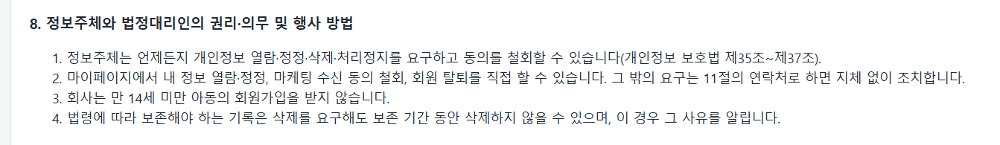

# 현황파악 — 1.4 정보주체 권리보장

> 안내서 현황파악(4.2, 61~64쪽)의 평가항목별 결과 양식으로 작성했습니다. 평가자료(처리방침·설계 문서)와 흐름분석 산출물, 시스템 담당자 인터뷰·실사로 판정했습니다
> 확인: 이행 / 부분이행 / 미이행. 해당 없음 지표(1.4.3)는 [평가항목](평가항목.md)에 사유가 있습니다

## 1.4.1

| 구분 | 내용 |
|---|---|
| 질의문 코드 | 1.4.1 |
| 질의문 | 개인정보 열람, 정정·삭제, 처리정지, 수집출처 통지 등 정보주체의 권리보장과 요구에 대한 처리절차를 수립하여 실시하고 있습니까? |
| 확인 | 부분이행 |
| 평가 근거 및 의견 | - 마이페이지에서 열람·정정·동의 철회·탈퇴를 직접 할 수 있고, 그 밖의 요구는 고충 처리 부서로 받도록 안내함 - 요구 유형별 처리 절차·관리대장·거절 기준 등 내부 처리절차가 없음  [증적] 개인정보 처리방침 권리 행사 방법  |
| 항목 설명 | ○ 열람·정정·삭제·처리정지·동의 철회 요구의 처리절차를 정하고, 수집 방법만큼 쉬운 행사 방법을 제공함 |
| 평가 예시 | ○ 이행: 요구 유형별 처리절차와 간편한 행사 방법을 모두 갖춘 경우 ○ 부분이행: 행사 방법은 제공하나 처리절차 일부가 없는 경우 |
| 관련 법령 및 문서 | 개인정보 보호법 제35조~제38조, 개인정보 보호법 시행령 제41조~제46조 |

## 1.4.2

| 구분 | 내용 |
|---|---|
| 질의문 코드 | 1.4.2 |
| 질의문 | 정보주체의 요구에 대한 조치에 불복이 있는 경우 이의를 제기할 수 있도록 필요한 절차를 마련하고 안내하고 있습니까? |
| 확인 | 미이행 |
| 평가 근거 및 의견 | - 삭제 요구를 거절할 때 사유만 알리고, 이의제기 절차와 방법은 마련·안내하지 않음  [증적] 개인정보 처리방침 권리 행사 방법  |
| 항목 설명 | ○ 요구에 대한 조치에 불복할 때 이의를 제기할 절차를 마련하고, 처리 결과를 알릴 때 그 방법을 함께 안내함 |
| 평가 예시 | ○ 이행: 이의제기 절차를 마련하고 처리 결과 통지 때 방법을 안내한 경우 ○ 부분이행: 이의제기 절차는 있으나 안내가 빠진 경우 |
| 관련 법령 및 문서 | 개인정보 보호법 제38조제5항, 개인정보 보호법 시행령 제42조제2항 |
