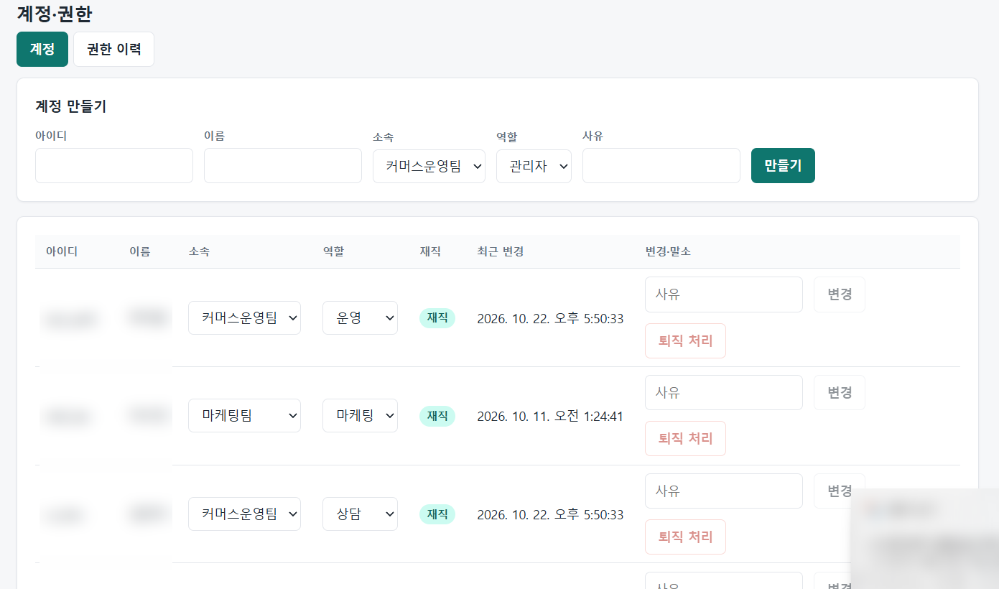

# 현황파악 — 2.1 개인정보취급자 관리

> 안내서 현황파악(4.2, 61~64쪽)의 평가항목별 결과 양식으로 작성했습니다. 평가자료(처리방침·설계 문서)와 흐름분석 산출물, 시스템 담당자 인터뷰·실사로 판정했습니다
> 확인: 이행 / 부분이행 / 미이행. 해당 없음 지표(2.1.2)는 [평가항목](평가항목.md)에 사유가 있습니다
> 역할별 접근 권한이 최소한인지는 4.1에서 판정합니다

## 2.1.1

| 구분 | 내용 |
|---|---|
| 질의문 코드 | 2.1.1 |
| 질의문 | 대상시스템에 대해 업무상 개인정보 취급 범위를 최소한으로 제한하고 업무수행에 필요한 최소한의 인원이 개인정보를 처리하도록 개인정보 취급자 지정을 계획하고 있습니까? |
| 확인 | 이행 |
| 평가 근거 및 의견 | - 부서·역할별로 처리할 수 있는 업무 범위를 정해 개인정보취급자를 지정함 - 백오피스 계정 목록으로 개인정보취급자(아이디·성명·소속·역할·재직 상태)를 관리함  [증적] 백오피스 계정·권한 화면  |
| 항목 설명 | ○ 업무상 필요한 최소 인원·범위로 개인정보취급자를 지정하는 기준을 두고, 취급자를 목록으로 관리함 |
| 평가 예시 | ○ 이행: 지정 기준에 따라 취급자를 지정하고 모든 취급자를 목록으로 관리한 경우 ○ 부분이행: 취급자 목록은 있으나 지정 기준이 없거나 일부 취급자가 목록에서 빠진 경우 |
| 관련 법령 및 문서 | 개인정보 보호법 제28조제1항, 표준 개인정보 보호지침 제15조제1항 |
