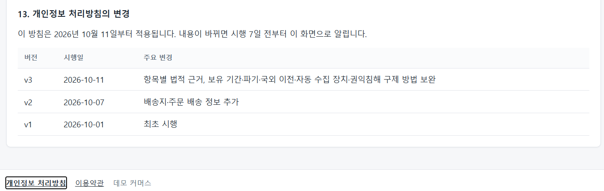
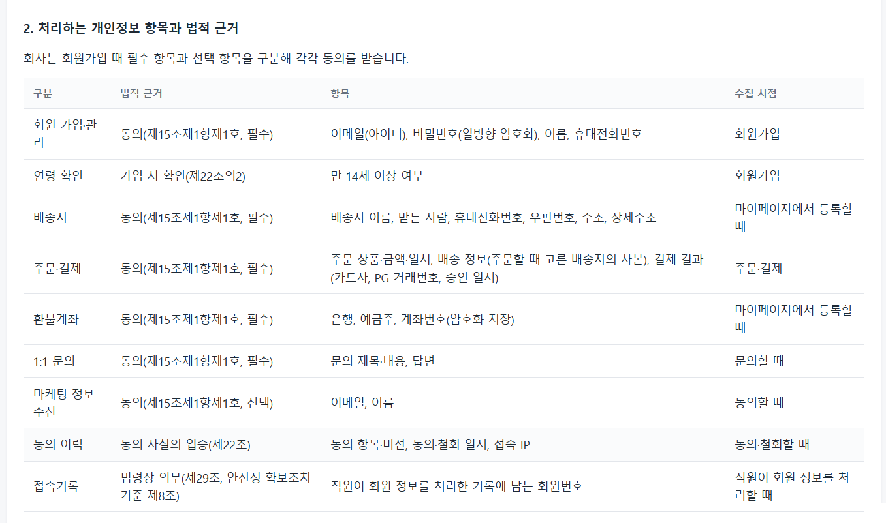
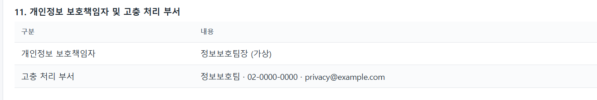

# 현황파악 — 2.3 개인정보처리방침

> 안내서 현황파악(4.2, 61~64쪽)의 평가항목별 결과 양식으로 작성했습니다. 평가자료(처리방침·설계 문서)와 흐름분석 산출물, 시스템 담당자 인터뷰·실사로 판정했습니다
> 확인: 이행 / 부분이행 / 미이행
> 위탁 사실 공개는 3.4.1에서 판정합니다

## 2.3.1

| 구분 | 내용 |
|---|---|
| 질의문 코드 | 2.3.1 |
| 질의문 | 대상시스템에 대한 개인정보 처리방침을 수립하거나 변경하는 경우에는 인터넷 홈페이지·관보 등에 정보주체가 알기 쉽게 확인할 수 있는 방법으로 안내하도록 계획하고 있습니까? |
| 확인 | 부분이행 |
| 평가 근거 및 의견 | - 고객 화면 하단에 "개인정보 처리방침"을 굵게 표시해 게시하고, 버전별 시행일과 주요 변경 내용을 공개함 - 이전 버전 내용을 볼 수 없어 변경 전·후를 비교할 수 없음  [증적] 개인정보 처리방침 변경 이력과 화면 하단 링크  |
| 항목 설명 | ○ 처리방침을 홈페이지에 다른 고지와 구분되게 게시하고, 변경 시 시행 시기와 변경 전·후 내용을 공개함 |
| 평가 예시 | ○ 이행: 처리방침을 구분되게 게시하고 변경 이력과 이전 내용을 공개한 경우 ○ 부분이행: 게시는 하나 변경 전·후 비교나 이전 내용 공개가 없는 경우 |
| 관련 법령 및 문서 | 개인정보 보호법 제30조제2항, 개인정보 보호법 시행령 제31조제2항·제3항, 표준 개인정보 보호지침 제21조 |

## 2.3.2

| 구분 | 내용 |
|---|---|
| 질의문 코드 | 2.3.2 |
| 질의문 | 대상시스템의 개인정보 처리방침은 법령 등에 따라 포함하여야 할 사항을 적정하게 정하고, 알기 쉽게 작성하며 정보주체가 쉽게 확인할 수 있도록 계획하고 있습니까? |
| 확인 | 부분이행 |
| 평가 근거 및 의견 | - 법령에서 정한 기재 사항을 모두 갖춤 - 아이디·본인확인 결과·결제·송장 정보, 마케팅 문자 발송 등 일부 처리 항목과 목적이 빠져 있음 - 고충 처리 부서를 실제 운영하지 않는 부서로 적음  [증적] 개인정보 처리방침 처리 항목과 법적 근거   [증적] 개인정보 처리방침 보호책임자·고충 처리 부서  |
| 항목 설명 | ○ 법령에서 정한 기재 사항을 모두 담고, 처리 항목·목적 등을 오류나 누락 없이 알기 쉽게 작성함 |
| 평가 예시 | ○ 이행: 기재 사항을 모두 담고 실제 처리와 일치하게 작성한 경우 ○ 부분이행: 기재 사항은 갖췄으나 일부 내용이 실제 처리와 다르거나 빠진 경우 |
| 관련 법령 및 문서 | 개인정보 보호법 제30조제1항, 개인정보 보호법 시행령 제31조제1항 |
