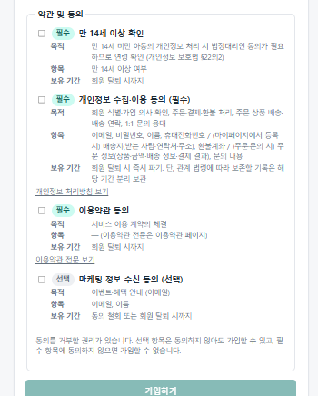
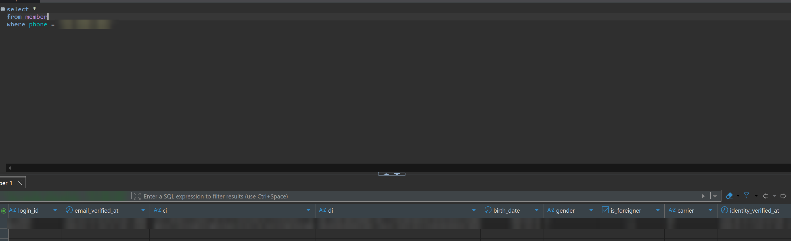
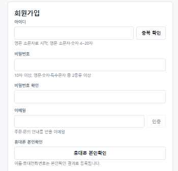
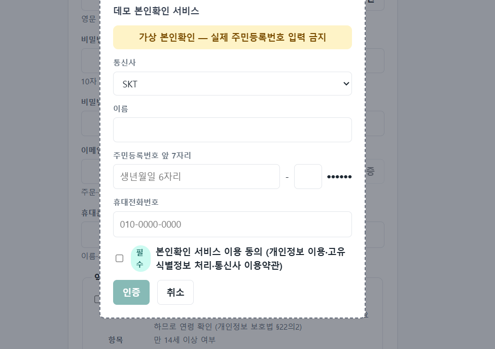
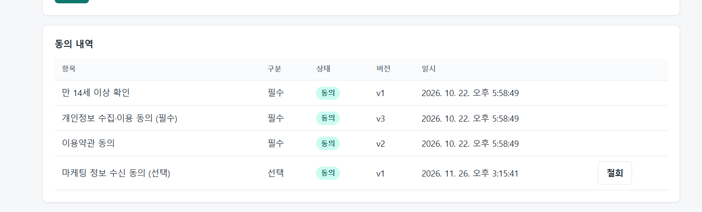
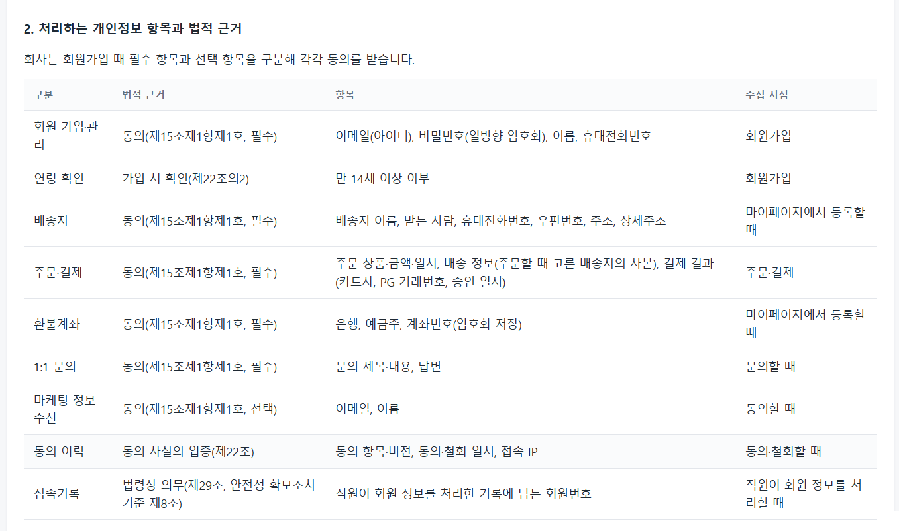

# 현황파악 — 3.1 수집

> 안내서 현황파악(4.2, 61~64쪽)의 평가항목별 결과 양식으로 작성했습니다. 평가자료(처리방침·설계 문서)와 흐름분석 산출물, 시스템 담당자 인터뷰·실사로 판정했습니다
> 확인: 이행 / 부분이행 / 미이행. 해당 없음 지표(3.1.3·3.1.4·3.1.7·3.1.10)는 [평가항목](평가항목.md)에 사유가 있습니다
> 처리방침에 적을 항목이 빠진 문제 전반은 2.3 처리방침 분야에서 판정하고, 여기서는 수집 근거와 동의 방법만 봅니다

## 3.1.1

| 구분 | 내용 |
|---|---|
| 질의문 코드 | 3.1.1 |
| 질의문 | 개인정보를 수집하는 경우 정보주체의 동의를 받거나, 법령 등에 따라 적법하게 수집하도록 계획하고 있습니까? |
| 확인 | 부분이행 |
| 평가 근거 및 의견 | - 수집 경로마다 적법 근거(동의, 계약 이행, 법령상 의무)가 있고, 동의를 받을 때 목적·항목·보유 기간·거부 권리와 불이익을 모두 알림 - 회원가입 때 저장하는 본인확인 결과(CI·DI·생년월일·성별·내외국인·통신사)가 동의 항목에 없어 수집 근거가 없음(본인확인 동의는 통신사 본인확인 창에서만 받음)  [증적] 회원가입 동의 화면  |
| 항목 설명 | ○ 동의, 계약 이행, 법령상 의무 등 적법한 근거가 있을 때만 수집하고, 동의를 받을 때는 목적·항목·보유 기간·거부 권리를 알려야 함 |
| 평가 예시 | ○ 이행: 수집 경로마다 적법 근거가 있고, 동의를 받을 때 고지 사항 4가지를 모두 알리는 경우 ○ 부분이행: 적법 근거나 동의 고지 사항이 일부 수집 항목·경로에서 빠진 경우 |
| 관련 법령 및 문서 | 개인정보 보호법 제15조제1항·제2항, 정보통신망법 제23조의5제4항 |

## 3.1.2

| 구분 | 내용 |
|---|---|
| 질의문 코드 | 3.1.2 |
| 질의문 | 개인정보를 수집하는 경우 목적에 필요한 최소한의 범위에서만 수집하도록 계획하고 있습니까? |
| 확인 | 부분이행 |
| 평가 근거 및 의견 | - 업무별 수집 항목은 목적에 필요한 범위이나, 본인확인 결과 중 DI·성별·내외국인·통신사는 처리 목적 없이 저장하고, 생년월일은 연령 확인 뒤에도 계속 보관함  [증적] 회원 테이블 본인확인 결과 저장  |
| 항목 설명 | ○ 목적에 필요한 최소한의 개인정보만 수집하고, 최소한이라는 입증 책임은 처리자에게 있음 |
| 평가 예시 | ○ 이행: 수집 항목마다 처리 목적이 있고 목적에 필요한 범위를 넘는 항목이 없는 경우 ○ 부분이행: 일부 수집 항목의 처리 목적이 없거나 필요한 범위를 넘는 경우 |
| 관련 법령 및 문서 | 개인정보 보호법 제3조제1항, 제16조제1항·제2항·제3항 |

## 3.1.5

| 구분 | 내용 |
|---|---|
| 질의문 코드 | 3.1.5 |
| 질의문 | 주민등록번호는 법적 근거가 있는 경우에 한하여 처리하고 있으며, 인터넷 홈페이지에 대해서는 주민등록번호를 사용하지 아니하고도 회원으로 가입할 수 있도록 계획하고 있습니까? |
| 확인 | 이행 |
| 평가 근거 및 의견 | - 회원가입 때 주민등록번호를 받지 않고 휴대폰 본인확인으로 가입하며, 주민등록번호 앞 7자리는 통신사 본인확인 창에서만 입력함 - 회원·개인정보취급자 정보 어디에도 주민등록번호를 저장하지 않음  [증적] 회원가입 입력 화면   [증적] 통신사 본인확인 창  |
| 항목 설명 | ○ 주민등록번호는 법적 근거가 있을 때만 처리하고, 회원가입은 휴대폰 본인확인 등 대체수단으로 할 수 있어야 함 |
| 평가 예시 | ○ 이행: 법적 근거 없이 주민등록번호를 처리하지 않고, 대체수단으로 회원가입을 받는 경우 ○ 부분이행: 대체수단을 제공하나 일부 가입·처리 경로에서 법적 근거 없이 주민등록번호를 받는 경우 |
| 관련 법령 및 문서 | 개인정보 보호법 제24조의2제1항·제2항, 정보통신망법 제23조의2 |

## 3.1.6

| 구분 | 내용 |
|---|---|
| 질의문 코드 | 3.1.6 |
| 질의문 | 정보주체의 동의를 받아 개인정보를 수집하는 경우 ‘정보주체의 자유로운 의사’에 따라 동의 여부를 결정할 수 있도록 계획하고 있습니까? |
| 확인 | 이행 |
| 평가 근거 및 의견 | - 동의 4개를 각각 체크하게 하고 기본 체크·전체 동의가 없으며, 선택 항목은 동의하지 않아도 가입할 수 있다고 알림 - 동의 기록(항목·버전·동의 여부·일시)이 남고, 마이페이지에서 확인·철회할 수 있음  [증적] 회원가입 동의 화면   [증적] 마이페이지 동의 내역  |
| 항목 설명 | ○ 기본 체크 없이 정보주체가 스스로 동의 여부를 정하게 하고, 동의 기록을 사후에 확인할 수 있게 보존함 |
| 평가 예시 | ○ 이행: 기본 체크 없이 동의를 받고, 선택 동의를 거부해도 서비스를 이용할 수 있으며, 동의 기록을 보존하는 경우 ○ 부분이행: 동의 절차는 갖췄으나 동의 기록이 남지 않거나 일부 동의 항목에 기본 체크가 있는 경우 |
| 관련 법령 및 문서 | 개인정보 보호법 제16조제3항, 제22조제1항·제5항 |

## 3.1.8

| 구분 | 내용 |
|---|---|
| 질의문 코드 | 3.1.8 |
| 질의문 | 개인정보 관련 동의를 서면으로 받을 때에는 중요한 내용을 명확히 표시하여 알아보기 쉽게 하고, 개인정보 수집·이용, 제3자 제공, 목적 외 이용 등에 대해 각각 구분하여 동의를 받도록 계획하고 있습니까? |
| 확인 | 부분이행 |
| 평가 근거 및 의견 | - 개인정보 수집·이용(필수)과 마케팅 정보 수신(선택) 동의를 구분해 각각 받음 - 마케팅 동의의 홍보 연락 사실(이벤트·혜택 안내)과 보유 기간을 다른 내용과 같은 글씨로 표시해 중요한 내용이 명확히 표시되지 않음  [증적] 회원가입 동의 화면  |
| 항목 설명 | ○ 동의 사항을 구분해 각각 받고, 홍보 연락 사실·보유 기간 등 중요한 내용은 글씨 색·굵기·밑줄 등으로 명확히 표시함 |
| 평가 예시 | ○ 이행: 동의 사항을 구분해 각각 받고 중요한 내용을 명확히 표시한 경우 ○ 부분이행: 동의 사항은 구분해 받으나 중요한 내용을 명확히 표시하지 않은 경우 |
| 관련 법령 및 문서 | 개인정보 보호법 제22조제1항·제2항, 개인정보 보호법 시행령 제17조제3항, 개인정보 처리 방법에 관한 고시 제4조 |

## 3.1.9

| 구분 | 내용 |
|---|---|
| 질의문 코드 | 3.1.9 |
| 질의문 | 정보주체의 동의 없이 처리할 수 있는 개인정보의 항목과 그 처리의 법적 근거를 정보주체의 동의를 받아 처리하는 개인정보와 구분하여 개인정보 처리방침에 공개하거나 서면등의 방법으로 정보주체에게 알리도록 계획하고 있습니까? |
| 확인 | 부분이행 |
| 평가 근거 및 의견 | - 처리방침에 항목별 법적 근거를 적어 접속기록·동의 이력·분리보관 기록은 동의 항목과 구분해 공개함 - 계약 이행으로 처리할 수 있는 회원·주문·배송지·환불계좌·문의 항목을 모두 "동의(필수)"로 공개해 구분하지 않고, 동의 없이 수집하는 송장번호·회수 송장번호는 공개하지 않음  [증적] 개인정보 처리방침 처리 항목과 법적 근거  |
| 항목 설명 | ○ 동의 없이 처리하는 개인정보의 항목과 근거를 동의받는 개인정보와 구분해 처리방침에 공개함 |
| 평가 예시 | ○ 이행: 동의 없이 처리하는 항목과 근거를 동의 항목과 구분해 모두 공개한 경우 ○ 부분이행: 구분해 공개하나 일부 항목·근거가 빠지거나 구분이 분명하지 않은 경우 |
| 관련 법령 및 문서 | 개인정보 보호법 제22조제3항 |
