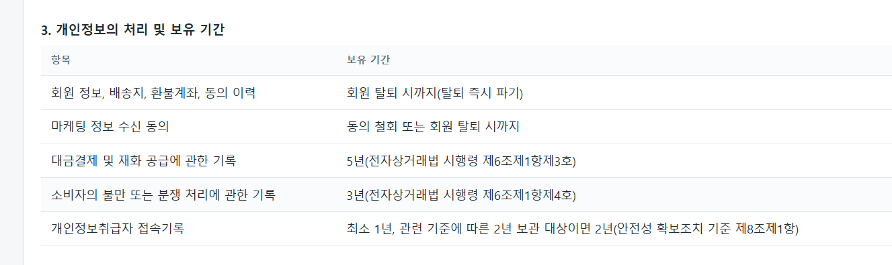
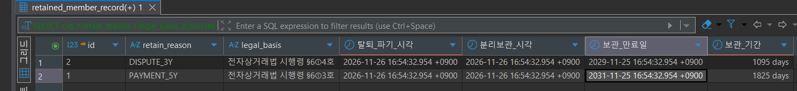

# 현황파악 — 3.2 보유

> 안내서 현황파악(4.2, 61~64쪽)의 평가항목별 결과 양식으로 작성했습니다. 평가자료(처리방침·설계 문서)와 흐름분석 산출물, 시스템 담당자 인터뷰·실사로 판정했습니다
> 확인: 이행 / 부분이행 / 미이행
> 접속기록 보관 기간은 4.4.5, 보유기간이 지난 기록의 파기는 3.5에서 판정합니다

## 3.2.1

| 구분 | 내용 |
|---|---|
| 질의문 코드 | 3.2.1 |
| 질의문 | 개인정보의 보유기간을 법령 기준 및 보유목적에 부합된 최소한의 기간으로 산정하도록 계획하고 있습니까? |
| 확인 | 부분이행 |
| 평가 근거 및 의견 | - 보유기간을 탈퇴·동의 철회 시까지, 거래·분쟁 기록은 법정 기간(5년·3년)으로 정함 - 거래·분쟁 기록의 보유기간을 거래 시점이 아닌 회원 탈퇴 시점부터 산정해, 법정 기간보다 오래 보관할 수 있음 - 환불 계좌 사본·퇴직자 계정 정보는 보유기간 없음  [증적] 개인정보 처리방침 보유 기간   [증적] 탈퇴 회원 분리보관 기록 보관 만료일  |
| 항목 설명 | ○ 개인정보파일별 보유기간을 법령 기준과 보유 목적에 맞는 최소 기간으로 정하고, 법령에 기간이 없으면 공식 절차로 정함 |
| 평가 예시 | ○ 이행: 개인정보파일마다 법령 기준이나 목적 달성 시점에 맞춰 최소 보유기간을 정한 경우 ○ 부분이행: 보유기간을 정했으나 일부 개인정보파일의 기간이 법령 기준이나 보유 목적을 넘는 경우 |
| 관련 법령 및 문서 | 개인정보 보호법 제21조제1항, 전자상거래 등에서의 소비자보호에 관한 법률 시행령 제6조제1항 |
