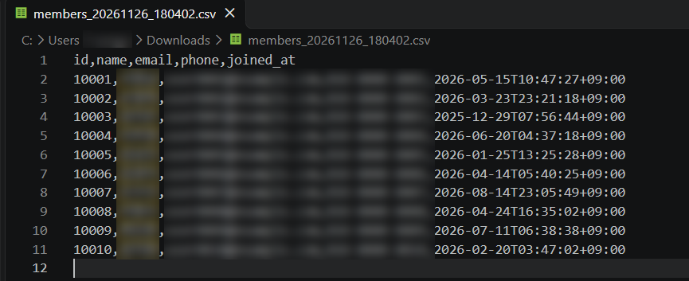
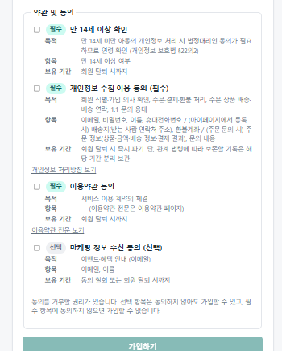

# 현황파악 — 3.3 이용·제공

> 안내서 현황파악(4.2, 61~64쪽)의 평가항목별 결과 양식으로 작성했습니다. 평가자료(처리방침·설계 문서)와 흐름분석 산출물, 시스템 담당자 인터뷰·실사로 판정했습니다
> 확인: 이행 / 부분이행 / 미이행. 해당 없음 지표(3.3.1·3.3.2·3.3.5·3.3.6·3.3.7)는 [평가항목](평가항목.md)에 사유가 있습니다

## 3.3.3

| 구분 | 내용 |
|---|---|
| 질의문 코드 | 3.3.3 |
| 질의문 | 개인정보를 목적 외의 용도로 이용하거나 이를 제3자에게 제공하는 경우, 정보주체의 별도 동의를 받거나, 법률 등에 따라 적법하게 목적외 이용‧제공하도록 계획하고 있습니까? |
| 확인 | 미이행 |
| 평가 근거 및 의견 | - 백오피스에 수신 동의 회원만 내려받는 기능이 없어, 동의하지 않은 회원에게 마케팅 정보를 발송할 수 있음 - 수신 동의 항목(성명·이메일)에 없는 전화번호로 문자를 발송함 - 마케팅 분석에 회원·주문정보를 이용하면서 별도 동의를 받지 않음  [증적] 회원 CSV 다운로드 파일   [증적] 회원가입 동의 화면  |
| 항목 설명 | ○ 수집 목적을 넘어 이용·제공할 때는 별도 동의를 받거나 법률상 근거가 있어야 함 |
| 평가 예시 | ○ 이행: 목적 외 이용·제공마다 별도 동의나 법률상 근거가 있는 경우 ○ 부분이행: 일부 목적 외 이용·제공에 별도 동의나 법률상 근거가 없는 경우 |
| 관련 법령 및 문서 | 개인정보 보호법 제18조제1항·제2항, 정보통신망법 제50조제1항 |

## 3.3.4

| 구분 | 내용 |
|---|---|
| 질의문 코드 | 3.3.4 |
| 질의문 | 개인정보를 목적 외의 용도로 이용하거나 이를 제3자에게 제공하는 경우 이용목적에 맞는 최소한의 항목으로 제한하도록 계획하고 있습니까? |
| 확인 | 부분이행 |
| 평가 근거 및 의견 | - 마케팅 발송에는 연락에 필요한 항목을 이용함 - 마케팅 분석 데이터는 요청마다 추출하며, 이용할 항목을 정해 최소화하는 기준이 없음 |
| 항목 설명 | ○ 목적 외로 이용·제공할 때는 필요한 항목을 정해 최소한으로 제한함 |
| 평가 예시 | ○ 이행: 목적 외 이용·제공 항목을 목적에 필요한 최소한으로 제한한 경우 ○ 부분이행: 일부 목적 외 이용·제공에 필요 이상의 항목이 포함된 경우 |
| 관련 법령 및 문서 | 개인정보 보호법 제3조제1항, 제18조제1항 |
