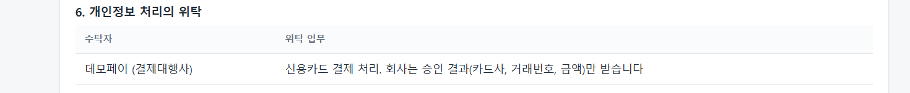

# 현황파악 — 3.4 위탁

> 안내서 현황파악(4.2, 61~64쪽)의 평가항목별 결과 양식으로 작성했습니다. 평가자료(처리방침·설계 문서)와 흐름분석 산출물, 시스템 담당자 인터뷰·실사로 판정했습니다
> 확인: 이행 / 부분이행 / 미이행. 해당 없음 지표(3.4.2·3.4.3·3.4.4)는 [평가항목](평가항목.md)에 사유가 있습니다

## 3.4.1

| 구분 | 내용 |
|---|---|
| 질의문 코드 | 3.4.1 |
| 질의문 | 개인정보 처리에 관한 업무 위탁 시 위탁하는 업무의 내용, 수탁자(개인정보 처리업무를 위탁받아 처리하는 자로부터 위탁받은 업무를 다시 위탁받은 제3자를 포함) 등의 사항을 정보주체에게 공개 또는 통지하도록 계획하고 있습니까? |
| 확인 | 부분이행 |
| 평가 근거 및 의견 | - 처리방침에 결제대행사(PG)와 카드 결제 위탁 업무를 공개함 - 배송·반품 회수를 맡는 택배사와 휴대폰 본인확인 기관은 공개하지 않음  [증적] 개인정보 처리방침 위탁  |
| 항목 설명 | ○ 위탁하는 업무의 내용과 모든 수탁자를 처리방침 등에 공개함 |
| 평가 예시 | ○ 이행: 모든 수탁자와 위탁 업무를 처리방침에 공개한 경우 ○ 부분이행: 일부 수탁자나 위탁 업무가 공개되지 않은 경우 |
| 관련 법령 및 문서 | 개인정보 보호법 제26조제2항, 개인정보 보호법 시행령 제28조제2항 |
