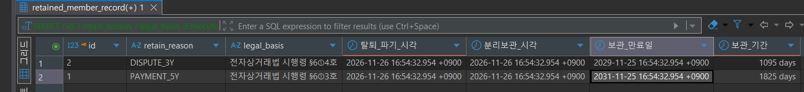

# 현황파악 — 3.5 파기

> 안내서 현황파악(4.2, 61~64쪽)의 평가항목별 결과 양식으로 작성했습니다. 평가자료(처리방침·설계 문서)와 흐름분석 산출물, 시스템 담당자 인터뷰·실사로 판정했습니다
> 확인: 이행 / 부분이행 / 미이행. 해당 없음 지표(3.5.3)는 [평가항목](평가항목.md)에 사유가 있습니다
> 파기 방법(복구·재생 불가)은 4.7.1에서 판정합니다

## 3.5.1

| 구분 | 내용 |
|---|---|
| 질의문 코드 | 3.5.1 |
| 질의문 | 개인정보의 보유 목적이 달성되었거나 보유 기간이 경과되었을 때 지체없이 파기되도록 계획하고 있습니까? |
| 확인 | 부분이행 |
| 평가 근거 및 의견 | - 회원 탈퇴 시 회원정보를 즉시 파기함 - 분리보관 기록·접속기록·권한 이력은 설계에 보존 기간이 정해져 있으나, 기간이 지난 뒤 파기하는 절차가 시스템에 반영되지 않음 - 환불이 끝난 이체 계좌 사본과 퇴직자 계정 정보는 파기 기준이 없음 |
| 항목 설명 | ○ 보유 기간이 지나거나 목적을 달성한 개인정보는 지체 없이 파기하도록 기준과 절차를 설계에 반영함 |
| 평가 예시 | ○ 이행: 개인정보파일마다 보유 기간 경과·목적 달성 시 파기하는 기준과 절차가 있는 경우 ○ 부분이행: 일부 개인정보파일에 파기 기준이나 절차가 없는 경우 |
| 관련 법령 및 문서 | 개인정보 보호법 제21조제1항, 표준 개인정보 보호지침 제10조제1항 |

## 3.5.2

| 구분 | 내용 |
|---|---|
| 질의문 코드 | 3.5.2 |
| 질의문 | 다른 법령 등에 따라 개인정보를 보존할 경우 해당 개인정보 또는 개인정보파일을 다른 개인정보와 분리하여 저장·관리하도록 계획하고 있습니까? |
| 확인 | 부분이행 |
| 평가 근거 및 의견 | - 탈퇴 회원의 법정 보존 기록을 별도 보존 테이블로 옮겨 보관함 - 운영 테이블과 같은 DB 계정으로 접근할 수 있어 접근 권한이 분리되지 않음  [증적] 탈퇴 회원 분리보관 기록  |
| 항목 설명 | ○ 법령에 따라 보존하는 개인정보는 다른 개인정보와 분리해 저장하고, 보존 목적에 필요한 경우에만 접근하도록 권한을 분리함 |
| 평가 예시 | ○ 이행: 보존 개인정보를 분리 저장하고 접근 권한을 분리한 경우 ○ 부분이행: 분리 저장하나 접근 권한 분리 등 보호조치가 미흡한 경우 |
| 관련 법령 및 문서 | 개인정보 보호법 제21조제3항 |
