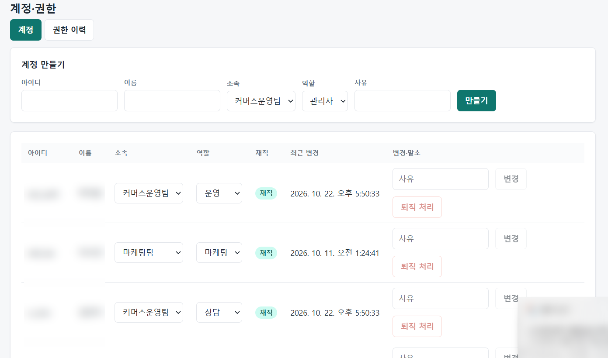
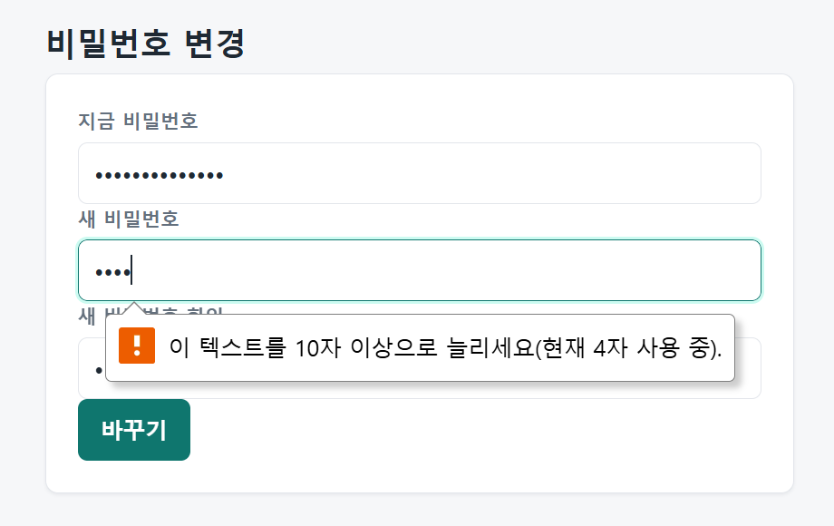
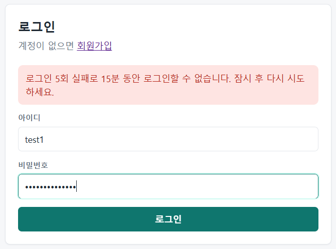
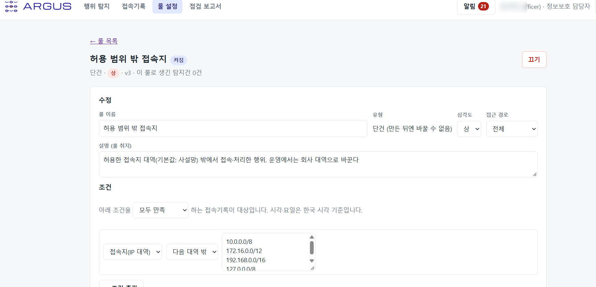
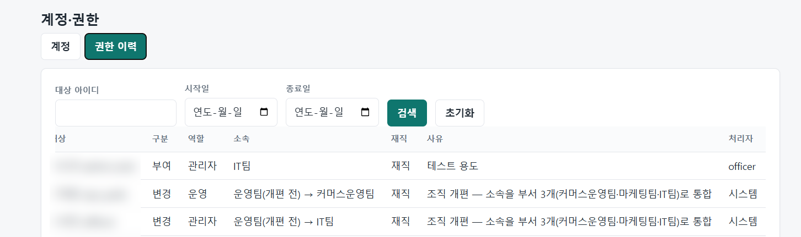
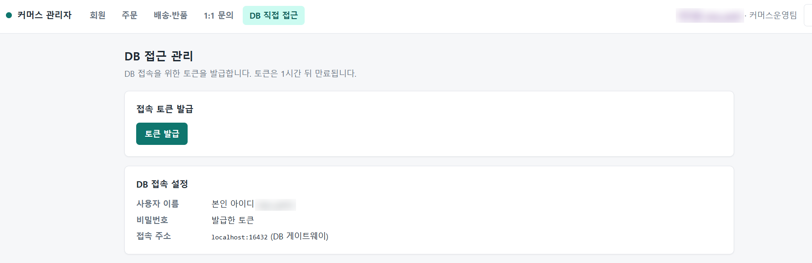

# 현황파악 — 4.1 접근권한 관리

> 안내서 현황파악(4.2, 61~64쪽)의 평가항목별 결과 양식으로 작성했습니다. 평가자료(처리방침·설계 문서)와 흐름분석 산출물, 시스템 담당자 인터뷰·실사로 판정했습니다
> 확인: 이행 / 부분이행 / 미이행. 해당 없음 지표(4.1.2·4.1.12·4.1.13)는 [평가항목](평가항목.md)에 사유가 있습니다
> 접근 통제(IP 제한 등)는 배포 설계안 기준으로 판정했습니다

## 4.1.1

| 구분 | 내용 |
|---|---|
| 질의문 코드 | 4.1.1 |
| 질의문 | 개인정보취급자별로 책임 추적성이 확보될 수 있도록 개별 계정을 부여하도록 계획하고 있습니까? |
| 확인 | 이행 |
| 평가 근거 및 의견 | - 백오피스·ARGUS는 취급자마다 개별 계정을 발급함 - DB 직접접근도 본인 계정으로 발급받은 접속 토큰으로만 접속해 접근자를 구분함  [증적] 백오피스 계정·권한  |
| 항목 설명 | ○ 응용프로그램·DB 등에 접근하는 취급자마다 고유 계정을 발급하고 공유하지 않음 |
| 평가 예시 | ○ 이행: 모든 개인정보처리시스템에 취급자별 개별 계정을 발급한 경우 ○ 부분이행: 일부 시스템에서 계정을 공유하는 경우 |
| 관련 법령 및 문서 | 개인정보 보호법 제29조, 개인정보의 안전성 확보조치 기준 제5조제4항 |

## 4.1.3

| 구분 | 내용 |
|---|---|
| 질의문 코드 | 4.1.3 |
| 질의문 | 개인정보취급자 및 정보주체의 인증수단을 안전하게 적용하고 관리하도록 계획하고 있습니까? |
| 확인 | 부분이행 |
| 평가 근거 및 의견 | - 취급자·정보주체 모두 비밀번호 10자 이상·2종류 이상 조합을 적용하고, 취급자 임시 비밀번호는 첫 로그인 때 변경하게 함 - DB 직접접근(관리자 권한 접근)에 접속 토큰 외 다중요소 인증이 없음  [증적] 관리자 비밀번호 변경 화면  |
| 항목 설명 | ○ 취급자와 정보주체를 인증하는 수단을 추측·탈취가 어렵도록 적용하고 관리함 |
| 평가 예시 | ○ 이행: 취급자·정보주체 모두에 안전한 인증수단과 관리 기준을 적용한 경우 ○ 부분이행: 일부 대상에 인증수단 기준이 없거나 미흡한 경우 |
| 관련 법령 및 문서 | 개인정보 보호법 제29조, 개인정보의 안전성 확보조치 기준 제5조제5항 |

## 4.1.4

| 구분 | 내용 |
|---|---|
| 질의문 코드 | 4.1.4 |
| 질의문 | 정보주체가 비밀번호 변경 등 중요 정보 접근 시 비밀번호 재확인 등 추가적인 인증이 적용되도록 계획하고 있습니까? |
| 확인 | 이행 |
| 평가 근거 및 의견 | - 마이페이지에서 비밀번호를 바꿀 때 현재 비밀번호를 다시 확인함  [증적] 마이페이지 비밀번호 변경 화면  |
| 항목 설명 | ○ 정보주체가 비밀번호 변경 등 중요 정보에 접근할 때 비밀번호 재확인 등으로 본인임을 다시 확인함 |
| 평가 예시 | ○ 이행: 중요 정보 접근 시 추가 인증을 적용한 경우 ○ 부분이행: 일부 중요 정보 접근에만 추가 인증을 적용한 경우 |
| 관련 법령 및 문서 | 개인정보 보호법 제29조 |

## 4.1.5

| 구분 | 내용 |
|---|---|
| 질의문 코드 | 4.1.5 |
| 질의문 | 대량의 개인정보 또는 민감한 개인정보를 처리하는 개인정보취급자 및 관리자는 강화된 인증방식이 적용되도록 계획하고 있습니까? |
| 확인 | 부분이행 |
| 평가 근거 및 의견 | - 백오피스와 DB 직접접근은 허용한 IP에서만 접속하도록 함 - 대량 처리 취급자에게 OTP 등 소유·생체 기반 인증을 적용하지 않음 |
| 항목 설명 | ○ 대량·민감 개인정보를 처리하는 취급자와 관리자는 비밀번호 외에 소유·생체·위치 기반 등 강화된 인증을 적용함 |
| 평가 예시 | ○ 이행: 대량·민감 개인정보 처리자에게 강화된 인증을 적용한 경우 ○ 부분이행: 일부 처리자나 접근 경로에만 강화된 인증을 적용한 경우 |
| 관련 법령 및 문서 | 개인정보 보호법 제29조 |

## 4.1.6

| 구분 | 내용 |
|---|---|
| 질의문 코드 | 4.1.6 |
| 질의문 | 정당한 권한을 가진 자만이 개인정보처리시스템에 접근할 수 있도록 일정 횟수 이상 인증에 실패한 경우 개인정보처리시스템에 대한 접근을 제한하는 등 필요한 조치를 취하도록 계획하고 있습니까? |
| 확인 | 이행 |
| 평가 근거 및 의견 | - 백오피스·ARGUS는 5회 연속 실패 시 계정을 잠그고 관리자만 해제함 - 쇼핑몰 회원은 5회 연속 실패 시 15분간 잠금  [증적] 쇼핑몰 로그인 실패 잠금 화면  |
| 항목 설명 | ○ 일정 횟수 이상 인증에 실패하면 계정 잠금 등으로 접근을 제한함 |
| 평가 예시 | ○ 이행: 모든 접근 대상에 인증 실패 시 접근 제한을 적용한 경우 ○ 부분이행: 일부 시스템이나 대상에 접근 제한이 없는 경우 |
| 관련 법령 및 문서 | 개인정보 보호법 제29조, 개인정보의 안전성 확보조치 기준 제5조제6항 |

## 4.1.7

| 구분 | 내용 |
|---|---|
| 질의문 코드 | 4.1.7 |
| 질의문 | 개인정보처리시스템에 대한 불법적인 접근 및 침해사고 방지를 위하여 개인정보취급자가 일정시간 이상 업무 처리를 하지 않는 경우에는 자동으로 시스템 접속이 차단되도록 계획하고 있습니까? |
| 확인 | 이행 |
| 평가 근거 및 의견 | - 백오피스·ARGUS는 30분 동안 사용하지 않으면 인증이 만료되어 다시 로그인해야 함 - DB 직접접근도 연결을 사용하지 않으면 끊기고 다시 인증해야 함 |
| 항목 설명 | ○ 취급자가 일정 시간 업무를 하지 않으면 접속을 자동 차단하고, 다시 접속할 때 처음과 같은 방법으로 인증함 |
| 평가 예시 | ○ 이행: 모든 접근 경로에 미사용 시 자동 차단을 적용한 경우 ○ 부분이행: 일부 접근 경로에 자동 차단이 없는 경우 |
| 관련 법령 및 문서 | 개인정보 보호법 제29조, 개인정보의 안전성 확보조치 기준 제6조제4항 |

## 4.1.8

| 구분 | 내용 |
|---|---|
| 질의문 코드 | 4.1.8 |
| 질의문 | 개인정보처리시스템에 대한 비정상적인 접근을 방지하기 위하여 장기 미접속시 계정 잠금, 동시 접속 제한, 관리자 로그인 알림 등 보호 대책이 적용되도록 계획하고 있습니까? |
| 확인 | 부분이행 |
| 평가 근거 및 의견 | - 개인정보 접속기록 점검 시스템으로 비정상적인 접근을 탐지함 - 업무 시간 외 접속 제한, 장기 미접속 계정 잠금, 동시 접속 제한, 관리자 로그인 알림이 없음  [증적] 개인정보 접속기록 점검 시스템 탐지 룰  |
| 항목 설명 | ○ 업무 시간 외 접속 제한, 장기 미접속 잠금, 동시 접속 제한, 관리자 로그인 알림 등으로 비정상 접근을 막거나 탐지함 |
| 평가 예시 | ○ 이행: 비정상 접근을 막거나 탐지하는 보호대책을 적용한 경우 ○ 부분이행: 보호대책을 일부만 적용한 경우 |
| 관련 법령 및 문서 | 개인정보 보호법 제29조 |

## 4.1.9

| 구분 | 내용 |
|---|---|
| 질의문 코드 | 4.1.9 |
| 질의문 | 개인정보취급자 또는 개인정보취급자의 업무가 변경될 경우 지체없이 개인정보처리시스템의 접근권한을 변경 또는 말소하도록 계획하고 있습니까? |
| 확인 | 부분이행 |
| 평가 근거 및 의견 | - 퇴직 처리하면 로그인·DB 접속 토큰 발급이 바로 막히고 ARGUS 명부에도 반영됨 - 시스템에 권한 변경·말소 기능은 있으나, 전보·퇴직 등 인사 변동을 권한 변경·말소로 이어지게 하는 절차가 없음 |
| 항목 설명 | ○ 전보·퇴직 등으로 취급자나 업무가 바뀌면 누락 없이 지체 없이 권한을 변경·말소하는 절차를 둠 |
| 평가 예시 | ○ 이행: 인사 변동 시 권한을 지체 없이 변경·말소하는 기능과 절차가 있는 경우 ○ 부분이행: 변경·말소 기능은 있으나 누락을 막는 절차가 없는 경우 |
| 관련 법령 및 문서 | 개인정보 보호법 제29조, 개인정보의 안전성 확보조치 기준 제5조제2항 |

## 4.1.10

| 구분 | 내용 |
|---|---|
| 질의문 코드 | 4.1.10 |
| 질의문 | 개인정보처리시스템의 접근권한을 부여, 변경 또는 말소한 내역을 기록하고 그 기록을 최소 3년간 보관하도록 계획하고 있습니까? |
| 확인 | 부분이행 |
| 평가 근거 및 의견 | - 권한 부여·변경·말소마다 대상·일시·역할·사유·처리자를 기록하고 3년 이상 보관함 - 권한 요청·승인 절차가 없어 승인자 정보가 기록되지 않음  [증적] 백오피스 권한 이력  |
| 항목 설명 | ○ 권한 부여·변경·말소 내역을 대상자·부여자(승인자)·일시·권한·사유가 드러나게 기록하고 3년 이상 보관함 |
| 평가 예시 | ○ 이행: 필요한 항목을 모두 기록하고 3년 이상 보관한 경우 ○ 부분이행: 기록 항목 일부가 빠졌거나 보관 기간이 부족한 경우 |
| 관련 법령 및 문서 | 개인정보 보호법 제29조, 개인정보의 안전성 확보조치 기준 제5조제3항 |

## 4.1.11

| 구분 | 내용 |
|---|---|
| 질의문 코드 | 4.1.11 |
| 질의문 | 개인정보처리시스템에 대한 접근 권한을 조회, 입력, 변경, 삭제, 출력, 다운로드 등 그 역할에 따라 최소한으로 부여할 수 있도록 계획하고 있습니까? |
| 확인 | 부분이행 |
| 평가 근거 및 의견 | - 역할별로 조회·다운로드·전체 보기·권한 관리 범위를 나누고 서버에서 검사함 - 마케팅팀 계정의 회원 상세에 업무와 관계없는 환불계좌가 보임 - DB 직접접근을 IT팀 외 커머스운영팀(운영 역할)도 할 수 있고, 하나의 DB 계정으로 모든 테이블에 접근함  [증적] 커머스운영팀 계정 DB 접근 관리 화면  |
| 항목 설명 | ○ 역할에 따라 조회·변경·다운로드 등 권한을 최소한으로 나눠 부여하고, DB 직접접근은 최소 인원으로 한정함 |
| 평가 예시 | ○ 이행: 역할별 권한을 업무에 필요한 최소 범위로 부여한 경우 ○ 부분이행: 일부 역할에 업무에 필요 없는 권한이 부여된 경우 |
| 관련 법령 및 문서 | 개인정보 보호법 제29조, 개인정보의 안전성 확보조치 기준 제5조제1항 |
