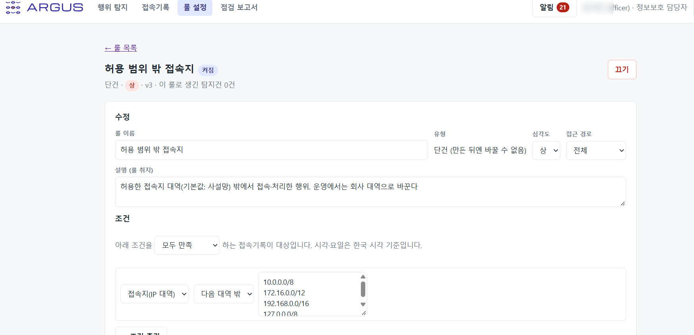

# 현황파악 — 4.2 접근통제

> 안내서 현황파악(4.2, 61~64쪽)의 평가항목별 결과 양식으로 작성했습니다. 평가자료(처리방침·설계 문서)와 흐름분석 산출물, 시스템 담당자 인터뷰·실사로 판정했습니다
> 확인: 이행 / 부분이행 / 미이행. 해당 없음 지표(4.2.4·4.2.5·4.2.7)는 [평가항목](평가항목.md)에 사유가 있습니다
> 접근 통제(IP 제한 등)는 배포 설계안 기준으로 판정했습니다. 웹 취약점 점검은 4.2.6에서 판정했습니다

## 4.2.1

| 구분 | 내용 |
|---|---|
| 질의문 코드 | 4.2.1 |
| 질의문 | 개인정보처리시스템에 대한 불법적인 접근 제한 및 개인정보 유출 시도 탐지·대응을 위한 안전조치를 하도록 계획하고 있습니까? |
| 확인 | 부분이행 |
| 평가 근거 및 의견 | - 방화벽과 허용 IP 목록으로 관리자 경로·DB 직접접근을 제한하고, 개인정보 접속기록 점검 시스템으로 취급자의 이상 접근을 탐지함 - 인터넷에 공개된 쇼핑몰로 들어오는 접속을 분석해 유출 시도를 탐지하는 기능이 없음  [증적] 개인정보 접속기록 점검 시스템 탐지 룰  |
| 항목 설명 | ○ IP 주소 등으로 인가받지 않은 접근을 제한하는 침입차단 기능과, 접속 IP 등을 분석해 유출 시도를 탐지·대응하는 침입탐지 기능을 모두 갖춤 |
| 평가 예시 | ○ 이행: 침입차단과 침입탐지 기능을 모두 갖춘 경우 ○ 부분이행: 두 기능 중 하나만 갖춘 경우 |
| 관련 법령 및 문서 | 개인정보 보호법 제29조, 개인정보의 안전성 확보조치 기준 제6조제1항 |

## 4.2.2

| 구분 | 내용 |
|---|---|
| 질의문 코드 | 4.2.2 |
| 질의문 | 개인정보처리시스템에 대한 정당한 접근 권한을 가진 자(다만, 정보주체는 제외)가 정보통신망을 통해 외부에서 개인정보처리시스템에 접속하려는 경우에는 인증서, 보안토큰, 일회용 비밀번호 등 안전한 인증수단을 적용하도록 계획하고 있습니까? |
| 확인 | 미이행 |
| 평가 근거 및 의견 | - 업무상 외부 접속이 필요하나, OTP·인증서 등 안전한 인증수단이나 VPN을 적용한 외부 접속 방법이 없음 |
| 항목 설명 | ○ 외부에서의 접속은 원칙적으로 차단하고, 필요한 경우 OTP·인증서 등 안전한 인증수단이나 VPN 등 안전한 접속수단을 적용함 |
| 평가 예시 | ○ 이행: 외부 접속을 차단하거나, 외부 접속 시 안전한 인증수단을 적용한 경우 ○ 부분이행: 일부 외부 접속 경로에 안전한 인증수단이 없는 경우 |
| 관련 법령 및 문서 | 개인정보 보호법 제29조, 개인정보의 안전성 확보조치 기준 제6조제2항 |

## 4.2.3

| 구분 | 내용 |
|---|---|
| 질의문 코드 | 4.2.3 |
| 질의문 | 인터넷 홈페이지, P2P, 공유설정, 공개된 무선망 등을 통해 개인정보가 노출되거나 유출되지 않도록 개인정보처리시스템, 개인정보취급자 컴퓨터, 모바일 기기 등에 조치를 계획하고 있습니까? |
| 확인 | 이행 |
| 평가 근거 및 의견 | - 관리자 페이지는 허용 IP에서만 열리고, DB는 인터넷에 직접 노출하지 않음 - 쇼핑몰에 개인정보가 공개되는 게시판이 없음 |
| 항목 설명 | ○ 관리자 페이지 노출 차단, 개인정보처리시스템의 인터넷 접속 차단 등으로 개인정보가 권한 없는 자에게 노출되지 않도록 함 |
| 평가 예시 | ○ 이행: 인터넷 홈페이지 등을 통한 노출·유출 방지 조치를 한 경우 ○ 부분이행: 일부 경로에 노출·유출 방지 조치가 없는 경우 |
| 관련 법령 및 문서 | 개인정보 보호법 제29조, 개인정보의 안전성 확보조치 기준 제6조제3항 |

## 4.2.6

| 구분 | 내용 |
|---|---|
| 질의문 코드 | 4.2.6 |
| 질의문 | 인터넷 홈페이지 취약점으로 인한 개인정보의 유출, 변조, 훼손 등을 방지하기 위하여 웹서버 및 응용프로그램에 대한 취약점 점검 및 대응조치를 수행하도록 계획하고 있습니까? |
| 확인 | 미이행 |
| 평가 근거 및 의견 | - 웹 취약점 진단 계획과 점검 결과를 조치·관리하는 절차가 없음 |
| 항목 설명 | ○ 개발 시 시큐어 코딩·취약점 점검을 적용하고, 운영 중 정기 취약점 진단과 조치 이행을 관리함 |
| 평가 예시 | ○ 이행: 개발 보안과 정기 취약점 진단·조치를 모두 수행하는 경우 ○ 부분이행: 개발 보안이나 정기 진단 중 일부만 수행하는 경우 |
| 관련 법령 및 문서 | 개인정보 보호법 제29조, 개인정보의 안전성 확보조치 기준 제4조 |
