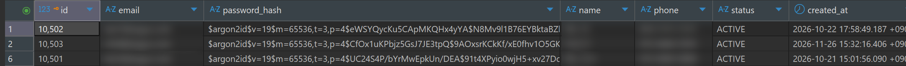
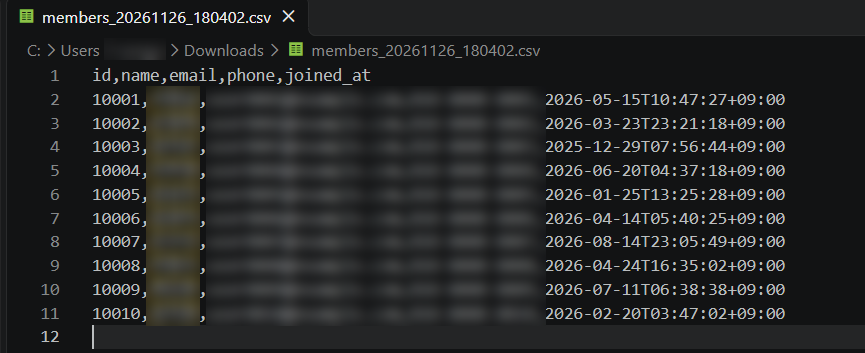
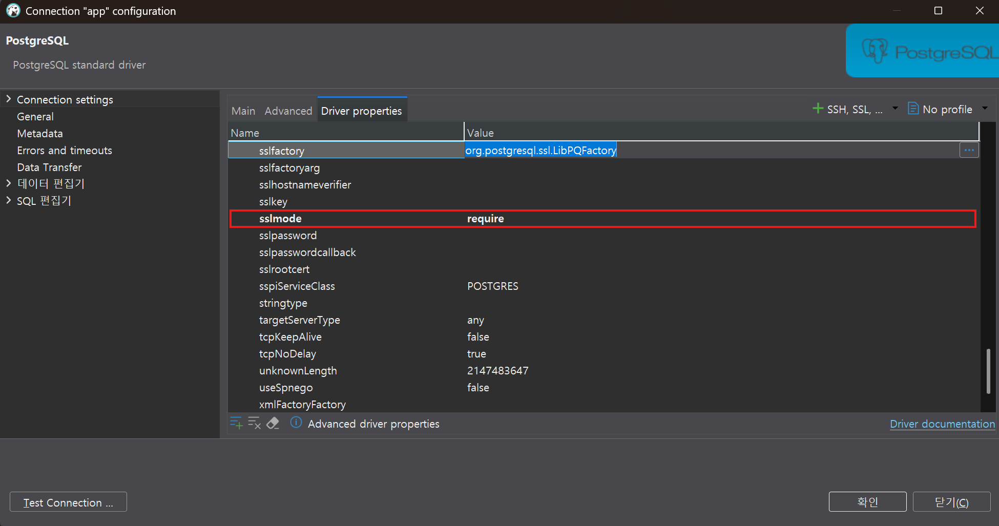

# 현황파악 — 4.3 개인정보의 암호화

> 안내서 현황파악(4.2, 61~64쪽)의 평가항목별 결과 양식으로 작성했습니다. 평가자료(처리방침·설계 문서)와 흐름분석 산출물, 시스템 담당자 인터뷰·실사로 판정했습니다
> 확인: 이행 / 부분이행 / 미이행. 해당 없음 지표(4.3.3)는 [평가항목](평가항목.md)에 사유가 있습니다
> 전송 구간 암호화는 배포 설계안 기준으로 판정했습니다

## 4.3.1

| 구분 | 내용 |
|---|---|
| 질의문 코드 | 4.3.1 |
| 질의문 | 인증정보, 고유식별정보 등 중요 개인정보를 저장하는 경우, 안전한 방식으로 암호화 저장하도록 계획하고 있습니까? |
| 확인 | 이행 |
| 평가 근거 및 의견 | - 비밀번호는 솔트를 적용한 일방향 암호(argon2id, 비밀번호 저장용 알고리즘)로, 환불계좌번호와 이체 환불 계좌 사본은 AES-256-GCM으로 암호화해 저장함 - 카드번호는 PG 결제창에서만 입력받아 저장하지 않고, 고유식별정보는 수집하지 않음  [증적] 회원 비밀번호 저장값  |
| 항목 설명 | ○ 인증정보는 안전한 알고리즘으로 암호화(비밀번호는 솔트를 적용한 일방향 암호화)하고, 이용자의 고유식별정보·카드번호·계좌번호·생체인식정보는 저장 위치와 관계없이 암호화해 저장함 |
| 평가 예시 | ○ 이행: 암호화 대상 개인정보를 모두 안전한 알고리즘으로 암호화해 저장하는 경우 ○ 부분이행: 일부 암호화 대상을 평문으로 저장하거나 안전하지 않은 알고리즘을 사용하는 경우 |
| 관련 법령 및 문서 | 개인정보 보호법 제29조, 개인정보의 안전성 확보조치 기준 제7조제1항·제2항 |

## 4.3.2

| 구분 | 내용 |
|---|---|
| 질의문 코드 | 4.3.2 |
| 질의문 | 이용자의 개인정보 또는 이용자가 아닌 정보주체의 고유식별정보를 개인정보취급자 컴퓨터, 모바일 기기 및 보조저장매체 등에 저장할 때에는 안전한 알고리즘으로 암호화 저장하도록 계획하고 있습니까? |
| 확인 | 미이행 |
| 평가 근거 및 의견 | - 백오피스에서 내려받은 회원 CSV와 마케팅 분석용 추출 파일을 암호화하지 않고 취급자 PC에 저장함  [증적] 회원 CSV 파일  |
| 항목 설명 | ○ 이용자의 개인정보를 취급자 PC·모바일 기기·보조저장매체에 저장할 때 문서 암호, DRM, 디스크 암호화 등으로 안전하게 암호화함 |
| 평가 예시 | ○ 이행: 취급자 PC 등에 저장하는 개인정보 파일을 모두 암호화하는 경우 ○ 부분이행: 일부 파일이나 일부 기기에만 암호화를 적용한 경우 |
| 관련 법령 및 문서 | 개인정보 보호법 제29조, 개인정보의 안전성 확보조치 기준 제7조제5항 |

## 4.3.4

| 구분 | 내용 |
|---|---|
| 질의문 코드 | 4.3.4 |
| 질의문 | 비밀번호, 생체인식정보 등 인증정보를 정보통신망을 통해 송·수신하는 경우에는 암호화하도록 계획하고 있습니까? |
| 확인 | 이행 |
| 평가 근거 및 의견 | - 쇼핑몰·백오피스·접속기록 점검 시스템은 HTTPS로, DB 직접접근은 암호화(TLS) 연결만 허용해 비밀번호·접속 토큰을 암호화해 전송함  [증적] DB 직접접근 SSL 설정  |
| 항목 설명 | ○ 비밀번호 등 인증정보는 내부망을 포함한 모든 정보통신망 구간에서 SSL/TLS 등으로 암호화해 송·수신함 |
| 평가 예시 | ○ 이행: 인증정보를 송·수신하는 모든 구간을 암호화한 경우 ○ 부분이행: 일부 구간에서 인증정보를 암호화하지 않고 송·수신하는 경우 |
| 관련 법령 및 문서 | 개인정보 보호법 제29조, 개인정보의 안전성 확보조치 기준 제7조제1항 |

## 4.3.5

| 구분 | 내용 |
|---|---|
| 질의문 코드 | 4.3.5 |
| 질의문 | 개인정보를 정보통신망을 통하여 인터넷망 구간으로 송·수신하는 경우 암호화하도록 계획하고 있습니까? |
| 확인 | 부분이행 |
| 평가 근거 및 의견 | - 쇼핑몰·백오피스의 웹 구간은 HTTPS로 암호화함 - PG사·택배사와 구매자·받는 사람 정보를 주고받는 연계 구간의 암호화가 설계에 반영되지 않음 |
| 항목 설명 | ○ 인터넷망 구간으로 개인정보를 송·수신할 때 보안서버(SSL 인증서) 등으로 암호화함 |
| 평가 예시 | ○ 이행: 인터넷망 구간의 개인정보 송·수신을 모두 암호화한 경우 ○ 부분이행: 일부 인터넷망 구간을 암호화하지 않은 경우 |
| 관련 법령 및 문서 | 개인정보 보호법 제29조, 개인정보의 안전성 확보조치 기준 제7조제4항 |
