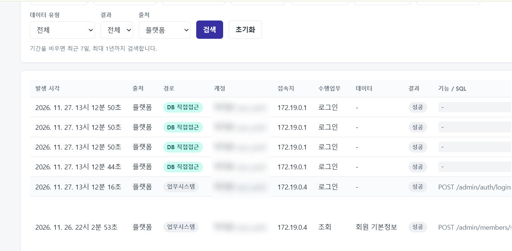
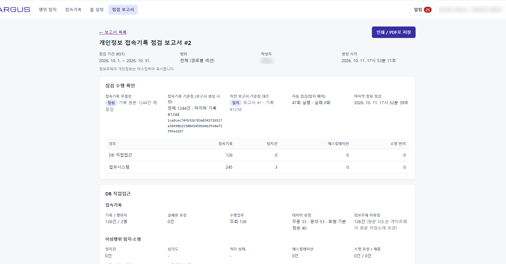

# 현황파악 — 4.4 접속기록의 보관 및 점검

> 안내서 현황파악(4.2, 61~64쪽)의 평가항목별 결과 양식으로 작성했습니다. 평가자료(처리방침·설계 문서)와 흐름분석 산출물, 시스템 담당자 인터뷰·실사로 판정했습니다
> 확인: 이행 / 부분이행 / 미이행. 해당 없음 지표(4.4.3·4.4.4)는 [평가항목](평가항목.md)에 사유가 있습니다

## 4.4.1

| 구분 | 내용 |
|---|---|
| 질의문 코드 | 4.4.1 |
| 질의문 | 개인정보처리시스템의 접속기록을 식별자, 접속일시, 접속지 정보, 처리한 정보주체 정보, 수행업무 등 필요한 사항이 모두 기록되도록 계획하고 있습니까? |
| 확인 | 부분이행 |
| 평가 근거 및 의견 | - 백오피스 화면 경유와 DB 직접접근 모두 식별자·접속일시·접속지·처리한 정보주체·수행업무를 기록함 - SSH·텔넷 등으로 서버에 직접 접속한 뒤 DB에 접속하는 경로는 접속기록이 남지 않음  [증적] 개인정보 접속기록 점검 시스템 접속기록 조회  |
| 항목 설명 | ○ 응용프로그램·DB 직접접속·서버 경유 등 접속 경로별로 5개 항목(식별자·접속일시·접속지·처리한 정보주체·수행업무)을 빠짐없이 기록하고, 접속기록에 불필요한 개인정보가 남지 않게 함 |
| 평가 예시 | ○ 이행: 모든 접속 경로에서 5개 항목을 빠짐없이 기록하는 경우 ○ 부분이행: 일부 접속 경로나 일부 항목이 기록되지 않는 경우 |
| 관련 법령 및 문서 | 개인정보 보호법 제29조, 개인정보의 안전성 확보조치 기준 제2조제3호·제8조제1항 |

## 4.4.2

| 구분 | 내용 |
|---|---|
| 질의문 코드 | 4.4.2 |
| 질의문 | 개인정보의 오·남용, 분실·도난·유출·위조·변조 또는 훼손 등에 대응하기 위하여 개인정보취급자의 개인정보처리시스템에 대한 접속기록 및 개인정보 다운로드 상황을 확인하고 점검하는 주기·방법·사후조치 절차 등을 내부 관리계획으로 정하고 이행하도록 계획하고 있습니까? |
| 확인 | 부분이행 |
| 평가 근거 및 의견 | - 개인정보 접속기록 점검 시스템이 대량 다운로드·업무 시간 외 접속 등을 자동 탐지하고, 소명 요청과 점검 보고서로 사후 확인함 - 점검 주기·방법·담당자·사후조치 절차를 내부 관리계획으로 정하지 않음  [증적] 개인정보 접속기록 점검 보고서  |
| 항목 설명 | ○ 점검 방법·기준·주기·담당자·비정상 행위 대응·보고 절차를 내부 관리계획으로 정하고, 대량 다운로드 등 위험 행위를 기술적으로 점검함 |
| 평가 예시 | ○ 이행: 점검 계획을 내부 관리계획으로 정하고 점검 기능을 갖춰 이행하는 경우 ○ 부분이행: 점검 기능은 있으나 점검 계획이 없거나, 계획은 있으나 점검 기능이 부족한 경우 |
| 관련 법령 및 문서 | 개인정보 보호법 제29조, 개인정보의 안전성 확보조치 기준 제8조제2항 |

## 4.4.5

| 구분 | 내용 |
|---|---|
| 질의문 코드 | 4.4.5 |
| 질의문 | 개인정보처리시스템의 접속기록을 최소 1년 또는 2년 이상 보관하고 위·변조 및 도난, 분실되지 않도록 해당 접속기록을 안전하게 보관하기 위한 조치를 계획하고 있습니까? |
| 확인 | 부분이행 |
| 평가 근거 및 의견 | - 접속기록은 수정·삭제를 막고 해시체인으로 위·변조 여부를 확인하며, 매일 암호화해 백업함 - 정보주체 5만 명 이상으로 2년 이상 보관 대상이나 보관 기간을 정하지 않았고, 백업을 같은 서버에만 보관함  [증적] 개인정보 접속기록 점검 보고서(무결성 점검)  |
| 항목 설명 | ○ 접속기록을 1년(5만 명 이상·고유식별정보·민감정보 처리 시 2년) 이상 보관하고, 물리적으로 분리된 저장장치 백업·덮어쓰기 방지·위변조 확인 등으로 안전하게 보관함 |
| 평가 예시 | ○ 이행: 법정 기간 이상 보관하고 별도 저장장치 백업과 위변조 방지 조치를 한 경우 ○ 부분이행: 보관 기간이나 안전한 보관 조치 중 일부가 부족한 경우 |
| 관련 법령 및 문서 | 개인정보 보호법 제29조, 개인정보의 안전성 확보조치 기준 제8조제1항·제3항 |
