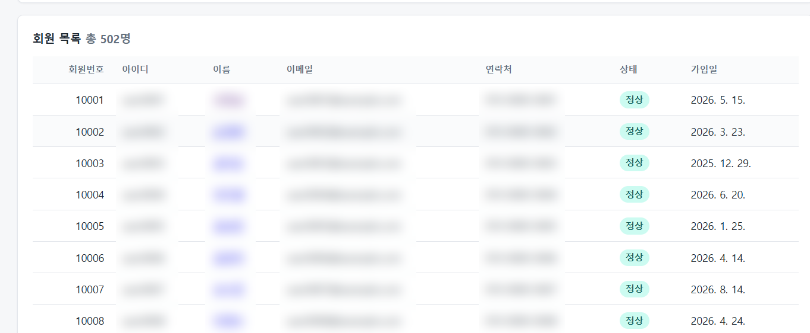
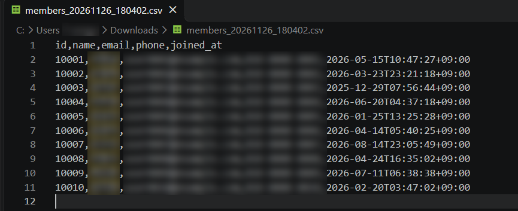

# 현황파악 — 4.8 기타 기술적 보호조치

> 안내서 현황파악(4.2, 61~64쪽)의 평가항목별 결과 양식으로 작성했습니다. 평가자료(처리방침·설계 문서)와 흐름분석 산출물, 시스템 담당자 인터뷰·실사로 판정했습니다
> 확인: 이행 / 부분이행 / 미이행. 해당 없음 지표(4.8.3)는 [평가항목](평가항목.md)에 사유가 있습니다

## 4.8.1

| 구분 | 내용 |
|---|---|
| 질의문 코드 | 4.8.1 |
| 질의문 | 개발 환경을 통한 개인정보의 유출을 방지하기 위하여 테스트 데이터 생성·이용·파기 및 기술적 보호조치 등에 관한 대책을 적용하도록 계획하고 있습니까? |
| 확인 | 이행 |
| 평가 근거 및 의견 | - 테스트 데이터는 모두 가상 데이터로 만들고, 개발 환경과 운영 서버를 분리하며, 소스 변경 이력을 PR로 관리함 |
| 항목 설명 | ○ 테스트 데이터는 실제 개인정보가 아닌 가공 정보를 쓰고, 개발·운영 환경을 분리해 통제된 절차로 이관하며, 소스프로그램의 비인가 접근·변경을 막음 |
| 평가 예시 | ○ 이행: 가공 테스트 데이터, 환경 분리, 소스프로그램 보호를 모두 적용한 경우 ○ 부분이행: 일부 대책만 적용한 경우 |
| 관련 법령 및 문서 | 개인정보 보호법 제29조 |

## 4.8.2

| 구분 | 내용 |
|---|---|
| 질의문 코드 | 4.8.2 |
| 질의문 | 개인정보취급자 및 정보주체의 개인정보 처리화면을 통한 개인정보 유·노출 등을 방지하기 위하여 개인정보 마스킹, 웹브라우저 우측 마우스 버튼 제한, 임시 파일 및 캐시 통제, 카드번호 등 중요 정보에 대한 복사·화면캡쳐 방지 및 키보드해킹 방지 등 보호대책을 적용하도록 계획하고 있습니까? |
| 확인 | 부분이행 |
| 평가 근거 및 의견 | - 배송 목록의 받는 사람·연락처·주소와 카드번호·환불계좌번호는 마스킹해 표시함 - 회원 목록·상세와 주문 상세는 이름·연락처·주소 등을 마스킹 없이 표시하고, 우측 마우스 버튼 제한·캐시 통제 등 노출 방지 조치가 없음  [증적] 백오피스 회원 목록  |
| 항목 설명 | ○ 처리화면의 개인정보는 일관된 기준으로 마스킹하고, 우측 마우스 버튼·히스토리·캐시를 통제하며, 카드번호 등 중요 정보에는 복사·화면캡처·키보드해킹 방지를 검토함 |
| 평가 예시 | ○ 이행: 처리화면 전반에 마스킹 기준과 노출 방지 조치를 적용한 경우 ○ 부분이행: 일부 화면이나 일부 조치만 적용한 경우 |
| 관련 법령 및 문서 | 개인정보 보호법 제29조 |

## 4.8.4

| 구분 | 내용 |
|---|---|
| 질의문 코드 | 4.8.4 |
| 질의문 | 개인정보처리시스템에서 개인정보의 출력(인쇄, 화면표시, 파일생성 등)시 용도를 특정하여 용도에 따라 출력항목을 최소화하여 출력하도록 계획하고 있습니까? |
| 확인 | 부분이행 |
| 평가 근거 및 의견 | - 역할별로 메뉴 접근 권한을 나눠, 맡은 업무가 아닌 화면의 개인정보는 출력되지 않음 - 같은 화면과 회원 CSV는 부서·용도와 관계없이 같은 항목을 출력하고, 업무상 꼭 필요하지 않은 항목도 마스킹 없이 출력함  [증적] 회원 CSV 파일  |
| 항목 설명 | ○ 개인정보를 인쇄·화면표시·파일생성으로 출력할 때 용도를 특정하고, 접근 권한과 용도에 따라 출력 항목을 최소화함 |
| 평가 예시 | ○ 이행: 출력 용도를 정하고 용도별로 출력 항목을 최소화한 경우 ○ 부분이행: 일부 출력에만 항목 최소화를 적용한 경우 |
| 관련 법령 및 문서 | 개인정보 보호법 제29조, 개인정보의 안전성 확보조치 기준 제12조제1항 |
